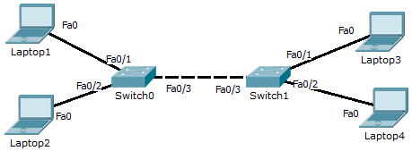
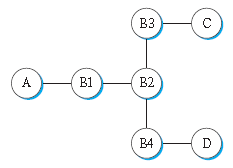

# 01_Cauhoiontapcuoiky2018.pdf

> 20 trang

## Trang 1

 1
Phát biểu nào sau đây là mô tả tốt nhất về cách thức hoạt động (nói
chung) của một router:
  a. Khi nhận được một packet, Router sẽ chuyển packet đó tới tất cả các
   mạng nối đến nó.
  b. Khi nhận được một packet, Router đọc địa chỉ vật lý chứa trong
    packet và chuyển tiếp đi ở ngõ ra thích hợp.
  c. Khi nhận được một packet, Router đọc địa chỉ tầng mạng chứa trong
    packet và chuyển tiếp đi ở ngõ ra thích hợp
 d. Khi nhận được một packet, Router thay thế địa chỉ tầng mạng chứa
    trong packet bằng địa chỉ vật lý của nó và chuyển tiếp đi ở ngõ ra
    thích hợp.

 2
Cho sơ đồ mạng như hình vẽ:
                          5
                              1
                   2    B                C    4

                             3       2        D                      1               A

                                           1                                4                 3
                                                F                           E

Các giá trị của từng liên kết đại diện cho khoảng cách giữa các bộ định
tuyến.
Khi dùng thuật toán Dijkstra, con đường đi ngắn nhất từ A đến D tìm được
là:
          a. A->B->C->D
         b. A->E->F->D
          c. A->C->D
         d. Tất cả các câu trên đều sai.

 3
Giao thức ARP:
          a. Được dùng ở tầng Datalink.

## Trang 2

b. Dùng cho việc ánh xạ địa chỉ IP sang địa chỉ ở tầng Datalink
        như địa chỉ Ethernet.
          c. Dùng cho việc ánh xạ địa chỉ ở tầng Datalink như địa chỉ
          Ethernet sang địa chỉ IP.
         d. Các câu trên đều đúng.

 4

Thông tin nào sau đây là địa chỉ IPv4 hợp lệ:
          a. 191.255.33.7
         b. 208.151.256.0
          c. 127.191.233.300
         d. Tất cả đều đúng.

 5
Địa  chỉ IPv4 nào sau đây thuộc   cùng một subnet  với  địa  chỉ
192.168.1.28/27 ?
          a. 192.168.1.98
         b. 192.168.1.65
          c. 192.168.1.40
         d. 192.168.1.10

 6
Địa  chỉ IPv4 nào sau đây  là hợp  lệ cho một  host thuộc mạng
172.28.2.128/255.255.255.192 ?
          a. 172.28.2.30
         b. 172.28.2.126
          c. 172.28.2.190
         d. 172.28.2.240

 7
Địa chỉ IPv4 nào sau đây không thể dùng để gán cho một host thuộc mạng
10.0.64.0/18
          a. 10.0.129.1
         b. 10.0.126.0

## Trang 3

c. 10.0.94.255
         d. 10.0.65.10

 8

Một bộ định tuyến có các dòng sau (CIDR) trong bảng đường đi:
   Address/mask                 Next hop

   135.46.56.0/22                    Interface 0

   135.46.60.0/22                    Interface 1

   192.53.40.0/23                  Router 1

   Default                        Router 2

Bộ định tuyến sẽ chuyển gói tin đến đâu khi nó nhận gói tin có địa chỉ đích
đến là 135.46.63.10:
          a. Interface 0
         b. Interface 1
          c. Router 1
         d. Router 2
 9

Với bảng cấu hình như câu trên, bộ định tuyến sẽ chuyển gói tin đến đâu
khi nó nhận gói tin có địa chỉ đích đến là 192.53.43.10:
          a. Interface 0
         b. Interface 1
          c. Router 1
         d. Router 2

  10

Đối với tầng Transport trong mô hình TCP/IP, phát biểu nào sau đây là
sai:
          a. Port dùng để kết nối giữa các đối tượng client/server.
         b. Port xác định ứng dụng truyền/ nhận dữ liệu.

## Trang 4

c. Port được dùng cho UDP và TCP.
         d. Port có giá trị từ 1 đến 1023.

  11

Cho biết chỉ số port nào sau đây không phải là chỉ số port mặc định của
một trong các dịch vụ SMTP, POP3, FTP và WWW, :
          a. 25
         b. 53
          c. 20
         d. 110

  12

Khi thực hiện lệnh nslookup www.vnn.vn , ta nhận được kết quả trả về là :
          a. Địa chỉ IP của tên miền www.vnn.vn
         b. Địa chỉ của Name server quản lý domain vnn.com
          c. Địa chỉ IP của Mail eXchange của www.vnn.vn
         d. Các câu trên đều sai.

  13
Cho biết kiểu truy vấn sử dụng với dịch vụ DNS khi Name Server cục bộ
phải gởi các truy vấn đến từng Name Server khác nhau như Root Name
Servers, Remote Name Servers, … khi nhận được một yêu cầu từ người
dùng:
          a. Truy vấn lặp (iterated query).
         b. Truy vấn đệ quy (recursive query).
          c. Truy vấn đơn giản (simple query).
         d. Các câu trên đều sai.

  14

Tập lệnh nào sau đây được dùng khi tương tác với POP3 Server:
          a. USERNAME, PASS, LIST, RETR, QUIT
         b. USERNAME, PASSWORD, LIST, QUIT

## Trang 5

c. USER, PASSWORD, LIST, RETR, QUIT
         d. USER, PASS, LIST, RETR, QUIT

  15

Trong giao thức HTTP 1.1, khi Web Server trả về một Response Message
với giá trị trạng thái (status code) và để báo hiệu thành công thì giá trị
trạng thái này nằm trong khoảng nào:
          a. 200 – 299
         b. 300 – 399
          c. 400 – 499
         d. 500 -599

  16
Trong giao thức HTTP 1.1, Web server trả về giá trị trạng thái trong
khoảng nào nếu Web Client gửi một Request Message bị sai (Bad
Request)?
          a. 200 – 299
         b. 300 – 399
          c. 400 – 499
         d. 500 -599

  17

Dùng lệnh nào sau đây để xem địa chỉ mạng của máy trên hệ điều hành
Linux:
          a. ibconfig
         b. ifconfig
          c. ipconfig
         d. itconfig

  18

Lệnh nào dưới đây được dùng để xác định địa chỉ ip của một server trên
mạng (hệ điều hành Windows)
          a. nslookup

## Trang 6

b. route
          c. telnet
         d. tracert

  19

Khi thông điệp truyền qua mạng bị phân mảnh thành nhiều IP datagram,
kết quả nào dưới đây được dùng để chỉ đây là IP datagram cuối cùng:
          a. MF=0, Fragment Offset=0
         b. MF=0, Fragment Offset=1024
          c. MF=1, Fragment Offset=0
         d. MF=1, Fragment Offset=1024

  20

Loại cáp xoắn đôi được sử dụng phổ biến nhất trong các mạng Ethernet
LAN là:
          a. UTP CAT5
         b. STP
          c. Cáp đồng trục
         d. Cáp quang

  21

ICMP là giao thức điều khiển của tầng IP, sử dụng để thông báo:
          a. Lỗi và các thông tin trạng thái khác
         b. Độ tin cậy của giao thức
          c. Kiểm soát luồng
         d. Khi các gói tin không theo thứ tự

  22

Lệnh PING dùng để:

## Trang 7

a. Kiểm tra các máy tính có đĩa cứng hay không
         b. Kiểm tra các máy tính có hoạt động tốt hay không
          c. Kiểm tra các máy tính trong mạng có liên thông không
         d. Kiểm tra các máy tính có truy cập vào Internet không

  23

Trong phương pháp tạo chữ ký điện tử sử dụng public key, để tạo chữ ký
người gửi sẽ:
          a. Sử dụng public key của mình
         b. Sử dụng private key của mình
          c. Sử dụng public key của người nhận
         d. Sử dụng private key của người nhận

  24

Trong kiến trúc public key, để bảo mật dữ liệu trong quá trình gửi tin,
người gửi sẽ:
          a. Sử dụng public key của mình
         b. Sử dụng private key của mình
          c. Sử dụng public key của người nhận
         d. Sử dụng private key của người nhận

  25

Chọn phát biểu đúng về quan hệ giữa Internet và World Wide Web:
          a. World Wide Web là hạ tầng, Internet là ứng dụng trên hạ tầng
        World Wide Web
         b. Internet là hạ tầng, World Wide Web là ứng dụng trên hạ tầng
          Internet
          c. Internet và World Wide Web là 2 hạ tầng mạng độc lập
         d. Internet và World Wide Web là một

## Trang 8

  26

Trong hệ thống Email, các transfer agent gửi email cho nhau với nhau sử
dụng giao thức:
          a. SMTP
         b. POP3
          c. IMAP
         d. HTTP

  27

Ưu điểm của giao thức IMAP khi so sánh với POP3 là:
          a. Nội dung của email đọc được ngay cả khi máy tính không được
          nối mạng
         b. Đòi hỏi ít thời gian kết nối hơn
          c. Thích hợp cho những người sử dụng di chuyển nhiều, dùng
         nhiều máy tính khác nhau
         d. Dễ được hiện thực

  28

Giao thức nào dưới đây được sử dụng cho Ethernet LAN

## Trang 9

a. CSMA/CD
         b. Bit-Map
          c. Binary Countdown
         d. Aloha

  29
Sau khi cấu hình VLAN, lệnh nào sau đây được dùng để để
xem thông tin về các VLAN, giả sử đang ở privileged EXEC
mode

A. print vlan

B. show vlan

C. shows v-lan

D. printf v-lan

  30

Chọn phát biểu đúng về lệnh cấu hình static route sau:
HQ(config)#ip route 172.28.10.0 255.255.255.0 10.11.12.13

A. Router HQ khi nhận gói tin có địa chỉ đích
172.28.10.0/24 sẽ đẩy sang địa chỉ 10.11.12.13

B. Thiết lập đường kết nối giữa máy có địa chỉ
172.28.10.0 và máy có địa chỉ 10.11.12.13

C. Thiết lập kết nối giữa mạng 172.28.10.0/24 và
máy có địa chỉ 10.11.12.13

D. Router HQ khi nhận gói tin có địa chỉ đích
10.11.12.13 sẽ đẩy sang mạng 172.28.10.0/24

  31

## Trang 10

Sử dụng Wireshark, phân tích một gói dữ liệu TCP có được
thông tin sau:
“Transmission Control Protocol, Src Port: 80 (80), Dst Port:
60025 (60025), Seq: 1, Ack: 644, Len: 0”
Cho biết số thứ tự (Seq) của byte cuối cùng ứng dụng chạy ở
cổng 80 đã nhận được là bao nhiêu:

A. 0

B. 1

C. 643

D. 644

  32

Sử dụng Wireshark, phân tích một gói dữ liệu TCP có được
thông tin sau:
“.... 0000 0001 0010 = Flags: 0x012 (SYN, ACK)”
Phát biểu nào sau đây đúng:

A. Đây là một gói dữ liệu trong quá trình thiết lập
kết nối TCP

B. Đây là một gói dữ liệu trong quá trình đóng kết
nối TCP

C. Đây là một gói dữ liệu trong quá trình truyền
nhận dữ liệu

D. Không có câu nào đúng

  33

Sử dụng Wireshark, phân tích một gói dữ liệu TCP có được
thông tin sau:

## Trang 11

“.... 0000 0001 0001 = Flags: 0x011 (FIN, ACK)”
Phát biểu nào sau đây đúng

A. Đây là một gói dữ liệu trong quá trình thiết lập
kết nối TCP

B. Đây là một gói dữ liệu trong quá trình đóng kết
nối TCP

C. Đây là một gói dữ liệu trong quá trình truyền
nhận dữ liệu

D. Không có câu nào đúng

  34

Mục đích của máy chủ DHCP (DHCP server) là gì?
A. Chứa email của người dùng
B. Dịch URLs thành địa chỉ IP
C. Dịch địa chỉ IP thành địa chị MAC
D. Cấp phát cấu hình IP cho các host (máy tính)

  35

Theo mô hình địa chỉ IP phân lớp, địa chỉ nào trong các địa
chỉ sau thuộc lớp C
A. 227.12.14.87
B. 193.14.56.22
C. 14.23.120.8
D. 252.5.15.111

  36

Cho một địa chỉ 110.23.120.14/20 . Địa chỉ đầu và địa chỉ
cuối của subnet chứa địa chỉ này lần lược là?

## Trang 12

A. 110.23.120.0/20 ; 110.23.120.255/20
B. 110.23.112.0/20 ; 110.23.127.255/20
C. 110.23.120.14/20 ; 110.23.120.255/20
D. 110.23.127.0/20; 110.23.127.14/20

  37

Ta sử dụng lệnh “show ip interfaces brief” ta thu được kết
quả ở cổng FastEthernet0/0 như sau:
Interface       IP-Address  OK?  Method   Status
Protocol
FastEthernet0/0 192.168.1.1  YES  manual   up
down
Với kết quả trên thì ta có thể có kết luận gì đối với cổng này?
A. Có vấn đề ở tầng vật lý (physical layer) của cổng này
B. Có vấn đề về việc trao đổi thông tin định tuyến ở cổng này
C. Có vấn đề ở giao thức vận chuyển và ở tầng vật lý.
D. Cổng này bị lỗi không kết nối được

  38

Giao thức IP thuộc tầng nào trong mô hình OSI?
         a. Ứng dụng (Application)
         b. Vận chuyển (Transport)
          c. Mạng (Network)
         d. Liên kết dữ liệu (Data Link)
  39

Giao thức PPPoE hoạt động ở tầng nào trong mô hình OSI?
         a. Ứng dụng (Application)
         b. Vận chuyển (Transport)
          c. Mạng (Network)
         d. Liên kết dữ liệu (Data Link)

## Trang 13

  40

Giải sử có một đường truyền Internet với tốc độ truyền dữ liệu
1 Mbps được dùng chung cho một nhóm 35 người sử dụng.
Mỗi người, trung bình chỉ hoạt động trong khoảng 10% thời
gian, và khi sử dụng thì có nhu cầu truyền dữ liệu ở mức 100
Kbps. Hỏi: xác suất kênh truyền không đáp ứng được nhu cầu
truyền dữ liệu của mỗi người sử dụng là bao nhiêu ?
A. ~ 0,0003
B. ~ 0,0004
C. ~ 0,0005
D. ~0,0006

  41

Ứng dụng nào sau đây phù hợp với dịch vụ hướng không kết
nối (Connectionless service)?
A. Hệ thống thanh toán qua mạng
B. Hệ thống hội thảo video trực tuyến
C. Email
D. Trình duyệt web

  42

Cho sơ đồ mạng sau:

Biết IP của các laptop:
Laptop 1: 192.168.1.10/16

## Trang 14

Laptop 2: 192.168.2.20/16
Laptop 3: 192.168.1.30/16
Laptop 4: 192.168.2.40/16

Tất cả các cổng của switch 0 và 1 được cấu hình ở mode access
và thuộc Vlan 1.
Chọn phát biểu đúng:
a. Laptop 1 và 3 không “ping” thấy nhau.
b. Laptop 3 và 4 “ping” thấy nhau.
c. Laptop 1 và 4 không “ping” thấy nhau.
d. Có 2 mạng LAN riêng biệt trong sơ đồ trên.

  43
Giả sử máy A gửi cho máy B 8 bytes dữ liệu trong 1 segment có
số thứ tự (sequence number) là 92, cho biết giá trị của số
acknowledgement (ACK number) của segment kế tiếp mà máy
B sẽ gửi cho máy A:
a. 92
b. 99
c. 100
d. 101

  44

Ở giai đoạn Bắt đầu chậm (Slow Start) trong kiểm soát tắc
nghẽn TCP thì
a. CongWin được gán bằng một giá trị cố định và không thay
   đổi
b. CongWin được gán bằng 1 MSS (Maximum Segment Size) và
  tăng thêm 1 MSS sau mỗi ACK nhận được
c. CongWin được gán bằng 1 MSS (Maximum Segment Size)
  sau đó tăng gấp đôi sau mỗi ACK nhận được
d. CongWin được ứng dụng thay đổi theo nhu cầu sử dụng
  đường truyền của nó

## Trang 15

  45

Trong kiểm soát tắt nghẽn TCP, nếu máy gửi nhận được 3 ACK
trùng với ACK trước đó thì:
a. CongWin giảm một nửa và chuyển sang trạng thái tăng
  tuyến tính
b. CongWin = 1 MSS (Maximum Segment Size) và chuyển sang
  tăng tuyến tính
c. CongWin = 1 MSS (Maximum Segment Size) và chuyển sang
   trạng thái tăng theo hàm mũ
d. CongWin giảm một nửa và chuyển sang trạng thái tăng theo
  hàm mũ

  46

Giao thức RIP (Routing Information Protocol) sử dụng giải
thuật:
A. Distance vector
B. Link state
C. Cả Distance vector và Link state
D. Cả (a) và (b) đều sai

  47

Cho một subnet có sơ đồ như hình vẽ:

     B              C

 A                   D

        F           E

Giả sử giải thuật định tuyến Distance Vector Routing được sử
dụng. Router C nhận được các vector thông tin về delay
(khoảng cách) từ các router B (5, 0, 8, 12, 6, 2), từ D (16, 12, 6,

## Trang 16

0, 9, 10) và từ F (7, 6, 3, 9, 4, 0). Mỗi vector biểu diễn thông tin
về delay từ chính router gửi đến các router trong mạng theo
thứ tự ABCDEF. Delay từ C đến B, D và F đo được lần lượt là 6,
3 và 5. Hỏi, trong bảng routing của C sau khi được cập nhật lại,
delay từ C đến E là bao nhiêu, và đường đi phải qua router nào
trước?
A. 12 – đi qua B
B. 12 – đi qua D
C. 9 – đi qua F
D. 7 – đi qua F

  48

Trong header của một gói tin IP, thông tin nào KHÔNG được
cung cấp?
A. Địa chỉ IP nguồn (Source IP address)
B. Địa chỉ IP đích (Destination IP address)
C. Số thứ tự gói tin (Sequence number)
D. Header Checksum

  49

Chọn địa chỉ rút gọn đúng cho địa chỉ IPv6:
8000:0000:0000:0123:0000:4567:89AB:CDEF:
A. 8000::123:0:4567:89AB:CDEF
B. 8::123:0:4567:89AB:CDEF
C. 8000::123::4567:89AB:CDEF
D. Cả 3 câu trên đều sai

  50

Cho biết địa chỉ IPv6 nào là hợp lệ:

## Trang 17

A. 2001::1685:2123::1428:57ab
B. 2001:99:ab:1:99:2:1:9
C. 2001:1428:57ab:1685:2123:1428:57ab
D. 2001:99:ab:1:99:2:1:9h

  51

Chọn phát biểu ĐÚNG về NAT?
a. NAT dùng để ngăn chặn một máy tính từ Internet kết nối vào
  một mạng cục bộ nào đó
b. NAT chỉ sử dụng IP header cho công việc của mình
c. Chức năng của NAT tương tự như firewall
d. Sau khi được xử lý bởi NAT, IP header của một gói dữ liệu sẽ
   bị thay đổi

  52

Khi di chuyển máy tính từ một mạng LAN A sang mạng LAN B
thuộc hai subnet khác nhau:
A. Địa chỉ MAC của máy sẽ bị thay đổi
B. Cả địa chỉ MAC lẫn địa chỉ IP sẽ không bị thay đổi
C. Cả địa chỉ MAC lẫn địa chỉ IP sẽ bị thay đổi
D. Chỉ địa chỉ IP của máy sẽ bị thay đổi

  53

Chuỗi nào sau đây là biểu diễn đúng của một địa chỉ MAC?
a. 59:A1:FG:C5:D2
b. 78:B5:FF:DG:65:93
c. 78:B5:FF:FF:65
d. 10:A1:FF:C5:D2:93

## Trang 18

  54

Chọn mô tả đúng về CDMA (Code Division Multiple Access):
A. CDMA là một giải pháp cụ thể của TDMA (Time Division
Multiple Accesss)
B. CDMA là một giải pháp cụ thể của FDMA (Frequency Division
Multiple Access)
C. Trong CDMA, tất cả người sử dụng dùng chung một dải tần
số, và có thể gửi dữ liệu đồng thời
D. CDMA là chuẩn được sử dụng cho Ethernet LAN

  55

Lý do nào dưới đây giải thích vì sao trong mạng không dây IEEE
802.11, phương pháp tránh đụng độ (CSMA/CA) được sử dụng
thay cho giải pháp phát hiện đụng độ (CSMA/CD):
a. Quá trình đụng độ có thể được phát hiện một cách chắc
   chắn, nhưng không thể khắc phục
b. Một máy trên mạng không thể nào chắc chắn được rằng các
  máy đang gửi dữ liệu cho nhau
c. Đụng độ không có khả năng xảy ra trong mạng không dây
d. Không thể phát hiện đụng độ trong sóng vô tuyến

  56

Bluetooth được thiết kế chủ yếu cho mạng:
A. MAN (Metropolitan Area Network)
B. LAN (Local Area Network)
C. WAN (Wide Area Network)
D. PAN (Personal Area Network)

## Trang 19

  57

Đặc điểm nào mô tả KHÔNG đúng một kết nối trong mạng
không dây:
A. Cường độ tín hiệu sẽ suy giảm dần khi đi xa nguồn tín hiệu
B. Tốc độ truyền dữ liệu là một hằng số, không phụ thuộc
khoảng cách giữa hai điểm truyền và nhận
C. Tín hiệu từ điểm nguồn có thể đến điểm đích bằng nhiều
đường khác nhau
D. Chất lượng tín hiệu phụ thuộc rất nhiều vào môi trường xung
quanh

  58

Khi một khung dữ liệu (frame) được chuyển đến một LAN
switch và địa chỉ đích đến không có trong bảng địa chỉ MAC
(MAC address table) thì switch trên sẽ làm gì?
A. Chuyển frame đến cổng đầu tiên sẵn sàng (available)
B. Chuyển frame đến tất cả các cổng ngoại trừ cổng mà frame
đến
C. Gởi thông điệp ngược lại nguồn gởi frame để hỏi địa chỉ đích
đến
D. Loại bỏ frame đó

  59

Địa chỉ nào được SWITCH sử dụng khi quyết định chuyển dữ
liệu sang cổng ra (output port) nào?
a. Source MAC address
b. Destination MAC address

## Trang 20

c. Network address
d. Subnetwork address
  60

Xem xét sơ đồ mạng như trên hình với các nodes A,C,D. Giả sử
ban đầu, tất cả các Bridge (tên gọi khác của Switch) B1 – B4 có
MAC Table trống. Các Bridges đang trong quá trình học địa chỉ.
Kết quả sẽ thế nào sau các bước sau:
■ A sends to C
■ C sends to A
■ D sends to C

a. Tất cả các Switches đều biết địa chỉ MAC của tất cả các máy
tính
b. B1 không biết địa chỉ MAC của máy tính C
c. B1 không biết địa chỉ MAC của máy tính D
d. B3 không biết địa chỉ MAC của máy tính D

