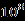
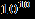
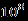
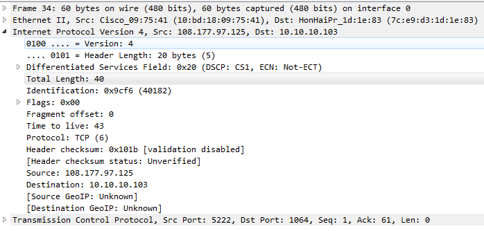

# 03_final_exam_2017.pdf

> 7 trang

## Trang 1

ĐẠI HỌC QUỐC GIA- ĐẠI HỌC        ĐỀ THI CUỐI KỲ I NĂM HỌC 2017-2018
    BÁCH KHOA TP.HCM                   Tên môn thi: Mạng máy tính
                                                    Thời gian làm bài: 90 phút
 KHOA KHOA HỌC & KỶ THUẬT                       (60 câu trắc nghiệm)
       MÁY TÍNH
Lưu ý:
                                                     Mã đề thi     Thí sinh KHÔNG được sử dụng tài liệu.
                                                                              132
     Thí sinh phải điền MSSV và Tên vào đề thi và NỘP lại đề cùng với bài làm

Họ, tên thí sinh:..................................................................... Mã sinh viên: .............................

Câu 1: Trong các ứng dụng hội thoại trực tuyến (video conferencing), thông số nào là quan trọng nhất để
đảm bao chất lượng dịch vụ tối ưu?
  A. Độ tin cậy (Reliability).                     B. Phần mềm tiện lợi (Softwares).
  C. Thiết bị chất lượng tốt (Devices).            D. Độ trễ của dữ liệu (Delay).
Câu 2: Chọn phát biểu đúng về DNS?
  A. Một Name Server có thể phục vụ nhiều tên miền (Domain Name) khác nhau
   B. Mỗi Name Server chỉ phục vụ cho đúng một tên miền (Domain Name)
  C. Tất cả tên miền (Domain Name) trên Internet đều được quản lý bởi duy nhất một Name Server
  D. Mỗi tên miền (Domain Name) được phục vụ bởi đúng một Name Server
Câu 3: Giao thức RIP (Routing Information Protocol) sử dụng giải thuật:
  A. Distance vector                            B. Link state
  C. Cả Distance vector và Link state            D. Cả (a) và (b) đều sai
Câu 4: Một trong những nguyên nhân dẫn đến sự mất gói và độ trễ trong bộ định tuyến là
  A. Các gói tin cạnh tranh nhau trong qua trình truyền tải
   B. Trong mạng có quá nhiều thiết bị sử dụng mạng
  C. Bộ định tuyến không tương thích với các thiết bị còn lại
  D. Tốc độ đầu vào vượt quá tốc độ đầu ra
Câu 5: Cho subnet sau:
                        3
            6   B              C    5
                       7        8       D                5     A
                                       4                           2          3                          F                 E

  Con đường ngắn nhất từ A đến D khi áp dụng giải thuật Dijkstra là:
  A. A->B->E->F->D    B. A->B->C->D       C. A->E->F->D       D. A->E->C->D
Câu 6: Mô tả nào KHÔNG đúng cho giao thức IMAP
  A. Cho phép người dùng tổ chức thư theo thư mục
   B. Giữ tất cả thư trong một nơi: trên máy chủ
  C. IMAP giữ lại trạng thái người dùng qua các phiên làm việc
  D. Toàn bộ các bản sao của thư sẽ được lưu trên nhiều User Agent khác nhau của người dùng
Câu 7: Giao thức truyền tải tệp tin FTP hoạt động theo mô hình
  A. Khách-chủ          B. Cả 3 mô hình trên    C. Point to Point       D. Mô hình lai
Câu 8: Trong hệ thống cơ sở dữ liệu của DNS, các resource records loại nào giúp phân giải từ hostname
sang địa chỉ IP
  A. A                  B. NS                C. MX               D. CNAME
Câu 9: Thành phần nào sau đây KHÔNG thuộc hệ thống thư điện tử
  A. Giao thức truyền tải thư: SMTP
   B. Công cụ quản lý thư người dùng (user agent - UA)
  C. Chương trình soạn thảo văn bản
  D. Máy chủ thư

                                                                           Trang 1/7 - Mã đề thi 132

## Trang 2

Câu 10: Router sử dụng giải thuật định tuyến dạng “Distance Vector” (DV) khác với router sử dụng giải
thuật định tuyến dạng “Link State” (LS) ở điểm:
  A. Router DV hiểu biết về tổng thể topology của toàn mạng.
   B. DV tính toán đường đi tối ưu dựa trên thông tin về khoảng cách được gởi đến từ các routers lân cận.
  C. Router DV tính toán đường đi tối ưu (best route) từ các routers LS.
  D. Dùng giải thuật Shortest Path First (SPF) để xác định đường đi tối ưu.
Câu 11: Ưu điểm của giải thuật Public-key so với giải thuật Symmetric-key là?
  A. Thời gian xử lý nhanh hơn                  B. Dễ sử dụng và quản lý hơn
  C. Mức độ an toàn cao hơn                   D. Độ dài key luôn lớn hơn
Câu 12: Chọn phát biểu đúng: Khi nhận được một gói tin (packet), một router sẽ:
  A. chuyển packet đến tất cả các cổng ra
   B. chuyển packet đến tất cả các cổng ra, trừ cổng mà packet đã đi đến router
  C. chuyển packet đến các cổng ra đang ở trạng thái nghỉ
  D. xác định cổng ra của packet bằng cách tra bảng chuyển tiếp (forwarding table), và chuyển packet
đến cổng tìm được
Câu 13: Phát biểu nào sau đây đúng cho UDP
  A. Hướng kết nối
   B. Có cơ chế kiểm soát tắc nghẽn
  C. Có cơ chế đảm bảo lưu lượng tối thiểu
  D. Đơn giản, không giữ thông tin về trạng thái kết nối ở người gửi và người nhận
Câu 14: Cho biết địa chỉ IPv6 nào là hợp lệ:
  A. 2001::1685:2123::1428:57ab                B. 2001:99:ab:1:99:2:1:9
  C. 2001:1428:57ab:1685:2123:1428:57ab       D. 2001:99:ab:1:99:2:1:9h
Câu 15: Một trong những ưu điểm khi sử dụng IMAP khi so sánh với POP3 là?
  A. Thời gian kết nối ngắn hơn
   B. Sử dụng ít tài nguyên trên server hơn
  C. Phù hợp hơn đối với người sử dụng hay di chuyển
  D. Dễ hiện thực hơn
Câu 16: Cho 2 host A và B cách nhau 20.000 km kết nói trực tiếp với nhau qua một dây dẫn có băng
thông R = 2 Mbps; tốc độ lan truyền tín hiệu của dây dẫn là s = 2.5 x     m/s. Hãy cho biết số lượng bit
lớn nhất có thể có trong dây dẫn là bao nhiêu
  A. 250.000 bits         B. 20.000 bits         C. 160.000 bits        D. 2x       bits
Câu 17: Giao thức SMTP thuộc tầng nào trong mô hình OSI?
  A. Liên kết dữ liệu (Data Link)                 B. Vận chuyển (Transport)
  C. Ứng dụng (Application)                   D. Mạng (Network)
Câu 18: Trong subnet thuộc class A, ta biết địa chỉ IP của một host và subnet mask như sau:
                     IP: 110. 23.120.14     Subnet mask: 255.255.240.0
  Bạn hảy cho biết địa chỉ IP (netwrok address)đầu tiên của subnet này?
  A. 110.23.112.0/20     B. 110.23.120.0/20     C. 110.23.100.0/20     D. 110.23.121.0/20
Câu 19: Bộ giao thức Wifi được qui định bởi chuẩn:
  A. IEEE 802.3         B. IEEE 802.15        C. IEEE 802.16        D. IEEE 802.11
Câu 20: Cho một DNS record như sau:

       hcmut-server.hcmut.edu.vn. 86400    IN    A     40.17.234.23

  Chọn phát biểu đúng:
  A. Thời gian sống của record là 1 ngày
   B. Địa chỉ IP của tên miền “www.hcmut.edu.vn” là 40.17.234.23
  C. Record trên thuộc kiểu “Additional”
  D. Đây là record dùng cho địa chỉ IPv6

                                                                           Trang 2/7 - Mã đề thi 132

## Trang 3

Câu 21: Cho một sơ đồ mạng như sau:

  Giả sử mạng dùng công nghệ chuyển gói, và các router hoạt động theo cơ chế “Store-and-Forward”.
Gói tin “L” có kích thước là L và các đường truyền có tốc độ là R. Thời gian để chuyển gói tin “L” từ
máy tính bên trái đến máy tính bên phải là:
  A. L/R                B. 3L/R              C. 4L/R              D. 2L/R
Câu 22: Thiết bị mạng nào dùng để nối các mạng và kiểm soát được broadcast?
  A. Hub                B. Router             C. Ethernet switch     D. Bridge
Câu 23: Khi một gói dữ liệu di chuyển từ tầng thấp lên một tầng cao hơn theo mô hình OSI, thì:
  A. Header của tầng thấp hơn sẽ được thay bằng header của tầng cao hơn
   B. Gói dữ liệu sẽ được loại bỏ bớt đi header
  C. Gói dữ liệu không bị thay đổi
  D. Gói dữ liệu sẽ được bổ sung với header mới
Câu 24: Thuật ngữ nào sau đây hay được sử dụng cho các đơn vị dữ liệu di chuyển ở tầng Mạng
(Network)
  A. Frame (Khung)                            B. Packet (Gói tin)
  C. Segment (Đoạn dữ liệu)                   D. Message (Thông điệp)
Câu 25: Chọn phát biểu đúng về số thứ tự SEQ (sequence number) của một kết nối TCP:
  A. Giá trị lớn nhất của số thứ tự là 2^32 - 1
   B. Bên gửi và bên nhận cùng thống nhất sử dụng cùng một số thứ tự cho hai chiều của kết nối
  C. Số thứ tự luôn được bắt đầu là 0 (không) khi kết nối được thiết lập
  D. Số của một bên trong kết nối phụ thuộc vào số thứ tự của bên còn lại
Câu 26: Cho đoạn mã sau:

      import java.net.*;
      public class Gateway {
         public static void main(String[] args){
            ServerSocket theServer;
            Socket client;
            try {
               theServer = new ServerSocket(8080);
               client = theServer.accept();
               //doing something
               client.close();
               theServer.close();
            }catch (Exception e) {
               System.err.println(e);
            }
         }
      }

  Với đoạn mã trên, trong một lần chạy, Gateway có thể phục vụ tối đa:
  A. 2 client                                   B. 1 client
  C. Không giới hạn số lượng client             D. 0 client
Câu 27: Hai trình duyệt Chrome và Firefox trên cùng một máy tính cùng gửi yêu cầu (request) đến trang
web https://www.google.com tại cùng một thời điểm, máy chủ Web có thể phân biệt các yêu cầu từ các
trình duyệt bằng cách:
  A. Dựa vào tổ hợp gồm cổng nguồn và đích (source ports và destination ports) mà các trình duyệt sử
dụng để tạo kết nối.
   B. Dựa vào cổng mà các trình duyệt sử dụng để tạo kết nối
  C. Máy chủ web không phân biệt được hai yêu cầu này
  D. Dựa vào tổ hợp gồm cổng nguồn và địa chỉ IP nguồn (source ports and source IP addresses) mà các
trình suyệt sử dụng để tạo kết nối.

                                                                           Trang 3/7 - Mã đề thi 132

## Trang 4

Câu 28: Chức năng của default gateway trong bảng định tuyến (Routing Table) là:
  A. Chỉ định đến địa chỉ IP tiếp theo (next hop) của gói dữ liệu nếu router hay host không biết đường
gởi đến đích
   B. Dùng để ấn định subnet mặc định cho mạng LAN
  C. Dùng xác định địa chỉ nguồn cho tất cả các gói dữ liệu gởi ra ngoài
  D. Là địa chỉ NAT của firewall khi kết nối các máy tính vào Internet
Câu 29: CSMA/CD hoạt động ở tầng nào trong mô hình OSI?
  A. Mạng (Network)                           B. Liên kết dữ liệu (Data Link)
  C. Ứng dụng (Application)                   D. Vận chuyển (Transport)
Câu 30: Các máy tính được nối vào 1 switch. Switch được cấu hình 2 VLAN khác nhau. Cần thêm yếu tố
nào để các máy thuộc 2 VLAN này có thể giao tiếp được với nhau.
  A. Một router kết nối với switch, trên interface vật lý kết nối với switch của router này cấu hình các
subinterface ứng với các VLAN, interface kết nối với router của switch cấu hình “mode trunk”.
   B. Cấu hình tất cả các interface của switch “mode access”.
  C. Một router kết nối với switch, cấu hình địa chỉ IP cho interface vật lý kết nối với switch của router.
  D. Cấu hình các interface của tất cả các máy tính “mode trunk”.
Câu 31: Chương trình Traceroute sử dụng thông tin cung cấp bởi giao thức nào để biết được đường đi
của gói tin trong mạng?
  A. IP                 B. UDP              C. TCP               D. ICMP
Câu 32: Để xây dựng một ứng dụng client-server sử dụng giao thức UDP trong Java, Java class nào sẽ
được sử dụng bởi cả client và server để thiết lập socket:
  A. DatagramSocket     B. ServerSocket       C. Socket             D. UDPSocket
Câu 33: Ứng dụng nào sau đây phù hợp nhất với dịch vụ hướng không kết nối (Connectionless service)?
  A. Trình duyệt web                           B. Hệ thống hội thảo video trực tuyến
  C. Email                                  D. Hệ thống thanh toán qua mạng
Câu 34: Chọn phát biểu SAI về kỹ thuật NAT
  A. Cho phép chuyển đổi địa chỉ port
   B. Giúp nhiều máy tính có thể nối Internet dùng chung một public IP
  C. Được thực hiện ở lớp Datalink
  D. Cho phép chuyển đổi địa chỉ IP
Câu 35: Tầng vận chuyển (Transport Layer) được hiện thực chủ yếu trên:
  A. Switch                                   B. Router
  C. Máy tính của người sử dụng                D. Tất cả các thiết bị mạng và máy tính
Câu 36: Giã sử hai host A và B nối với nhau thông qua dây dẫn có băng thông R = 56 kbps. Khoản cách
giữa hai host là m km; tốc độ lan truyền tín hiệu trong dây dẫn là s = 2.5 x     m/s. Gói tin gửi từ A đến
B có kích thước L = 120 bits. Khoản cách m là bao nhiêu để độ trể của việc lan truyền dữ liệu  (       )
bằng thời gian chuyển gói tin (        )
  A. ~560 km            B. Lớn hơn 1000 km    C. ~120 km           D. ~536 km
Câu 37: Trong subnet thuộc class A, ta biết địa chỉ IP của một host và subnet mask như sau:
                     IP: 110. 23.120.14     Subnet mask: 255.255.240.0
  Bạn hảy cho biết địa chỉ IP (netwrok address) cuối cùng của subnet này?
  A. 110.23.127.255/20   B. 110.23.120.255/20   C. 110.23.100.255/20   D. 110.23.121.255/20
Câu 38: Ở giai đoạn Bắt đầu chậm (Slow Start) trong kiểm soát tắc nghẽn TCP thì
  A. CongWin được ứng dụng thay đổi theo nhu cầu sử dụng đường truyền của nó
   B. CongWin được gán bằng 1 MSS (Maximum Segment Size) sau đó tăng gấp đôi sau mỗi ACK nhận
được
  C. CongWin được gán bằng một giá trị cố định và không thay đổi
  D. CongWin được gán bằng 1 MSS (Maximum Segment Size) và tăng thêm 1 MSS sau mỗi ACK
nhận được
Câu 39: Giao thức ICMP hoạt động ở tầng nào trong mô hình OSI?
  A. Liên kết dữ liệu (Data Link)                 B. Ứng dụng (Application)
  C. Mạng (Network)                         D. Vận chuyển (Transport)

                                                                           Trang 4/7 - Mã đề thi 132

## Trang 5

Câu 40: Một phòng học ở H6 có 40 máy tính được kết nối thành một mạng LAN, Hãy cho biết dãi IP nào
trong các dãi sau có thể được sử dụng để đảm bảo cho việc tiết kiệm IP.
  A. 192.168.1.0/27      B. 192.168.1.0/28      C. 192.168.1.0/26      D. 192.168.1.0/24
Câu 41: Thực hiện bắt gói bằng chương trình wireshark, thông tin cụ thể của một gói tin như hình bên
dưới.

  Chọn phát biểu đúng:
  A. Địa chỉ IP của máy nhận gói tin là 108.177.97.125, địa chỉ IP của máy gửi gói tin là 10.10.10.103.
   B. Máy gửi sử dụng giao thức TCP, máy nhận sử dụng giao thức UDP.
  C. Máy có địa chỉ IP 108.177.97.125 đã nhận được byte có số thứ tự 60 của gói tin được gửi từ máy có
địa chỉ IP 10.10.10.103.
  D. Gói tin được gửi trên port 1064 của máy có địa chỉ IP 108.177.97.125.
Câu 42: Giao thức được dùng như thành phần chủ yếu trong các ứng dụng mạng. Giao thức quy định?
  A. Hoạt động liên quan đến truyền nhận dữ liệu
   B. Phương thức kết nối giữa các đối tượng trao đổi dữ liệu
  C. Định dạng, thứ tự dữ liệu được truyền tải
  D. Cả (A), (B) và (C) đều đúng
Câu 43: Cho một subnet có sơ đồ như hình vẽ:

      B           C

  A                 D

          F          E

  Giả sử giải thuật định tuyến Distance Vector Routing được sử dụng. Router C nhận được các vector
thông tin về delay (khoảng cách) từ các router B (4, 10, 8, 12, 3, 2), từ D (6, 12, 7, 0, 1, 10) và từ F (7, 6,
3, 9, 5, 0). Mỗi vector biểu diễn thông tin về delay từ chính router gửi đến các router trong mạng theo thứ
tự ABCDEF. Delay từ C đến B, D và F đo được lần lượt là 5, 4 và 10. Hỏi, trong bảng routing của C sau
khi được cập nhật lại, delay từ C đến E là bao nhiêu, và đường đi phải qua router nào trước?
  A. 5 – đi qua D         B. 5 – đi qua A        C. 5 – đi qua B        D. 5 – đi qua F
Câu 44: Trong các giải thuật định tuyến cho dòng dữ liệu dạng broadcast (broadcast routing), mỗi router
sẽ phải xây dựng một hình cây (sink tree) để hạn chế sự lãng phí băng thông. Các giải pháp nào dưới đây
có thể được sử dụng để xây dựng sink tree?
  A. Count-to-infinity.                          B. Reverse Path Forwarding.
  C. Flooding.                               D. Shortest Path Forwarding.

                                                                           Trang 5/7 - Mã đề thi 132

## Trang 6

Câu 45: Giả sử máy A gửi cho máy B 18 bytes dữ liệu trong 1 segment có số thứ tự SEQ (sequence
number) là 1092, cho biết giá trị của số acknowledgement (ACK number) của segment kế tiếp mà máy B
sẽ gửi cho máy A:
  A. 1092               B. Không xác định     C. 1110              D. 19
Câu 46: Trong một mạng dạng chuyển gói (Packet switching), các gói tin sẽ được định tuyến như thế
nào?
  A. Mỗi router có một bảng định tuyến gồm các thông tin đầy đủ về đường đi đến router đích
   B. Gói tin có thể được định tuyến theo từng chặng (hop) dựa vào địa chỉ IP đích
  C. Gói tin được chuyển theo một mạch ảo (virtual circuit) được tạo sẵn trước khi truyền dữ liệu
  D. Mỗi gói tin chỉ phải chứa một số hiệu VC (virtual circuit) để đến router đích
Câu 47: Ứng dụng nào sau đây có thể được xem là một ứng dụng theo mô hình Peer-to-Peer?
  A. BitTorent
   B. Web site của Trường Đại học Bách Khoa tại: http://hcmut.edu.vn
  C. Web Browser
  D. Cả (A), (B) và (C) đều đúng
Câu 48: Cho bảng chuyển tiếp, sử dụng phương pháp trùng lặp tiền tố (longest prefix matching)
         Tiền tố                          Cổng liên kết
        11001000 00010111 00011              0
        11001000 00010111 00011000           1
        11001000 00010111 00010              2
                   Khác                   3

  Cho biết một gói tin có địa chỉ đích “11001000 00010111 00010000 10100001” sẽ đi ra ở cổng nào?
  A. 0                  B. 1                 C. 2                 D. 3
Câu 49: Bạn cần 4 subnets, mỗi subnet có thể chứa 52 host. Vậy mặt nạ mạng con nào đáp ứng nhu cầu
của bạn :
  A. 255.255.255.192     B. 255.255.255.224     C. 255.255.255.240    D. 255.255.255.248
Câu 50: Để gửi thông điệp HTTP tới trang web gaia.cs.umass.edu chúng ta cần biết:
  A. Port, Mac Address   B. IP, port            C. IP, Mac Address     D. Tất cả đều đúng
Câu 51: Địa chỉ IPv4 nào sau đây thuộc cùng một subnet với địa chỉ 192.168.1.28/27?
  A. 192.168.27.168      B. 192.168.17.135      C. 192.168.1.36        D. 192.168.1.20
Câu 52: Cặp giao thức và cổng dịch vụ tương ứng được liệt kê dưới đây là đúng theo mặc định:
  A. DNS: TCP Port 69   B. HTTP: TCP Port 8080                     C. Telnet: UDP Port 23
                       D. FTP: TCP Port 21
Câu 53: Chọn phát biểu đúng về DNS?
  A. Mỗi tên miền (Domain Name) được phục vụ bởi đúng một Name Server
   B. Mỗi Name Server chỉ phục vụ cho đúng một tên miền (Domain Name)
  C. Tất cả tên miền (Domain Name) trên Internet đều được quản lý bởi duy nhất một Name Server
  D. Một Name Server có thể phục vụ nhiều tên miền (Domain Name) khác nhau
Câu 54: Giao thức điều khiển truy cập nào sau đây cần có sự đồng bộ đồng hồ thời gian giữa các máy:
  A. CSMA/CD          B. Token Ring         C. Slotted ALOHA     D. FDMA
Câu 55: Công nghệ mạng LAN nào sử dụng phương pháp CSMA/CD?
  A. Ethernet            B. Token Ring         C. ATM              D. MPLS
Câu 56: Phương pháp nào dùng để ngăn chặn các thâm nhập trái phép từ mạng và có thể lọc bỏ các gói
tin?
  A. Encryption          B. Bảo vệ hạ tầng vật lý C. Firewall           D. Login/ password
Câu 57: SMTP sử dụng giao thức nào dưới đây của tầng Transport để truyền tải email?
  A. FTP                B. TCP               C. UDP              D. MTP

                                                                           Trang 6/7 - Mã đề thi 132

## Trang 7

Câu 58: Được biết, giải thuật mã hóa công khai (public key cryptography) được sử dụng để tạo ra chữ ký
số. Trong qui trình này, khóa nào (công khai (public key), cá nhân (private key)) được sử dụng để tạo ra
chữ ký:
  A. Công khai                                B. Cá nhân
  C. Cả hai khóa đều được sử dụng              D. Không khóa nào được sử dụng
Câu 59: Sự bất lợi của TCP so với giao thức UDP là?
  A. Việc mất mát hoặc nhân đôi packets có thể xảy ra.
   B. Tầng ứng dụng phải chịu trách nhiệm cho việc sắp xếp thứ tự packets dữ liệu.
  C. Packets không được đánh số sequence numbers.
  D. Việc xác nhận packet (Acknowledgement) có thể làm tăng chi phí truyền tải.
Câu 60: Một điểm khác biệt giữa cáp UTP CAT 3 và UTP CAT 5 là:
  A. Cáp UTP CAT 3 có nhiều sợi hơn
   B. Cáp UTP CAT 5 có nhiều sợi hơn
  C. Với cùng một đơn vị chiều dài, cáp UTP CAT3 được xoắn nhiều hơn
  D. Với cùng một đơn vị chiều dài, cáp UTP CAT5 được xoắn nhiều hơn

                                                  ----------- HẾT ----------

             Khoa/Mộ môn                         Cán bộ phụ trách

                                                                           Trang 7/7 - Mã đề thi 132
