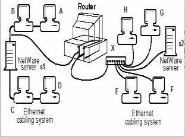

# 08_DeOn3.pdf

> 13 trang

## Trang 1

2. Thiết bị hub thông thường nằm ở     nhiêu mét?                        đoạn mạng, ta có thể:
tầng nào của mô hình OSI?            10                                      a)Đặt tối đa 4 đoạn mạng có máy tính
a. Tầng 1                            20                                      b)Đặt tối đa 5 đoạn mạng có máy tính
b. Tầng 2                            100                                     c)Đặt tối đa 3 đoạn mạng có máy tính
c. Tầng 3                            200                                       d)Tất cả đều đúng
d. Tất cả đều sai                      14.Cáp quang có thể kết nối tối đa bao   26.Phát biểu nào sau đây là đúng nhất
3.Thiết bị Switch thông thường nằm ở   nhiêu mét ?                        cho Switch
tầng nào của mô hình OSI?             a.1000                              a)Sử dụng địa chỉ vật lý và hoạt động tại
a. Tầng 1                              b.2000                                  tầng Physical của mô hình OSI.
b. Tầng 2                                   c.lớn hơn 1000                       b)Sử dụng địa chỉ vật lý và hoạt động tại
c. Tầng 3                                        d.tất cả đều sai                          tầng Network của mô hình OSI.
d. Tất cả đều sai                       15.Để nối Router và máy tính ta phải    c)Sử dụng địa chỉ vật lý và hoạt động tại
4.Thiết bị Bridge nằm ở tầng nào của   bấm cáp kiểu nào?                      tầng Data Link của mô hình OSI.
mô hình OSI?                       Thẳng                              d)Sử dụng địa chỉ IP và hoạt động tại tầng
a.Tầng 1                          Chéo                                 Network của mô hình OSI.
b.Tầng 2                               Kiểu nào cũng được
c.Tầng 3                                 Tất cả đều sai                          27.Router là 1 thiết bị dùng để:
d.Tất cả đều sai                          16.Thiết bị nào là thiết bị ở tầng         a)Định tuyến giữa các mạng
5.Thiết bị Repeater nằm ở tầng nào của  Physical: (chọn 2)                      b)Lọc các gói tin dư thừa
mô hình OSI?                             a)Switch.                           c)Mở rộng một hệ thống mạng
Tầng 1                              b)Cáp truyền dữ liệu.                   d)Cả 3 đều đúng
Tầng 2                               c)Hub và repeater.                        28.Thiết bị Repeater cho phép:
Tầng 3                                    d)Router.                             a)Kéo dài 1 nhánh LAN qua việc khuyếch
Tất cả đều sai                         17.Các thiết bị nào thuộc tầng thứ hai    đại tín hiệu truyền đến phần mở rộng của
6.Thiết bị Router thông thường nằm ở   trong mô hình OSI:                       nó.
tầng nào của mô hình OSI?            a)Hub                               b)Ngăn không cho các packet thuộc loại
a.Tầng 1                                 b)Bridge                                Broadcast đi qua nó
b.Tầng 2                                 c)Router                                c)Giúp định tuyến cho các packets
c.Từ tầng 3 trở lên                        d)Switch                                  d)Tất cả đều đúng
d.Tất cả đều sai                       18.Các thiết bị nào thuộc tầng thứ ba    29.Thiết bị Hub cho phép:
7.Thiết bị Hub có bao nhiêu collision    trong mô hình OSI:                    a)Kéo dài 1 nhánh LAN thông qua việc
domain?                               a)Repeater                            khuyếch đại tín hiệu truyền đến nó
1                                   b)Hub                               b)Ngăn không cho các packet thuộc loại
2                                        c)Router                                Broadcast đi qua nó
3                                        d)Switch                                c)Giúp định tuyến cho các packets
4                                   19.Các thiết bị nào thuộc tầng thứ tư    d)Kết nối nhiều máy tính lại với nhau để
8.Thiết bị Switch có bao nhiêu collision  trong mô hình OSI:                       tạo thành một nhánh LAN (segment)
domain?                                 a)Bridge                                  30.Thiết bị Bridge cho phép:
a.1 collision                              b)Router                             a)Ngăn không cho các packet thuộc loại
b.2 collision                               c)Switch                                Broadcast đi qua nó
c.1 collision/1port                          d)Tất cả đều sai                         b)Giúp định tuyến cho các packets
d.tất cả đều đúng                         20.Thiết bị Repeater xử lý ở:             c)Kết nối 2 mạng LAN lại với nhau đồng
9.Thiết bị Switch có bao nhiêu          a)Tầng 1: Vật lý                             thời đóng vai trò như một bộ lọc (filter), chỉ
Broadcast domain?                    b)Tầng 2: Data Link                    cho phép các packet mà địa chỉ đích nằm
1                                     c)Tầng 3: Network                       ngoài nhánh LAN mà packet xuất phát, đi
2                                    d)Tầng 4 trở lên                          qua.
3                                        21.Thiết bị Hub xử lý ở:                  d)Tất cả đều sai.
tất cả đều sai                          a)Tầng 1: Vật lý                           31.Thiết bị Router cho phép:
10.Thiết bị Hub có bao nhiêu Broadcast  b)Tầng 2: Data Link                    a)Kéo dài 1 nhánh LAN thông qua việc
domain?                              c)Tầng 3: Network                      khuyếch đại tín hiệu truyền đến nó
a.1                                   d)Tầng 4 trở lên                           b)Liên kết nhiều mạng LAN lại với nhau,
b.2                                       22.Thiết bị Bridge xử lý ở:             đồng thời ngăn không cho các packet
c.3                                   a)Tầng 1: Vật lý                          thuộc loại Broadcast đi qua nó và giúp
d.tất cả đều đúng                       b)Tầng 2: Data Link                        việc định tuyến cho các packets
11.Thiết bị Router có bao nhiêu         c)Tầng 3: Network                         c)Kết nối nhiều máy tính lại với nhau
collision domain ?                     d)Tầng 4 trở lên                           d)Tất cả đều đúng
1                                        23.Thiết bị Router xử lý ở:             32.Chức năng chủ yếu của thiết bị
2                                    a)Tầng 1: Vật lý                        Repeater:
3                                    b)Tầng 2: Data Link                      a.Khuyết đại tín hiệu và truyền tin
tất cả đều sai                          c)Tầng 3: Network                       b.Khuyết đại tín hiệu, lọc tin, và truyền tin
12.Thiết bị router có bao nhiêu          d)Tầng 4 trở lên                          c.Định tuyến các gói tin
Broadcast domain?                      24.Thiết bị Switch xử lý ở:                d.Tất cả đều đúng.
a.1 broadcast/1port                     a)Tầng 1: Vật lý
b.2                                   b)Tầng 2: Data Link
c.3                                   c)Tầng 3: Network                    33.Chức năng chủ yếu của thiết bị
d.4                                   d)Tầng 4 trở lên                         Bridge:
13.Cáp UTP có thể kết nối tối đa bao     25.Khi dùng repeater để mở rộng các    a.Khuyết đại tín hiệu và truyền tin

## Trang 2

b.Khuyết đại tín hiệu, lọc tin, và truyền tin   41.Các thiết bị mạng nào sau đây có    d)Cả ba câu trên đều sai.
c.Định tuyến đường truyền tin           khả năng định tuyến cho 1 gói tin        50.Kỹ thuật dùng để nối kết nhiều máy
d.Tất cả đều sai                       (chuyễn gói tin sang một mạng kế khác  tính với nhau trong phạm vi một văn
34.Chức năng chủ yếu của thiết bị     nằm trên đường đến mạng đích) bằng   phòng gọi là:
Switch:                            cách dựa vào địa chỉ IP của máy đích   a)LAN
a.Khuyết đại tín hiệu và truyền tin        có trong gói tin và thông tin hiện thời   b)WAN
b.Khuyết đại tín hiệu, lọc tin, và truyền tin  về tình trạng mạng được thể hiện trong c)MAN
c.Định tuyến đường truyền tin           bảng định tuyến có trong thiết bị:         d)Internet
d.Tất cả đều sai                          a)Bridge                            51.Mạng Internet là sự phát triển của:
35.Chức năng chủ yếu của thiết bị       b)Router                             a)Các hệ thống mạng LAN.
Router:                                  c)Switch                              b)Các hệ thống mạng WAN.
a.Khuyết đại tín hiệu và truyền tin         d)Hub và Repeater                     c)Các hệ thống mạng Intranet.
b.Khuyết đại tín hiệu, lọc tin, và truyền tin  42.Cáp đồng trục mảnh và dày khác     d)Cả ba câu đềuđúng.
c.Định tuyến đường truyền tin           nhau chủ yếu là:                     52.Mạng cục bộ (LAN) là:
d.Tất cả đều sai                       a)Cáp đồng trục mảnh có lõi đồng dày      a)tập hợp các thiết bị tin học có thể hoạt
36.Chọn các phát biểu SAI về HUB:     hơn                                động độc lập có trong 1 phòng, 1 tầng, 1
(chọn 2)                             b)Cáp đồng trục mảnh có lõi đồng mỏng    toà nhà...
a)Lọc các gói tin dựa vào địa chỉ MAC.    hơn                                    b)hệ thống các môi trường truyền tin dùng
b)Là repeater multiport.                 c)Cáp đồng trục mảnh truyền thông tin đi   để liên kết các thiết bị tin học
c)Làm tăng kích thước của collision       xa hơn                               c)Cả hai câu trên đều đúng
domain.                              d)Cáp đồng trục mảng chống nhiễu tốt     53.Điều gì đúng đối với mạng ngang
d)Hoạt động ở tầng Data Link.           hơn                                 hàng:
37.Chọn các phát biểu ĐÚNG về        43.Cáp đồng trục mảnh dùng trong trường a)Cung cấp sự an toàn và mức độ kiểm
Repeater: (chọn 2)                  hợp nào:                                 soát cao hơn mạng dựa trên máy phục vụ.
a)Hoạt động ở tầng Physical.            a)Dùng làm cáp chính trong đồ hình dạng  b)Được khuyến cáo sử dụng cho mạng có
b)Lọc các gói tin dựa vào địa chỉ MAC.     bus                                      từ 10 người dùng trở xuống.
c)Tiếp nhận tín hiệu ở một cổng, khuyếch  b)Dùng làm cáp nối giữa máy tính với cáp  c)Đòi hỏi một máy phục vụ trung tâm có
đại tín hiệu lên và truyền ra cổng kia.       chính                                cấu hình mạnh.
d)Có chức năng phân cách các collision    c)Dùng kết nối trong đồ hình dạng sao     d)Người dùng phân bố trong địa bàn rộng.
domain.                                   d)Tất cả đều sai                      54.Mạng LAN khác mạng WAN ở chỗ:
38.Chức năng CHÍNH của router là:     44.Cáp UTP được sử dụng với đầu nối   a)kích thước (tính theo bán kính của
a)Mở rộng kích thước cho phép của một    là:                                mạng) mạng LAN nhỏ hơn mạng WAN.
đoạn mạng bằng cách khuyếch đại tín     a)RJ45                              Tốc độ truyền thông tin trên mạng LAN
hiệu.                             b)BNC                              nhanh hơn trên mạng WAN
b)Kết nối nhiều mạng LAN với nhau, ngăn  c)Cả hai                                   b)kích thước (tính theo bán kính của
các gói tin broadcast và chuyển các gói tin  d)Các câu trên đều sai                 mạng) mạng LAN lớn hơn hơn mạng
giữa các mạng LAN.                   45.Khoảng cách tối đa cho cáp UTP là : WAN. Tốc độ truyền thông tin trên mạng
c)Kết nối nhiều máy tính với nhau.        a)185m.                         LAN không nhanh hơn trên mạng WAN.
d)Lọc các gói tin dựa vào địa chỉ MAC.     b)100m.                             c)Mạng LAN do doanh nghiệp sở hữu,
39.Chọn phát biểu ĐÚNG về switch và   c)150m.                            nhưng mạng WAN có thể không
hub:                                  d)50m.                             d)Mạng LAN và WAN đều phải do một
a)Sử dụng HUB hiệu quả hơn, do HUB    46.Khoảng cách tối đa cho cáp đồng    doanh nghiệp sở hữu.
làm tăng kích thước của collision-domain.  trục mảnh là:                          55.Kiến trúc một mạng LAN có thể là:
b)Sử dụng SWITCH hiệu quả hơn, do     a)185m.                            a)RING
SWITCH phân cách các collision-domain.  b)200m.                           b)BUS
c)HUB và SWITCH đều cho hiệu suất      c)250m.                            c)STAR
hoạt động ngang nhau, tuy nhiên SWITCH  d)500m.                             d)Có thể phối hợp các mô hình trên
cho phép cấu hình để thực hiện một số    47.Khoảng cách tối đa cho cáp đồng    56.Phát biểu nào sau đây mô tả đúng
công việc khác nên đắt tiền hơn.           trục dày là:                           nhất cho cấu hình Star
d)HUB làm tăng hiệu năng của mạng do   a)185m.                             a)Cần ít cáp hơn nhiều so với các cấu
chỉ chuyển các tín hiệu nhị phân mà       b)200m.                                 hình khác.
không xử lý gì hết. Khác với SWITCH phải  c)250m.                                  b)Khi cáp đứt tại một điểm nào đó làm
xử lý các tín hiệu trước khi truyền đi nên   d)500m.                                 toàn bộ mạng ngưng hoạt động.
làm tăng độ trễ dẫn đến giảm hiệu năng    48.Khi sử dụng mạng máy tính ta sẽ     c)Khó tái lập cấu hình hơn so với các cấu
mạng.                          được các lợi ích:                        hình khác.
40.Để hạn chế sự đụng độ của các gói   a)Chia sẻ tài nguyên (ổ cứng, cơ sở dữ    d)Dễ kiểm soát và quản lý tập trung.
tin trên 1 đoạn mạng, người ta chia        liệu, máy in, các phần mềm tiện ích, …)    57.Mô tả nào thích hợp cho mạng Bus
mạng thành các mạng nhỏ hơn và nối   b)Quản lý tập trung.                    a)Cần nhiều cáp hơn các cấu hình khác.
kết chúng lại bằng các thiết bị:          c)Tận dụng năng lực xử lý của các máy    b)Phương tiện rẻ tiền và dễ sử dụng.
a)Repeaters/Hub                             tính rỗi để làm các đề án lớn.             c)Dễ sửa chữa hơn các cấu hình khác.
b)Bridges/Switches                        d)Tất cả đều đúng.                     d)Số lượng máy trên mạng không ảnh
c)Router                                      49.Kiế n trú c mạng má y tính là :         hưởng đến hiệu suất mạng.
d)Tất cả các thiết bị trên                     a)Cấ u trú c kế t nố i cụ thể giữa cá c má y
                                           trong mạng.
                                     b)Các phần tử chức năng cấu thành
                               mạng và mối quan hệ giữa chúng.
                                     c)Bao gồ m hai ý của câu a) và b).

## Trang 3

58.Môi trường truyền tín hiệu trong      và truyền đi đến đích.                     d)Net use X: = \\datacenter\software
mạng WAN có thể là: (chọn 2)          d)Các giao thức này được các ROUTER
a)Cáp xoắn đôi,                     sử dụng.                             76.Các loại Resource Record nào sau
b)Cáp đồng trục.                       67.Trong chồng giao thức TCP/IP, ở    đây được mô tả trong DNS
c)Cáp quang.                          tầng Transport có những giao thức nào: a)NAMED
d)Sóng vô tuyến.                      (chọn 2)                            b)NS
59.Môi trường truyền tin thông thường  a)SMTP.                           c)SOA
trong mạng máy tính là:                b)TCP.                            d)MS
a)Các loại cáp như: đồng trục, xoắn đôi,   c)UDP.
Cáp quang, cáp điện thoại,...             d)HTTP.                              77.Tên FQDN được hiểu như là tên
b)Sóng điện từ,...                       68.Giao thức TCP trong mạng Internet:   DNS..... ?
c)Tất cả môi trường nêu trên              a)Là giao thức gởi nhận dữ liệu tin cậy    a)Đầy đủ
60.Việc nhiều các gói tin bị đụng độ       giữa hai chương trình.                   b)Tên gọi tắt
trên mạng sẽ làm cho:                  b)Là giao thức gởi nhận dữ liệu thô.       c)Tên HostName
a)Hiệu quả truyền thông của mạng tăng    c)Là giao thức gởi nhận dữ liệu thô giữa   d)Server Name
lên                                         hai chương trình.
b)Hiệu quả truyền thông của mạng kém đi  d)Là giao thức gởi nhận dữ liệu thô giữa   78.Trong Mail Server thường sử dụng
c)Hiệu quả truyền thông của mạng không   hai má y.                            các giao thức nào sau đây(chọn 2)?
thay đổi                               69.Người ta dù ng từ “hệ điề u hành     a)SNMP
d)Phụ thuộc vào các ứng dụng mạng mới  mạng” để chỉ:                      b)POP3
tính được hiệu quả.                         a)Tập trung cá c module phầ n mề m quản  c)SMTP
61.Kĩ thuật dùng để truy cập đường           lý mạng.                            d)ICMP
truyền trong mạng Ethernet là:            b)Tập trung cá c module phầ n mề m thực
a.Token passing                                hiện cá c cấ p trong kiế n trú c mạng.        79.Record nào sau đây hỗ trợ cơ chế
b.CSMA/CD                                 c)Hệ điề u hà nh quản lý tà i nguyên cá c    chứng thực cho miền?
c.Tất cả đều sai                    máy trong một mạng máy tính.            a)Một SOV record.
62.Kĩ thuật dùng để truy cập đường      d)Hệ điề u hà nh có chức năng mạng.       b)Một SOS record.
truyền trong mạng Ring là:             70.Giao thức FTP sử dụng cổng dịch    c)Một SRV record.
a.Token passing                     vụ số:                                 d)Một SOA record.
b.CSMA/CD                            a)20
c.Tất cả đều đúng                       b)21                                   80.Dịch vụ nào sau đây được yêu cầu
                                        c)25                                     khi quản trị AD
63.Cho biết đặc điểm của mạng         d)53                             a)DNS
Ethernet 100BaseTX: (chọn 3)           71.Giao thức SMTP sử dụng cổng dịch  b)WINS
a)Sử dụng cáp xoắn đôi loại 3 (UTP cat3).  vụ số:                            c)SMTP
b)Dùng HUB/SWITCH để kết nối hoặc kết  a)110                            d)DHCP
nối trực tiếp giữa hai máy tính.            b)23
c)Hoạt động ở tốc độ 100Mbps.           c)25                               81.DC viết tắt của từ nào?
d)Sử dụng connector RJ-45.              d)53                                 a)Domain name controller
e)Sử dụng connector BNC.               72.Giao thức POP3 sử dụng cổng dịch  b)Domain controller
                                  vụ số:                               c)Domain control
64.Đơn vị của “băng thông là”: (chọn    a)110                                     d)Tất cả đều đúng
các đáp án đúng)                       b)23
a)Hertz (Hz).                             c)25                                   82.Dịch vụ DNS Server có chức năng
b)Volt (V).                              d)53                                 chính là gì?
c)Bit/second (bps).                     73.Để bấm cáp UTP đạt chuẩn 100      a)Phân giải tên miền (IP sang tên và
d)Ohm (Ω).                         Mbps, ta chú ý xếp các sợi ruột theo    ngược lại)
                                 quy tắc:                             b)Phân giải địa chỉ MAC
65.Định nghĩa giao thức (protocol):      a)1 – 2 – 3 – 4.                        c)Phân giải tên netbios
(chọn các đáp án đúng)                 b)1 – 2 – 4 – 8.                            d)Tất cả đều sai
a)Là các tín hiệu nhị phân truyền đi trước   c)1 – 2 – 5 – 6.
khi truyền dữ liệu thật sự.                  d)Tất cả đều sai.                       83.Record MX dùng làm gì?
b)Là một tập các quy ước, thoả thuận mà  74.Để kết nối hai HUB với nhau ta sử    a)Cho dịch vụ chuyển mail
các thiết bị trên mạng phải tuân theo để   dụng kiểu bấm cáp:                   b)Dùng để định tuyến gói tin
có thể liên lạc được với nhau.            a)Thẳng (straight-through).              c)Dùng để backup
c)Là cơ chế “bắt tay ba lần” mà mọi thiết   b)Chéo (cross-over).                   d)Dùng cho dịch vụ FTP
bị mạng đều phải thực hiện khi khởi động.  c)Console.
d)Là một tập các đặc tả mà mọi nhà sản    d)Tất cả đều đúng.                     84.Kể tên bốn loại record quan trọng
xuất sản phẩm mạng phải dựa theo để                                          nhất của dịch vụ DNS
thiết kế sản phẩm của mình.              75.Trên server datacenter (HĐH       a)SOA………..
66.Chọn các phát biểu đúng về các     Windows 2000) có chia sẻ một thư mục b)A………..
giao thức định tuyến: (chọn 3)         dùng chung đặt tên là software. Lệnh   c)MX………..
a)Trao đổi các bảng định tuyến với nhau   để ánh xạ thư mục trên thành ổ đĩa X:   d)NS………..
để cập nhật thông tin về các đường đi.    cục bộ trên máy là:
b)Các thông tin về các đường đi được lưu  a)Net map X:=\\datacenter\software
trữ trong bảng định tuyến (routing table).   b)Net use X: \\datacenter\software
c)Đóng gói dữ liệu của các tầng bên trên   c)Mapping X: = \\datacenter\software

## Trang 4

1.        trong các cơ chế sau đây , cơ chế nào  11.      Chiến lược selective repeat ...          1.     Máy tính đóng vai trò Router cần
được sử dụng để cài webcache                     a. Cài đặt dễ hơn go-back-N
a.Cookie                                           b. Hiệu suất tốt khi kênh truyền phía dưới có tỷ  có tối thiểu bao nhiều card mạng vật lý ?
b.Kiểm chứng và mã kiểm chứng 401               lệ lỗi cao                                     a.1
Authirization require                                  c. Yêu cầu truyền lại nhiều hơn so với go-back-   b.2
c.Trường tiêu đề "Last-Modified" và "If-       N
modified-since"                                    d. Yêu cầu phía nhận phải lưu tạm các gói tin    c.3
d.Phương thức yêu cầu POST                 đến không theo thứ tự                       d.4
e.a,b và c                                          e. a và c
f.b và c                                                             f. b và d
                                                                                              2.     Máy tính đóng vai trò router cần
2.      Ưu điểm của dịch vụ không hướng     12.      Giao thức MAC liên quan đến tình     có tối thiểu bao nhiêu địa chỉ IP để hoạt
nối so với dịch vụ hướng nối là                huống khi ...                          động như một router
a.Độ trễ thấp hơn                                  a. Nhiều thiết bị kết nối vào kênh quảng bá
b.Gửi và nhận các thông điệp theo thứ tự       dùng chung                                  a.1
c.Cơ chế khôi phục lỗi tốt hơn                     b. Nhiều nút cùng muốn truyền dữ liệu tại cùng  b.2
d.Hiệu suất sử dụng kênh truyền tốt hơn          thời điểm                                    c.3e. a và d                                                c. Cần cơ chế để xác định nút nào được quyền
f.a và d,c                                      truyền                                     d.4
                                                    d. Mục tiều là giảm thiểu độ trễ và cực đại hiệu
3.       Trong gói UDP (UDP segment) , địa    suất khi sử dụng kênh truyền                   3.      Giả sử máy tính B gửi một yêuchỉ dùng để xác nhận tiến trình nhận nằm ở       e. Tất cả
a. Byte 1 và 2                                                                  cầu tới webserver s2 , s2 có thể xác định
b Byte 3 và 4                                  13.      Địa chỉ nào sau đây thuộc lớp A      được chỉ MAC của B
c. Byte 5 và 6                                 a.172.29.14.10
d. Không xác định                               b.10.1.1.1                             a.Đúng
                                                c.140.8.8.8                                  b.Sai
4.      Để phát hiện lỗi trong gói tin , người   d.203.5.6.7                                    4.      Giả sử máy tính H gửi một yêu
ta sử dụng kỹ thuật
a.Số thứ tự (sequence number)                 14.       trong lòn gói tin IP luôn chứa tiêu đề  cầu tới webserver s2 , s2 có thể xác định
b.Số thứ tự ghi nhận (acknowledgement         của gói tin ở tầng giao vận (TCP hay UDP)      được chỉ MAC của H
number)                                   a.Đúng                               a.Đúng
c.Bộ định thời (timer)                            b.Sai
d.Checksum                                                                             b.Sai
e.a,b,c,d                                      15.     Chọn một ý không phải ưu điểm của
                                     NAT                                           5.      Router có thể cấm máy H nhưng
5.       Phát biểu nào đúng về giao thức       a.Cấu hình mạng cục bộ không phụ thuộc vào
HTTP:                                         bất kỳ ISP nào                          cho phép máy G truy cập đến server s2
a.Số hiệu phiên bản giao thức luôn được đặt      b.Chỉ ánh xạ địa chỉ IP thực và ảo , tuân thủ tốt  a.Đúng
trong tất cả các thông điệp                     cơ chế phân tầng                             b.Saib.Tất cả các tiêu đề đều dưới dạng text             c. Tiết kiệm không gian địa chỉ IP
c. a và b
d. Tất cả dữ liệu truyền dưới dạng văn bản                                                      6.      Router có thể cấm máy A nhưng
(text)                          Câu 2 :                              cho phép máy B truy cập đến server s2
6.       Nhiều đối tượng (chẳng hạn file ảnh ) Máy tính A trong mạng Lan 1 và máy     a.Đúng
có thể gửi qua cùng một kết nối TCP ?           tinh B trong mạng Lan 2 . Hai mạng này    b.Sai
a.ĐÚng
b.Sai                                được kết nối với nhau qua 1 router. MTU
                                       của hai mạng Lan 1 và 2 lần lượt là         7.    B có thể xác định được địa chỉ
7.       Trong những thông điệp HTTP trả lời  1000B và 500B . Giả sử một ứng dụng   MAC của A
dưới đây thông điệp nào đúng ??
a. 200 "OK"                                   trên A thực thi 5000 lời gọi tới một ứng    a.Đúng
b.201 "Moved permanently"                dụng trên B . Mỗi lời gọi khiến HDH bên   b.Sai
c. 404 ""Not modified"              A tạo ra một gói tin IPv4 với kích thước
d.20 "Not IMplemented"
e.a và c                              đúng bằng MTU để gửi đi trên mạng        8.    B có thể xác định được địa chỉ
                                   Lan1 . Mỗi gói tin IP này chỉ có 20 byte  MAC của B
8.      Những chức năng nào dưới đây được   tiêu đề(không có trương tùy chọn) và 980  a.Đúng
giao thức POP3 hỗ trợ
a. Kiểm chứng (authorisation)                 byte dữ liệu . Có bao nhiêu gói tin đi từ A  b.Sai
b.Đọc một thư (retrieving a message)         đến B trung chuyển qua mạng Lan 2 và
c.Tìm kiếm từ khóa trong thư                 kích thước mỗi gói tin ? Hãy giải thích ?    9.    B có thể xác định được tất cả địad.Xóa một thư
e.a ,b,d                            Câu 3                                      chỉ MAC của router
                                                                         a.Đúng
9.        Dịch vụ nào sau đây mà tầng liên kết                                              b.Saidữ liệu nào cũng phải cung cấp ?
a. Đặt gói tin tầng mạng vào frame
b.Định tuyến                                                                          10.    Mạng Lan 2 là mạng có topo
c.Mã hóa các bit thành các tín hiệu vật lý                                                 hoạt động vật lý dạngd.Tạo đường truyền tin cậy
                                                                                 a.Sao
10.      Khoảng cách hamming ...                                                 b.Bus
a. của hai từ mã là số lượng các bit khác nhau
giữa chúng                                                                           c.Tree
b. giữa 10001001 và 10110001 là 3
c.là phương pháp tốt để xác định các bit tự     Lan bên trái tên là LAN 1 . Lan bên phải
dưng bị chèn thêm vào một thông điệp           là LAN 2 . 2 LAN segment nối với nhaud.sửa được tất cả các lỗi
e. a và b                              qua một router là máy tính .

## Trang 5

1.   Tầng nào trong mô hình OSI thực          C.  550 mét                             A.   Application
     hiện gửi tín hiệu lên cáp?                D.  3 kilo-mét                           B.   Transport
     A.   Physical                       10.  Địa chỉ nào dưới đây là địa chỉ tầng        C.   Internet
     B.  Network                        2 (địa chỉ MAC)?                        D.  Network
     C.  Data Link                            A.  192.201.63.251                       E.   Physical
     D.  Transport                            B.  19-22-01-63-25                21.  Giao thức nào được sử dụng để
2.   Bridge hoạt động tại tầng nào trong       C.  0000.1234.FEG                    thông báo lỗi liên quan đến IP?
   mô hình OSI?                           D.  00-00-12-34-FE-AA                  A.  SMTP
     A.   Session                        11.  Địa chỉ IP nào dưới đây nằm trong         B.  ICMP
     B.  Data Link                     mạng 192.168.100.0/255.255.255.0       C.  RTMP
     C.   Transport                           ?                                      D.  SNMP
     D.  Network                             A.   192.168.1.1                    22.  Địa chỉ IP nào dưới đây thuộc địa chỉ
3.   Nhược điểm của mạng (cách thức          B.  192.167.100.10                       lớp B?
    quản lý tài nguyên) peer-to-peer?         C.  192.168.100.254                     A.   127.26.36.85
     A.   Đòi hỏi chi phí đầu tư cao cho        D.  192.168.100.255                     B.  211.39.87.100
       máy chủ                       12. Mạng Ethernet nào cho phép thực         C.  89.156.253.10
     B.   Đỏi hỏi chi phí đầu tư cao cho         hiện kết nối dài hơn 1km?                D.  191.123.59.5
        hệ điều hành mạng đặc dụng         A.  10Base2                               E.   199.236.35.12
     C.   Đòi hỏi phải có quản trị mạng         B.  10Base5                       23.  Giao thức phân giải địa chỉ IP thành
     D.  Không có độ an toàn-bảo mật         C.  10BaseT                               địa chỉ MAC?
         cao                               D.  10BaseFX                            A.  DNS
4.   Các địa chỉ IP cùng mạng con với     13.  Thiết bị nào gửi gói dữ liệu tới tất cả       B.  ARP
     địa chỉ 131.107.2.56/28?                 các máy trên một đoạn LAN?              C.  NetBIOS
     A.   từ 131.107.2.48 đến                 A.  Hub                               D.  TCP
         131.107.2.63                        B.   Router                         24.  Thứ tự của các tầng trong mô hình
     B.   từ 131.107.2.48 đến                 C.   Switch                         tham chiếu OSI?
         131.107.2.6.2                      D.  Gateway                             A.   Physical, Data Link, Network,
     C.   từ 131.107.2.49 đến                                        14.  Chuẩn IEEE 802.2 liên quan đến?               Transport, System,
         131.107.2.62                                                                         Presentation, Application
     D.   từ 131.107.2.49 đến                 A.  Định nghĩa tầng con (sublayer)       B.   Physical, Data Link, Network,
         131.107.2.63                               Logical Link Control (LLC)                  Transport, Session,
     E.   từ 131.107.2.55 đến                 B.  Token Ring                                Presentation, Application
         131.107.2.126                       C.  Định nghĩa tầng con (sublayer)       C.   Physical, Data Link, Network,                                              Media Access Control (MAC)
5.   Tên gọi của mô hình tham chiếu 7                                                     Transform, Session,                                           D.  Ethernet
     lớp?                                                                                       Presentation, Application
                                        15.  Địa chỉ mạng được gán tại tầng nào       D.   Presentation, Data Link,     A.  ISO
                                              trong mô hình OSI ?                         Network, Transport, Session,     B.  OSI
     C.  OIS                                  A.   Session                                     Physical, Application
     D.  IOS                                  B.  Data Link                      25.  Tầng nào trong mô hình OSI có
                                              C.   Presentation
6.   Địa chỉ IP                                                               nhiệm vụ chia dữ liệu thành các                                           D.  Network
     172.17.0.22/255.255.255.240 thuộc                                         khung (frame) để truyền lên mạng?
    mạng nào?                         16.  Chiều dài tối đa một đoạn mạng           A.  Network
                                          (segment) trong 10Base-5 ?               B.  Data Link     A.   127.0.0.1
     B.   172.17.0.0                           A.  500 m                               C.   Physical
     C.   172.17.0.21                         B.  100 m                             D.  Session
     D.  172.17.0.16                         C.  2000 m                                E.   Transport
     E.   255.255.255.240                   D.  187 m
7.   Chuẩn IEEE nào định nghĩa mạng     17.  Loại cáp nào được sử dụng trong
    dùng mô hình kết nối đường tròn          kiến trúc 100BaseTX?
     (ring)?                                   A.  RG-58 Coax
     A.  802.3                                B.  RG-62 Coax
     B.  802.5                               C.  UTP CAT-3
     C.  802.12                            D.  UTP CAT-5
     D.  802.11b                               E.   Telephone Twisted pair (TTP)
8.  Chữ cái “T” trong 100BASE-TX biểu   18.  10Base-2 còn được gọi với tên gì?
     diễn cho thông tin gì?                     A.   Thicknet
     A.   tốc độ truyền (Transmission          B.   Thinnet
         speed)                              C.   unshielded twisted-pair
     B.  bộ chuyển đổi tín hiệu đầu cuối       D.  Category 3
          (Terminal adapter)             19. Mô hình kết nối (topology) chính của
     C.  cáp xoắn đôi (Twisted-pair         LAN là?
          cable)                               A.   Star
     D.   tín hiệu truyền hai chiều (Twin        B.  Bus
           direction signal)                      C.   Ring
9.   Chiều dài tối đa của một đoạn trong       D.  Một trong những topology nói
     kiến trúc 1000Base-T?                          trên
     A.  100 mét                       20.  Tầng nào trong mô hình TCP/IP ứng
     B.  325 mét                               với tầng mạng trong mô hình OSI?

## Trang 6

Câu 1: Những thiết bị lớp 1 nào sau đây được sử   trạm này sang trạm khác, bất kể yếu tố địa lý hay   Câu 27 : Một mạng con lớp A mượn 5 bit để chia
dụng để mở rộng mạng LAN :                   hệ điều hành sử dụng:                           subnet thì SM sẽ là :
a. Hub                                                 a. FTP                                                 a. 255.248.0.0
b. Switch                                              b. Telnet                                               b. 255.255.255.1
c. Repeater                                               c. Email                                                   c. 255.255.255.248
d. Bridge                                               d. WWW                                               d. 255.255.255.128
Câu 2: Byte đầu tiên của một địa chỉ IP có dạng:   Câu 15: Lớp nào cung cấp phương tiện để truyền  Câu 28 : Một mạng con lớp A mượn 7 bit để chia
11000001. Vậy nó thuộc lớp nào:                  thông tin qua liên kết vật lý đảm bảo tin cậy :        subnet thì SM sẽ là :
a. Lớp D                                               a. Physical                                             a. 255.255.254.192
b. Lớp E                                               b. Data link                                            b. 255.254.0.0
c. Lớp C                                                  c. Network                                                c. 255.248.0.0
d. Lớp A                                               d. Transport                                           d. 255.255.255.254
Câu 3 : Byte đầu tiên của một địa chỉ IP có dạng:   Câu 16: Lớp B được phép mượn tối đa bao nhiêu  Câu 29 : Một mạng con lớp A cần chứa tối thiểu
11100001. Vậy nó thuộc lớp nào:                         bit cho subnet :                              255 host sử dụng SM nào sau đây :
a. Lớp B                                               a. 8                                                    a. 255.255.254.0
b. Lớp C                                               b. 6                                                    b. 255.0.0.255
c. Lớp D                                                  c. 14                                                      c. 255.255.255.240
d. Lớp E                                               d. 2                                                    d. 255.255.255.192
Câu 4 : Giao thức nào thực hiện truyền các thông  Câu 17: Byte đầu tiên của một địa chỉ IP có dạng :  Câu 30 : Một mạng con lớp A mượn 1 bit để chia
báo điều khiển giữa các gateway hoặc trạm của    00000001. Vậy nó thuộc lớp nào:                 subnet thì SM sẽ là :
liên mạng:                                             a. Lớp A                                               a. 255.255.128.0
a. ARP                                                 b. Lớp C                                               b. 255.128.0.0
b. ICMP                                                  c. Lớp B                                                  c. 255.255.255.240
c. RARP                                               d. Lớp D                                               d. 255.255.128.0
d. TCP                                Câu 18: Lớp nào cung cấp phương tiện để truyền  Câu 31 : Một mạng con lớp B mượn 5 bit để chia
Câu 5 : Lệnh ping sử dụng các gói tin nào sau      thông tin qua liên kết vật lý đảm bảo tin cậy :        subnet thì SM sẽ là :
đây :                                                   a. Physical                                             a. 255.255.248.0
a. echo                                                b. Network                                             b. 255.255.255.1
b. TTL                                                    c. Data link                                               c. 255.255.255.248
c. SYN                                                 d. Transport                                           d. 255.255.255.128
d. FIN                                 Câu 19: Thiết bị mạng trung tâm dùng để kết nối   Câu 32 : Một mạng con lớp B mượn 7 bit để chia
Câu 6 : Lớp nào thực hiện việc chọn đường và     các máy tính trong mạng hình sao (STAR)          subnet thì SM sẽ là :
chuyển tiếp thông tin; thực hiện kiểm soát luồng      a. Switch/Hub                                         a. 255.255.254.0
dữ liệu và cắt/hợp dữ liệu:                            b. Router                                              b. 255.255.254.192
a. Session                                                c. Repeater                                               c. 255.255.255.240
b. Network                                             d. NIC                                                 d. 255.255.255.254
c. Transport                             Câu 20: Lệnh nào dưới đây được dùng để xác     Câu 33 : Một mạng lớp B cần chia thành 3 mạng
d. Data link                                       định đường truyền (trong hệ điều hành Windows)   con sử dụng SM nào sau đây :
Câu 7 : Phương thức nào mà trong đó cả hai bên    a. nslookup                                            a. 255.255.224.0
đều có thể đồng thời gửi dữ liệu đi:                   b. Route                                               b. 255.0.0.255
a. Full – duplex                                          c. ipconfig                                                c. 255.255.192.0
b. Simplex                                             d. Tracert                                              d. 255.255.255.224
c. Half – duplex                          Câu 21: Lớp nào cung cấp các phương tiện để    Câu 34 : Một mạng lớp B cần chia thành 9 mạng
d. Phương thức khác                          người sử dụng có thể truy nhập được vào môi      con sử dụng SM nào sau đây :
Câu 8 : Địa chỉ IP nào sau đây là hợp lệ:           trường OSI và cung cấp các dịch vụ thông tin phân  a. 255.255.240.0
a. 192.168.1.2                                         tán:                                                    b. 255.0.0.255
b. 255.255.255.255                                    a. Transport                                              c. 255.224.255.0
c. 230.20.30.40                                        b. Presentation                                        d. 255.255.255.224
d. Tất cả các câu trên                                   c. Session                              Câu 35 : Một mạng lớp B cần chia thành 15 mạng
Câu 9 : Địa chỉ IP nào sau đây là địa chỉ quảng bá   d. Application                                con sử dụng SM nào sau đây :
cho một mạng bất kỳ:                      Câu 22: Tầng hai trong mô hình OSI tách luồng bit   a. 255.255.224.0
a. 172.16.1.255                                   từ Tầng vật lý chuyển lên thành:                      b. 255.0.0.255
b. 255.255.255.255                                    a. Frame                                                 c. 255.255.240.0
c. 230.20.30.255                                      b. Segment                                            d. 255.255.255.224
d. Tất cả các câu trên                                   c. Packet                               Câu 36: Lớp C được phép mượn tối đa bao nhiêu
Câu 10: Trong số các cặp giao thức và cổng dịch    d. PSU                                                         bit cho subnet :
vụ sau, cặp nào là sai :                     Câu 23 : Các trạm hoạt động trong một mạng vừa   a. 8
a. SMTP: TCP Port 25                       như máy phục vụ (server), vừa như máy khách      b. 6
b. FTP: UDP Port 22                                           ( client) có thể tìm thấy trong mạng nào ?             c. 4
c. HTTP: TCP Port 80                                 a. Client/Server                                        d. 2
d. TFTP: TCP Port 69                                 b. Ethernet                              Câu 37 : Một mạng lớp C cần chia thành 5 mạng
e. DNS: UDP Port 53                                    c. Peer to Peer                               con sử dụng SM nào sau đây :
Câu 11 : Địa chỉ 19.219.255.255 là địa chỉ gì?        d. LAN                                                 a. 255.255.224.0
a. Broadcast lớp B                        Câu 24 : Để kết nối trực tiếp hai máy tính với nhau   b. 255.0.0.255
b. Broadcast lớp A                                    ta có thể dùng :                                          c. 255.224.255.0
c. Host lớp A                                          a. Cáp chéo (Cross- Cable)                           d. 255.255.255.224
d. Host lớp B                                          b. Cáp thẳng ( Straight Cable)                Câu 38 : Một mạng lớp C cần chia thành 3 mạng
Câu 12 : Trong kiến trúc phân tầng mạng, tầng       c. Rollover Cable                             con sử dụng SM nào sau đây :
nào có liên kết vật lý                                   d. Không có loại nào                                  a. 255.255.224.0
a. Tầng 1                               Câu 25 : Mô hình phân lớp OSI có bao nhiêu lớp :   b. 255.0.0.255
b. Tầng n                                              a. 7                                                       c. 255.255.255.192
c. Tầng i                                               b. 4                                                    d. 255.255.255.224
d. Tầng i <>1                                             c. 5
Câu 13: Topo mạng cục bộ nào mà tất cả các trạm  d. 2
phân chia chung một đường truyền chính:        Câu 26 : Các đơn vị dữ liệu giao thức trong lớp 2
a. Bus                                      của mô hình OSI được gọi là :
b. Star                                                 a. PDU
c. Ring                                                 b. Packet
d. Hybrid                                                 c. CSU
Câu 14: Dịch vụ nào cho phép chuyển các file từ     d. Frame

## Trang 7

1. Phát biểu nào sau đây về việc        d) Physical                                a) Mã hóa dữ liệu
“phân chia các hoạt động mạng         7. Cấp nào thấp nhất thực hiê ̣n viê ̣c    b) Điều khiển các phiên làm việc
thành nhiều tầng” là SAI:              kiểm soát sai đầy đủ :                    c) Thâm địa chỉ mạng vào dữ liệu
a) Giảm độ phức tạp.                     a) Cấp Physical.                         d) Tất cả đều sai
b) Chuẩn hoá các giao diện.              b) Cấp MAC.                           17. Nêu các chức năng của tầng
c) Đơn giản hoá việc giảng dạy và học    c) Cấp Datalink.                       Presentation (Chọn 2)
tập.                                     d) Cấp Network.                          a) Mã hoá dữ liệu
d) Cho phép người dùng lựa chọn bất     8. Tầng nào của mô hình OSI chịu     b) Giải mã dữ liệu
kỳ phân tầng (layer) nào thích hợp và    trách nhiệm mã hóa dữ liệu theo        c) Phân đoạn dữ liệu
cài đặt cho hệ thống mạng của mình.    dạng âm thanh, hình ảnh, văn bản …  d) Đánh địa chỉ logic ma ̣ng
2. Những điểm lợi khi sử dụng mô      a) Application.                          18. Phát biểu nào sau đây mô tả đúng
hình theo cấu trúc phân tầng (chọn 2): b) Session                          nhất cho tầng Application
a) Cho phép chia nhỏ vấn đề phức tạp    c) Network                                a) Mã hoá dữ liệu.
thành các vấn để nhỏ hơn dễ giải quyết.  d) Presentation.                         b) Cung cấp những dịch vụ mạng cho
b) Thay đổi trên một tầng không ảnh                                     những ứng dụng của người dùng.
hưởng đến các tầng khác.                  9. Tầng nào trong mô hình OSI làm    c) Sử dụng địa chỉ vật lý để cung cấp
c) Thay đổi trên một tầng ảnh hưởng     việc với các tín hiệu điện:            cho việc truyền dữ liệu và thông báo
đến tất cả các tầng còn lại.                a) Data Link.                                 lỗi , kiến trúc mạng và điều khiển việc
d) Giới hạn việc sử dụng bởi một nhà    b) Network.                              truyền.
cung cấp.                                 c) Physical.                             d) Cung cấp những tín hiệu điện và
3. Định nghĩa quá trình đóng gói dữ    d) Session.                        những tính năng cho việc liên kết và
liệu:                                    10. Đơn vị dữ liệu của tầng Physical   duy trì liên kết giữa những hệ thống.
a) Là quá trình chuyển dữ liệu sang một  là:
định dạng thích hợp để truyền trên        a) Frame.                               19. Cấp Network trong OSI và cấp IP
mạng.                                  b) Packet.                           trong Internet tương đương nhau vì:
b) Là quá trình dữ liệu di chuyển từ       c) Segment.                               a) Cùng cung cấp dịch vụ gởi nhận
tầng Application xuống tầng Physical.    d) Bit.                               thông tin giữa hai máy bất kỳ.
c) Là quá trình bổ sung vào PDU nhận   11. Cho biết đặc điểm của địa chỉ ở     b) Cùng cung cấp dịch vụ gởi nhận
được từ tầng trên một header và một     tầng Data Link: (chọn 2)              thông tin tin câ ̣y.
trailer tạo thành PDU của tầng hiện       a) Còn gọi là địa chỉ MAC.               c) Có thể hiểu và giao tiếp với nhau.
hành, sau đó chuyển xuống tầng dưới.    b) Còn gọi là địa chỉ mạng.              d) Cả ba câu trên đều đúng.
d) Tất cả đều đúng.                       c) Còn gọi là địa chỉ vật lý.              20. Card mạng được coi như là thiết
4. Dữ liệu sẽ truyền như thế nào        d) Còn gọi là địa chỉ loopback.           bị ở tầng nào trong mô hình OSI:
trong mô hình OSI.                    12. Chức năng chính của tầng            a. Physical
a) Application , Network, Presentation,  Network (chọn 2):                        b. Data Link
Session, Transport, Data Link, Physical.  a) Điều khiển việc truyền tin tin cậy       c. Network
b) Application , Presentation, Session,    b) Định tuyến đường truyền               d. Transport
Network , Transport, Data Link,          c) Thêm địa chỉ MAC vào gói tin
Physical.                                d) Thêm địa chỉ mạng vào gói tin      ĐỊA CHỈ IP:
c) Application , Presentation, Session,    13. Tầng Transport có thể thông tin    21. Đi ̣a chỉ IP là:
Transport, Network , Data Link,         trực tiếp với các tầng Network và       a) Đi ̣a chỉ logic của một máy tính.
Physical.                             Presentation :                          b) Một số nguyên 32 bit.
d) Application , Session, Presentation,    a. Đúng                                   c) Một record chứa hai field chính: đi ̣a
Transport, Network , Data Link,          b. Sai                                    chỉ network và địa chỉ host trong
Physical.                                14. Tầng Network có thể thông tin     network.
5. Trình tự dòng dữ liệu khi truyền    trực tiếp với các tầng Datalink và      d) Cả ba câu trên đều đúng.
từ máy này sang máy khác là:        Transport :
a) Data, segment, frame, packet, bit       a) Đúng                                22. Đi ̣a chỉ IP là:
b) Data, packet, segment, frame, bit      b) Sai                                     a) Đi ̣a chỉ của từng chương trình.
c) Data, frame, packet, segment, bit      15. Nêu các chức năng của tầng        b) Đi ̣a chỉ của từng máy.
d) Data, segment, packet, frame, bit     Transport (chọn 2)                      c) Đi ̣a chỉ của người sử dụng đă ̣t ra.
6. Tầng nào chịu trách nhiệm tích      a) Nén dữ liệu                           d) Cả ba câu trên đều đúng.
hợp dữ liệu các tầng trên để tạo        b) Định dạng thông điệp
thành một gói tin gọi là segment:       c) Đánh số các packet                   23. Đi ̣a chỉ IP được biểu diễn tượng
a) Transport                            d) Chia nhỏ dữ liệu từ tầng trên xuống   trưng bằng:
b) Network                          để tạo thành các segment                 a) Một giá tri nhi phân 32 bit.
c) Data Link                            16. Chức năng của tầng session:        b) Một giá tri thâ ̣p phân có chấm.

## Trang 8

c) Một giá tri thâ ̣p lục phân có chấm.    sang cơ số binary.                       d) 200.29.110.57/255.255.255.248
d) Cả ba câu trên đều đúng.               a) 01111101.
                                        b) 01101111.                           39. Cho đường mạng
24. Viê ̣c phân lớp đi ̣a chỉ IP do nguyên   c) 01011111.                           180.45.0.0/255.255.224.0 Tính:
nhân sau:                               d) 01111110.                             a) Số mạng con hợp lệ:6
a) Kích thước các mạng khác nhau.                                               b) Địa chỉ đường mạng thứ 1: Địa chỉ
b) Phụ thuộc vào khu vực kết nối.        33. Địa chỉ IP nào hợp lệ:               broadcast:180.45.63.255
c) Dể quản lý các thông tin.               a) 172.29.2.0                              c) Địa chỉ đường mạng thứ 4: Địa chỉ
d) Cả ba câu trên đều đúng.              b) 172.29.0.2                           broadcast:180.45.223.255
                                           c) 192.168.134.255                      d) Số host hợp lệ trong mỗi mạng
25. Địa chỉ IP gồm bao nhiêu byte:       d) 127.10.1.1                         con:2046
a) 4 byte
b) 5 byte                                34. Địa chỉ nào sau đây thuộc lớp B:     40. Cho địa chỉ IP:
c) 6 byte                             (chọn các đáp án đúng)                 192.17.8.194/255.255.255.240 Tính:
d) Tất cả đều sai                          a)                                         a) Địa chỉ đường mạng con chứa địa chỉ
                                   10011001.01111000.01101101.111110  IP trên:
26. Giả sử máy A có địa chỉ           00                                      b) Địa chỉ broadcast của mạng con trên:
172.29.14.1/24 và máy B có địa chỉ      b)                                         c) Vùng địa chỉ host hợp lệ trong mạng
172.29.14.100/24. Tại máy A, để kiểm   01011001.11001010.11100001.011001  con trên:
tra xem có thể gửi dữ liệu đến máy B    11
được hay không, ta dùng lệnh nào:        c)                                      41. Cho đường mạng có địa chỉ
a) Ping 172.29.14.1.                  10111001.11001000.00110111.010011   172.17.100.0/255.255.252.0. Phương
b) Ping 172.29.14.100.               00                                pháp chia mạng con này cho bao nhiêu
c) Ipconfig 172.29.14.100.               d)                                     subnet và bao nhiêu host trong mỗi
d) Tất cả đều sai.                     11011001.01001010.01101001.001100  mạng con:
                                  11                                         a) 126 subnet, mỗi subnet có 510 host
27. Dạng nhị phân của số 139 là:                                                 b) 64 subnet, mỗi subnet có 1022 host
a) 00001010                            35. Địa chỉ nào sau đây là địa chỉ         c) 62 subnet, mỗi subnet có 1022 host
b) 10001101                            broadcast của mạng lớp B là :            d) 128 subnet, mỗi subnet có 512 host
c) 10001011                              a) 149.255.255.255
d) 10001010                            b) 149.6.255.255.255                    42. Giả sử hệ thống mạng của bạn phải
                                           c) 149.6.7.255                          chia thành 15 mạng con (subnet) và sử
28. Dạng nhị phân của số 101 là:         d) Tất cả đều sai                    dụng một địa chỉ lớp B. Mỗi mạng con
a) 01100111                                                           chứa ít nhất 1500 host. Vậy subnet
b) 01100101                            36. Trong các địa chỉ sau sẽ có một địa  mask nào sẽ được sử dụng:
c) 11100100                             chỉ không cùng nằm chung mạng con     a) 255.248.0.0
d) 01100011                           với bốn địa chỉ còn lại khi sử dụng       b) 255.255.248.0
                                       subnet mask là 255.255.224.0:            c) 255.255.224.0
29. Dạng thập phân của số 10101001 là:  a) 172.16.67.50                         d) 255.255.252.0
a) 163                                  b) 172.16.66.24
b) 167                                    c) 172.16.64.42                         43. Giả sử hệ thống mạng của bạn phải
c) 169                                  d) 172.16.63.31                         chia thành 8 mạng con (subnet) và sử
d) 168                                                              dụng một địa chỉ lớp B. Mỗi mạng con
                                        37. Trong các địa chỉ sau, địa chỉ nào    chứa ít nhất 2500 host. Vậy subnet
30. Dạng thập phân của số 01010110 là: không nằm cùng mạng với các địa chỉ   mask nào sẽ được sử dụng:
a) 83                               còn lại:                                    a) 255.248.0.0
b) 84                                      a) 172.29.100.10/255.255.240.0          b) 255.255.240.0
c) 85                                   b) 172.29.110.50/255.255.240.0          c) 255.255.224.0
d) 86                                      c) 172.29.97.20/255.255.240.0           d) 255.255.252.0
                                        d) 172.29.95.34/255.255.240.0
31. Giá trị 170 biểu diễn dưới cơ số 2 là
a) 1101000101                          38. Trong các địa chỉ sau, địa chỉ nào
b) 1010101010                     không nằm cùng mạng với các địa chỉ
c) 1001101110                      còn lại:
d) 1000100010                            a) 200.29.110.54/255.255.255.248
                                        b) 200.29.110.50/255.255.255.248
32. Biểu diễn số 125 từ cơ số decimal    c) 200.29.110.52/255.255.255.248

## Trang 9

1/ Phương pháp truy cập                                           A. CSMA/CD hiệu quả hơn khi
CSMA/CD trên mạng Ethernet     8/ Địa chỉ mạng của 1 mạng vật  mạng tải nặng
được cài đặt thông qua:           lý được mô tả ở tầng nào trong  B. Token passing hiệu quả hơn
A. Phần mềm ứng dụng mạng    mô hình OSI                        khi mạng tải nặng
B. Phần mềm hệ thống mạng       A. Tầng Data link                 C. CSMA/CD hiệu quả hơn khi
C. Phần cứng trong HUB          B. Tầng Physical              mạng tải nhẹ
D. Phần cứng trên NIC            C. Tầng Network                 D. Token passing hiệu quả hơn
2/ Sự phân loại các hệ thống     D. Tầng Application                 khi mạng tải nhẹ
mạng (LAN/MAN/WAN) là dựa
theo các yếu tố:                    9/ Hai địa chỉ IP nào sau đây là   15/ Điều nào sau đây không
A. Số lượng các máy tính         thuộc cùng một mạng vật lý     đúng đối với mạng ngang hàng
B. Số lượng người dùng           A. 155.40.5.2 và 155.140.5.3       A. Chi phí thấp
C. Phạm vi địa lý triển khai cho     B. 95.120.3.4 và 95.200.10.30      B. Tương đối dễ cài đặt
phép                            C. 199.100.10.5 và               C. Tính an toàn cao
D. Loại thiết bị và phương tiện     199.100.120.15                  D. Không cần máy phục vụ trung
truyền thông                     D. 199.50.20.3 và 199.200.20.10   tâm
3/ Địa chỉ trạm của một máy trên
mạng LAN được qui định thông  10/ Giả sử một mạng WAN sử    16/ Thiết bị bridge có chức năng
qua:                       dụng router có địa chỉ IP là       A. Nối kết 2 đoạn mạng với nhau
A. ROM BIOS                     212.95.120.10. Một máy muốn    để giảm lưu thông mạng
B. Phần mềm giao thức          broadcast đến tất cả các máy    B. Xác định lộ trình thích hợp nhất
C. Mạch chuyển                 trong mạng này ta phải dùng     trên mạng
D. Card mạng NIC                địa chỉ broadcast:               C. Khuếch đại tín hiệu nhằm có
4/ Một máy tính dùng địa chỉ IP   A. 212.255.255.255                thể đi xa hơn
lớp A cho phép kết nối tối đa     B. 212.95.255.255                D. Đổi tín hiệu dạng số sang tín
bao nhiêu máy con?             C. 212.95.120.255                 hiệu dạng tương tự
A. 256                          D. 255.255.255.255
B. 65.536                                                            17/ Khi cần tổ chức một hệ
C. 16.999.216                     11/ Địa chỉ IP 202.166.70.5 thuộc thống mạng có địa chỉ lớp B
D. 32.767                      lớp nào?                    bao gồm 8 mạng con, thì
                                  A. Lớp A                    submask sử dụng phù hợp là:
5/ Thiết bị LAN card hoạt động   B. Lớp B                          A. 255.255.224.0
ở tầng nào trong mô hình OSI    C. Lớp C                         B. 255.255.192.0
A. Physical                      D. Lớp D                        C. 255.255.255.224
B. Data link                                                      D. 255.255.255.192
C. Network                        12/ DNS là dịch vụ trên mạng
D. Application                      internet có chức năng:
                                  A. Download và upload file          1/ A
6/ Tầng nào sau đây trong mô    B. Chuyển đổi tên máy chủ sang    2/ C
hình OSI liên quan đến mã hoá   địa chỉ IP                             3/ B
và chuyển đổi dữ liệu            C. Truy cập web                     4/ C
A. Physical                      D. Tìm kiếm thông tin                5/ B
B. Data link                                                                 6/ C
C. Presentation                    13/ Trong mô hình TCP/IP, giao   7/ B
D. Network                    thức TCP là                         8/ B
                                  A. Giao thức truyền thông có liên   9/ C
7/ Cấu hình mạng Ethernet        kết                                10. C
10BaseT được sử dụng trong    B. Giao thức truyền thông phi liên   11/ C
cấu hình mạng nào                kết                                12/ B
A. Bus tuyến tính với cáp đồng     C. Giao thức định tuyến            13/ B
trục mỏng                       D. Giao thức truyền tập tin         14/ B
B. Hình sao với cáp UTP                                             15/ C
C. Hình vòng với cáp UTP          14/ So sánh phương pháp truy   16/ A
D. Bus tuyến tính với cáp đồng    cập CSMA/CD và Token Passing 17/ A
trục dày

## Trang 10

1. Tầng mạng trong kiến       B. Trên kênh truyền tốc độ      C. Tiết kiệm không gian địa
    trúc Internet đòi hỏi viẹc      R bps, khi chỉ có một nút         chỉ IP.
    thiết lập đường truyền         dữ liệu gửi đi, nút đó
    (call setup)                  được gửi với tốc độ R        11. Yếu tố nào không ảnh
A. Đúng                         bps                        hưởng đến kiểm soát tắc
B. Sai                        C. Nút được gửi dữ liệu           nghẽn?
                                   theo nhu cầu của mình       A. Quyết định sử dụng
2. Trong mạng nào, các gói                                    chuyển mạch gói hay
    tin có thể đến không           6. Giao thức đa truy cập          chuyển mạch ảo
   đúng thứ tự gửi? Vì sao?        nào yêu cầu các nút đồng     B. Thời gian sống giữa các
A. Mạng chuyển mạch ảo         bộ hóa thời điểm bắt đầu         gói tin
    (virtual circuit)               mỗi khoảng truyền?         C. Kích thước của các gói
B. Mạng chuyển mạch gói      A. CSMA                               tin
   (datagram)                 B. Slotted ALOHA
   Vì gói tin được xác định     C. Taking – turns               12. Xác định nhiệm vụ nào
   trạm (hoặc nút) tiếp theo                                 không phải của 7 byte
    tại mỗi trạm trung             7. ARP làm công việc gì?         đầu tiên trong frame
   chuyển, trong khi bảng      A. Chuyển đổi giữa địa chỉ          Ethernet:
   định tuyến của mỗi trạm         IP và địa chỉ vật lý          A. Giúp adapter nhận xác
   có thể thay đổi theo thời     B. Chuyển đổi giữa địa chỉ         định tốc độ truyền thực
   gian nên 2 gói tin cùng          IP và địa chỉ URL              của adapter gửi
   nguồn và đích có thể đi                                    B. Thống nhất mã kiểm tra
   theo 2 đường khác nhau                                  dữ liệu
  => thứ tự đến khác nhau                                   C. “Đánh thức” adapter
                                    8. Về mặt kiến trúc, ICMP        nhận
3. Dịch vụ hướng nối của          thuộc tầng nào?
   tầng giao vận có thể hoạt     A. Tầng giao vận                13. Hub là thiết bị tầng nào?
   động dựa trên dịch vụ        B. Tầng mạng                A. Tầng mạng
   chuyển mạch gói của        C. Tầng liên kết dữ liệu         B. Tầng liên kết dữ liệu
   tầng mạng không?                                        C. Tầng vật lý
A. Có                              9. Nếu tốc độ đường truyền
B. Không                       vào và ra của router bằng     14. Trong các thiết bị sau,
                                  nhau, gói tin có thể mất            thiết bị nào không có khả
4. Giao thức nào không           không?                      năng kết nối các LAN
   thuộc tầng liên kết dữ       A. Có                          segment sử dụng công
    liệu?                       B. Không                      nghệ Ethernet khác nhau?
A. Ethernet                                              A. Hub
B. ATM                        10. Chọn 1 ý không phải là      B. Bridge
C. RIP                       ưu điểm của NAT:          C. Switch
                            A. Cấu hình mạng cục bộ
5. Ưu điểm của giao thức         không phụ thuộc vào bất
   phân chia kênh truyền         kỳ ISP nào
   trong điều khiển đa truy      B. Chỉ ánh xạ địa chỉ IP
   cập là gì?                      thực và ảo, tuân thủ tốt
A. Giao thức được triển khai       cơ chế phân tầng
   phân tán

## Trang 11

Đề thi trắc nghiệm TK và QTM
                                                                  CÂU 15:Công nghệ mạng LAN nào được sử
CÂU 1: Lớp nào (Layer) trong mô hình OSI  CÂU 8: Nếu 4 PCs kết nối với nhau thông   dụng rộng rãi nhất hiện nay?
chịu trách nhiệm mã hoá (encryption) dữ   qua HUB thì cần bao nhiêu địa chỉ IP cho 5
                                                                                 A) Token Ringliệu?                                      trang thiếi bị mạng này?

    A) Application                          A) 1                                   B) Ethernet

    B) Presentation                         B) 2                                    C) ArcNet

     C) Session                              C) 4                                 D) FDDI

                                                                  CÂU 16: Phần nào trong địa chỉ IP được    D) Transport                          D) 5
                                                                  ROUTER sử dụng khi tìm đường đi?
CÂU 2: Hãy chọn các bước hợp lý được     CÂU 9: Routers làm việc ở lớp nào trong
                                                                                 A) Host addressthực hiện trong quá trình đóng gói dữ liệu  mô hình OSI?
(encapsulation)?
                                           A) Layer 1                             B) Network address (địa chỉ mạng)    A) Data-segments-packets-frames-
      bits                                                                             C) Router address (địa chỉ của                                            B) Layer 2
    B) Data-packets-segments-frames-                                          ROUTER)
      bits
                                             C) Layer 3                            D) FDDI     C) Data-frames-segments-packets-
      bits                                                           CÂU 17: Địa chỉ nào là địa chỉ Broadcast                                         D) Layer 4
    D) Data-segments-frames-packets-                                          của lớp C?
      bits                          CÂU 10: Độ dài tối đa cho phép khi sử
                                                                                 A) 190.12.253.255CÂU 3: Nếu lấy 1 địa chỉ lớp B để chia      dụng dây cáp mạng UTP là bao nhiêu mét?
subnet với netmask là 255.255.240.0 thì
                                           A) 100                                 B) 190.44.255.255có bao nhiêu subnets có thể sử dụng được
(useable subnets)?
                                            B) 185                                  C) 221.218.253.255
     A) 2
                                             C) 200                               D) 129.219.145.255
     B) 6
                                                                  CÂU 18: Số lượng bit nhiều nhất có thể                                         D) 500
     C) 14                                                       mượn để chia subnets của địa chỉ IP lớp C
                                 CÂU 11: Có bao nhiêu vùng va chạm         là bao nhiêu?
                                                 (collision domains) trong mạng gồm 88    D) 30                                                                        A) 2                                máy tính , 10 HUB và 2 REPEATER?
CÂU 4: Trang thiết bị mạng nào dùng để
                                           A) 1                                   B) 4nối các mạng và kiểm soát được
broadcast?
                                            B) 10                                   C) 6
    A) Hub
                                             C) 12                                D) 8
    B) Bridge
                                                                  CÂU 19: Trong HEADER của IP PACKET có                                         D) 100
     C) Ethernet switch                                                       chứa :
                                 CÂU 12: Điều gì sẽ xảy ra với dữ liệu khi có
                                                                                 A) Source address                                      va chạm (collision)?    D) Router
                                           A) HUB/SWITCH sẽ gửi lại dữ liệu         B) Destination addressCÂU 5: địa chỉ nào là địa chỉ broadcast của
lớp 2?                                      B) Dữ liệu sẽ bị phá hỏng từng bit
                                                                                     C) Source and Destination addresses                                            một.    A) 111.111.111.111
                                             C) Dữ liệu sẽ được xây dựng lại tại
                                                                              D) Không chứa địa chỉ nào cả                                    máy nhận.    B) 255.255.255.255
                                 CÂU 13:Công nghệ LAN nào sử dụng       CÂU 20: Lớp nào trong mô hình OSI đóng
                                  CSMA/CD?                                  gói dữ liệu kèm theo IP HEADER?:     C) AAAA.AAAA.AAAA
                                           A) Ethernet                            A) Layer 1
    D) FFFF.FFFF.FFFF
                                            B) Token Ring                          B) Layer 2CÂU 6: Địa chỉ nào được SWITCH sử dụng
khi quyết định gửi data sang cổng (port)
nào?                                        C) FDDI                                C) Layer 3
    A) Source MAC address                 D) Tất cả cá câu trên.                   D) Layer 4
    B) Destination MAC address        CÂU 14: Trang thiết bị mạng nào làm giảm  CÂU 21: Địa chỉ 139.219.255.255 là địa
                                         bớt sự va chạm (collisions)?                 chỉ gì?
     C) Network address                     A) Hub                                A) Broadcast lớp B

    D) Subnetwork address                  B) NIC                                 B) Broadcast lớp A
CÂU 7: Thẻ giao tiếp mạng (NIC) thuộc lớp
nào trong mô hình OSI?                       C) Switch                               C) Broadcast lớp C
    A) Layer 2                            D) Transceiver                        D) Host lớp B

    B) Layer 3

     C) Layer 4

    D) Layer 5

## Trang 12

CÂU 22: Số nhị phân nào dưới đây có giá
                                            B) Router                             D) Câu A) và B)trị là 164
                                                                  CÂU 37: Lệnh PING dùng để:
    A) 10100100                            C) Repeater                                                                                 A) kiểm tra các máy tính có đĩa cứng
                                                                               hay không
    B) 10010010                          D) NIC                                                                                   B) kiểm tra các máy tính có hoạt
                                 CÂU 30: Lệnh nào dưới đây được dùng để       động tốt hay không     C) 11000100
                                        xác định đường truyền (trong hệ điều hành      C) kiểm tra các máy tính trong mạng
                                    Windows)                                   có liên thông không    D) 10101010
                                                                              D) kiểm tra các máy tính có truy cập                                           A) nslookup
CÂU 23: Địa chỉ lớp nào cho phép mượn 15                                            vào Internet không
bits để chia subnets?                                                   CÂU 38: Lệnh nào sau đây cho biết địa chỉ                                            B) ipconfig
                                                                               IP của máy tính :     A) lớp A
                                             C) Route                               A) IP
     B) lớp B
                                         D) Tracert                              B) TCP_IP
     C) lớp C
                                 CÂU 31: Hệ điều hành nào dưới đây có trợ
                                                                                     C) FTP                                         giúp về tính an toàn (security)
    D) Không câu nào đúng
                                           A) Windows 95 / 98                    D) IPCONFIGCÂU 24: Giao thức nào dùng để tìm địa chỉ
MAC khi biết địa chỉ IP của máy tính                                        CÂU 39: Trong mạng máy tính dùng giao                                            B) Windows NT
                                                                                 thức TCP/IP và đều dùng Subnet Mask là    A) RARP
                                                                                255.255.255.0 thì cặp máy tính nào sau
                                             C) Windows ME                                                                           đây liên thông
    B) DHCP
                                         D) Tất cả các câu trên                   A) 192.168.1.3  và 192.168.100.1
     C) TCP/IP
                                 CÂU 32: Giao thức mạng nào dưới đây                                                                                   B) 192.168.15.1 và  192.168.15.254
                                     được sử dụng trong mạng cục bộ LAN
    D) ARP                                                                                     C) 192.168.100.15 và
                                           A) TCP/IP
CÂU 25: TCP làm việc ở lớp nào của mô                                                 192.186.100.16
hình OSI?
                                            B) NETBIOS                           D) 172.25.11.1 và 172.26.11.2
    A) Layer 4
                                                                  CÂU 40: Trong mạng máy tính dùng giao
                                             C) IPX                                                                                 thức TCP/IP và Subnet Mask là
    B) Layer 5                                                                               255.255.255.224 hãy xác định địa chỉ
                                         D) Tất cả các câu trên                broadcast của mạng nếu biết rằng một
     C) Layer 6                                 CÂU 33: Địa chỉ IP nào sau đây là hợp lệ:   máy tính trong mạng có địa chỉ
                                                                                  192.168.1.1
    D) Layer 7                             A) 192.168.1.2
                                                                                 A) 192.168.1.31
CÂU 26: Giao thức nào dưới đậy không
                                            B) 255.255.255.254
đảm bảo dữ liệu gửi đi có tới máy nhận                                                 B) 192.168.1.255
hoàn chỉnh hay không?
                                             C) 10.20.30.40
    A) TCP                                                                          C) 192.168.1.15
                                         D) Tất cả các câu trên
    B) ASP                                                                    D) 192.168.1.96
                                 CÂU 34: Thiết bị mạng nào sau đây là
                                     không thể thiếu được trong mạng Internet  CÂU 41: Điều gì xảy ra khi máy tính A gửi     C) ARP                                                 (là thành phần cơ bản tạo lên mạng         broadcasts (ARP request) đi tìm địa chỉ
                                           Internet)                         MAC của máy tính B trên cùng một mạng?
    D) UDP                                                                      A) Máy chủ DNS sẽ trả lời A với địa
                                           A) HUB                                      chỉ MAC của B.CÂU 27: Những trang thiết bị nào có thể
sử dụng để ngăn cách các collision                                                     B) Tất cả các máy tính trong mạng
                                            B) SWITCH                           đều nhận được yêu cầu (ARP request)domains? (chọn 3)
                                                                                 và tất cả sẽ trả lời A với địa chỉ MAC
    A) Hubs/Repeaters                      C) ROUTER                             của B.
                                                                                     C) Tất cả các máy tính trong mạng
    B) Routers                            D) BRIGDE                           đều nhận được yêu cầu (ARP request)
                                                                           nhưng chỉ có B mới trả lời A với địa
                                 CÂU 35: Địa chỉ IP nào sau đây không     C) Bridges                                                                                  chỉ MAC của mình.
                                     được dùng để kết nối trực tiếp trong mạng                                                                              D) Các Router gần nhất nhận được
                                           Internet (không tồn tại trong mạng    D) Switches                                                                yêu cầu (ARP request) sẽ trả lời A với                                           Internet) :                                                                                              địa chỉ MAC của B hoặc sẽ gửi tiếp
CÂU 28: Độ dài của địa chỉ MAC là?                                           A) 126.0.0.1                           yêu cầu này tới các router khác
    A) 8 bits                                                                         (forwards the request to another
                                            B) 192.168.98.20                           router).
                                                                  CÂU 42: Máy tính A và Z có địa chỉ trên 2    B) 24 bits
                                                                    SUBNET khác nhau. Điều gì xảy ra khi máy                                             C) 201.134.1.2
                                                                                           tính A gửi broadcasts (ARP request) đi tìm     C) 36 bits
                                                                                         địa chỉ MAC của máy tính Z.                                         D) Tất cả các câu trên
    D) 48 bits                                                                    A) Không có trả lời (no response).                                 CÂU 36: Địa chỉ IP nào sau đây thuộc lớp
                                   C :                                         B) Router sẽ trả lời với địa chỉ MAC
CÂU 29: Trang thiết bị mạng trung tâm                                                của Z.                                           A) 190.184.254.20
dùng để kết nối các máy tính trong mạng                                                C) Router sẽ trả lời với địa chỉ MAC
hình sao (STAR)                                                                    của mình                                            B) 195.148.21.10
                                                                              D) Router sẽ gửi tiếp yêu cầu (ARP    A) Switch/Hub
                                                                                         request) tới subnet của Z và lúc đó Z                                             C) 225.198.20.10
                                                                                    có thể trả lời A.

## Trang 13

*Không trích xuất được văn bản ở trang này.*
