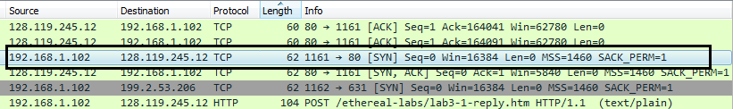
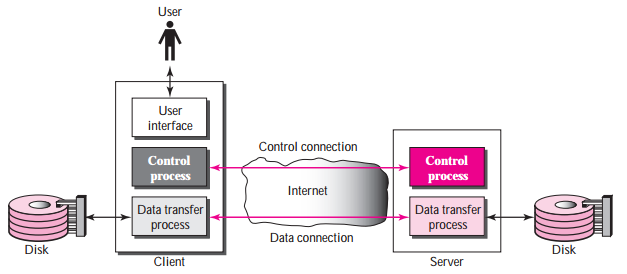
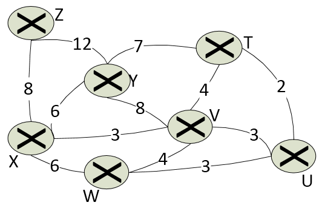
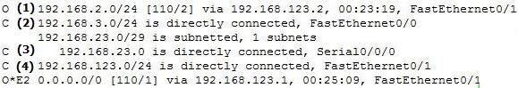
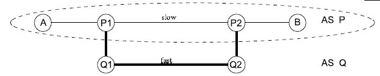
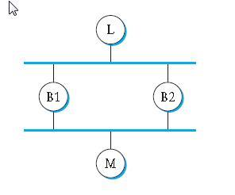

# 191.pdf

> 10 trang

## Trang 1

ĐỀ THI CUỐI KỲ – HK1 2019/2020
  Họ Tên:.............................................                                    MÔN: MẠNG MÁY TÍNH
    MSSV:...............................................           Ngày thi: 02/01/2020 - Thời gian: 90 phút

Ghi chú :

               •  Sinh viên không được phép sử dụng tài liệu
               •  Mỗi câu hỏi, chỉ chọn một câu trả lời đúng nhất
               •  Sinh viên phải sử dụng giấy trả lời trắc nghiệm cho phần trả lời
               •  Sinh viên phải ghi Họ Tên, MSSV lên đề thi và nộp trở lại

           Giảng viên ra đề               Chủ nhiệm Bộ môn/Trưởng Khoa

   Câu 1.   (L.O.2.2) An có địa chỉ email tại server mail A, Bình có địa chỉ email tại server mail B. An sử
      dụng trình duyệt web để truy cập vào email của mình và gửi email cho Bình. Bình sử dụng chương
        trình đọc mail có sử dụng giao thức POP3 để truy cập vào mail server của mình. Bạn hãy cho biết
       phát biểu nào sau đây có thể miêu tả đúng nhất về quá trình gửi và đọc email này.

A. Email của An được gửi từ server mail A đến server mail B thông qua giao thức SMTP, ngay sau khi nhận
được email, server mail B gửi nội dung email đến chương trình đọc mail của Bình thông qua giao thức
POP3.
B. Email của An được gửi từ server mail A đến server mail B thông qua giao thức SMTP, ngay sau khi nhận
được email, server mail B gửi nội dung email đến chương trình đọc mail của Bình thông qua giao thức HTTP
hoặc HTTPS khi có yêu cầu từ chương trình đọc email.
C. Email của An được trình duyệt web gửi lên server mail A thông qua giao thức HTTP hoặc HTTPS. Server
mail A sẽ gửi nội dung email đến server mail B thông qua giao thức SMTP. Sau đó server mail B sẽ chuyển
mail đến chương trình đọc mail của Bình thông qua giao thức POP3.
D. Email của An được trình duyệt web gửi lên server mail A thông qua giao thức HTTP hoặc HTTPS. Server
mail A sẽ gửi nội dung email đến server mail B thông qua giao thức SMTP. Sau đó server mail B sẽ chuyển
mail đến chương trình đọc mail của Bình thông qua giao thức HTTPS hoặc HTTPS.

   Câu 2.   (L.O.3.1) UDP socket có thể nhận dữ liệu từ:

A. Chỉ một UDP socket                              B. Nhiều UDP socket
C. Chỉ một TCP socket                             D. TCP hoặc UDP socket

   Câu 3.   (L.O.1.1) Trong mô hình TCP/IP, kiến trúc truyền thông dạng Client-Server được hiện thực ở
       tầng nào?

A. Ứng dụng (Application)  B. Vận chuyển (Transport)  C. Mạng (Internet)   D. Host-to-Netwok

   Mã đề: 1911                                                                     1

## Trang 2

Câu 4.   (L.O.1.1) Giao thức SMTP được sử dụng trong các ứng dụng thư điện tử (email). SMTP dùng
     mô hình Client-Server, trong đó Client (hay User Agent – UA) gởi và nhận email thông qua Mail
       Server (hay Message Transfer Agent – MTA). Giao thức này KHÔNG được dùng trên kết nối:

A. Sender UA gởi email đến Sender MTA
B. Sender UA gởi email trực tiếp đến Recipient MTA
C. Sender MTA và Recipient MTA
D. SMTP không được dùng trên tất cả các kết nối trong A), B), C)

   Câu 5.   (L.O.1.1) Chọn câu SAI trong các phát biểu sau đây:

A. Thiết bị mạng Repeater khuếch đại tín hiệu ở cổng vào và chuyển tín hiệu đến tất cả các cổng ra
B. Thiết bị mạng Hub có thể hiệu chỉnh tốc độ tối đa khác nhau cho từng port kết nối máy tính vào
C. Thiết bị mạng Switch được thiết kế để các ports trên Switch không xảy ra đụng độ
D. Thiết bị mạng Router TCP/IP có hiện thực đầy đủ chức năng của tầng Host-to-network và tầng Internet

   Câu 6.   (L.O.1.2) Giả sử ta có một gói tin truyền từ host A đến host B thông qua hai bộ chuyển mạch
       (switch) lắp nối tiếp nhau. Tốc độ truyền dữ liệu từ host A đến switch và từ switch về host B là R,
       tốc độ truyền dữ liệu giữa hai switch gấp 3 lần tốc độ truyền dữ liệu từ host đến switch. Giả sử rằng
       switch hoạt động theo cơ chế “store-and-forward packet switching”. Bạn hãy cho biết tổng thời gian
      để chuyển hết gói tin có chiều dài L từ A đến B là bao nhiêu? (bỏ qua tất cả các thời gian trễ tại
       switch và thời gian lan truyền tín hiệu trong dây dẫn)

A. L /5R                 B. 7L/3R                  C. 5R /L                  D. 7R/5L

   Câu 7.   (L.O.1.2) Những thiết bị nào trong các thiết bị sau thuộc vùng biên mạng (network edge)

A. Máy tính (computer), Điện thoại thông minh (smartphone), Laptop (máy tính xách tay)
B. Máy tinh (computer), Bộ chuyển mạch (switch), Bộ định tuyến (router)
C. Điện thoại thông minh (smartphone), Điểm đa truy cập (access point), Bộ định tuyến (router)
D. Bộ chuyển mạch (switch), Dây dẫn, Bộ định tuyến (router)

   Câu 8.   (L.O.1.2) Mất bao nhiêu thời gian để chuyển một đoạn dữ liệu có kích thước 1 280 000 bits từ
       host A sang host B trong network? Giả sử rằng tất cả các đường truyền trong network sử dụng
      phương thức chia kênh truyền theo thời gian (TDM) với 24 khung thời gian (time slot) và tốc độ
      đường truyền là 7,680 Mbps (bỏ qua thời gian thiết lập kết nối từ host A đến host B).

A. 0.17 giây              B. 4 giây            C. 10 giây                D. 17 giây

   Câu 9.   (L.O.1.2) Giả sử rằng có một nhóm 4 người sử dụng chung kênh truyền với tốc độ đường
       truyền là R Mbps, nhưng khi sử dụng kênh truyền thì tốc độ của một người dùng chỉ đạt R/4 Mbps
      và thời gian của một người sử dụng kênh truyền là 30%. Bạn hãy cho biết xác suất tại một thời điểm
       bất kỳ nào đó mà cả 4 người đều đồng thời sử dụng kênh truyền là bằng bao nhiêu?

A. 0.0256                       B. 0.0081           C. 0.3                    D. 0.09

   Câu 10. (L.O.2.1) Trong một mạng (network), một tiến trình (process) đang chạy trên một thiết bị đầu
       cuối (host A) sử dụng thông tin nào trong các thông tin sau để xác định một tiến trình (process) đang
      chạy ở một thiết bị đầu cuối khác (host B).

A. IP của host A và cổng (port) của socket trong process đang chạy ở host A

   Mã đề: 1911                                                                     2

## Trang 3

B. IP của host B và cổng (port) của socket trong process đang chạy ở host B
C. Cổng (port) của socket trong process đang chạy ở host A
D. Cổng (port) của socket trong process đang chạy ở host B

   Câu 11. (L.O.2.1) Sử dụng phần mềm Wireshark để bắt gói tin ta thu được thông tin của gói tin (gói
         tin trong khung hình chữ nhật) như sau:

Bạn hãy cho biết phát biểu nào sau đâu là ĐÚNG?
A. Đây là gói tin gửi yêu cầu nội dung của một trang web
B. Đây là gói tin được sử dụng trong quá trình tạo kết nối
C. Đây là gói tin được sử dụng trong quá trình yêu cầu ngắt kết nối
D. Đây là gói tin quảng bá (broadcast)

   Câu 12. (L.O.2.2) Chọn phương pháp ĐÚNG để gán (assign) một port của Switch cho một VLAN?

A. Cấu hình Port đó cố định cho một VLAN
B. Dựa vào địa chỉ MAC của máy kết nối vào Port đó
C. Dựa vào địa chỉ IP của máy kết nối vào Port đó
D. Tất cả các phương pháp A), B), C)

   Câu 13. (L.O.2.2) Cho một mô hình như hình sau:

Bạn hãy cho biết đây có thể là mô hình của ứng dụng nào trong các ứng dụng sau
A. FTP                  B. Web Server             C. Skype                 D. Torrent

   Câu 14. (L.O.2.2) Chọn câu trả lời ĐÚNG về các công nghệ được sử dụng trên các đường truyền (links)
      dạng LAN, MAN, WAN?

A. Mạng cục bộ LAN theo chuẩn IEEE 802.3 (Ethernet) chỉ khai thác đường truyền dùng cáp đồng xoắn
(twisted pair)
B. Mạng WAN sử dụng công nghệ ATM là một mạng hướng kết nối và có độ dài đơn vị dữ liệu không đổi
C. Công nghệ ADSL là công nghệ duy nhất khai thác đường truyền của hệ thống điện thoại, viễn thông
PSTN

   Mã đề: 1911                                                                     3

## Trang 4

D. SONET/SDH là một phương pháp phân chia kênh truyền trên đường truyền dạng WAN sử dụng cáp
quang

   Câu 15. (L.O.2.2) Khi sử dụng lệnh nslookup thihockymmt.hcmut.edu.vn ta thu được kết quả như sau:

      nslookup thihockymmt.hcmut.edu.vn
      Server: wifi-cse.hcmut.edu.vn
      Address: 172.28.211.1

     *** wifi-cse.hcmut.edu.vn can't find thihockymmt.hcmut.edu.vn: Non-existent domain

Kết quả được hiển thị ở trên cho biết:
A. Địa chỉ IP của máy tính hiện tại
B. Địa chỉ IP của DNS server trả lời câu truy vấn
C. Địa chỉ IP của domain thihockymmt.hcmut.edu.vn
D. Domain thihockymmt.hcmut.edu.vn còn có tên khác là wifi-cse.hcmut.edu.vn

   Câu 16. (L.O.3.1) Host A gửi 2 phân đoạn (segment) TCP back to back đến host B thông qua kết nối
      TCP. Phân đoạn thứ nhất có SEQ là 190, phân đoạn thứ 2 có SEQ là 210. Giả sử rằng phân đoạn thứ
       nhất bị mất, phân đoạn thứ 2 đến được host B. Bạn hãy cho biết giá trị của ACK phản hồi về máy
     A?

A. 190                   B. 210                    C. 20              D. Một giá trị bất kỳ

   Câu 17. (L.O.3.1) Khi gửi một file có kích thước 𝐿= 216 bytes từ host A sang host B thông qua kết
       nối TCP với kích thước lớn nhất của phân đoạn (MSS) là 512 bytes và tổng số bytes mào đầu (header)
      được thêm vào mỗi gói tin trong quá trình gửi dữ liệu là 56 bytes. Bạn hãy cho biết tổng số bytes
      được gửi từ host A sang host B trong trường hợp này là bao nhiêu?

A. 65536 bytes           B. 65592 bytes             C. 72704 bytes            D. 70720 bytes

   Câu 18. (L.O.3.1) Bạn hãy cho biết giá trị TimeoutInterval là bao nhiêu, nếu ta biết được giá trị của
      SampleRTT là 106 ms, alpha = 0,125, beta = 0,25 và EstimatedRTT của lần gửi gói tin trước đó là
      100ms?

A. 120,99 ms             B. 100,75 ms              C. 5,06 ms                D. 103,15 ms

   Câu 19. (L.O.3.1) Trên đường truyền có tốc độ 10Mbps chỉ có một duy nhất một kết nối TCP, kích
       thước của segment bằng 1500 bytes, thời gian lan truyền dữ liệu 2 chiều của kết nối này là 150 msec.
      Bạn hãy cho biết giá trị lớn nhất của “maximum window size” trong segment có thể đạt được lớn
      hơn bao nhiêu lần kích thước segments? (Giả sử rằng bên gửi một file có kích thước rất lớn và buffer
       của bên nhận có kích thước lớn hơn congestion window)

A. 125                   B. 100                    C. 150                   D. 10

   Câu 20. (L.O.3.1) Giả sử DNS Server có địa chỉ IP là X nhận được một yêu cầu từ DNS Client thông
      qua UDP datagram và Server cũng phản hồi lời yêu cầu đó bằng một gói tin thông qua UDP
       datagram. Nếu Client B sử dụng IP giả mạo Y của một DNS Client khác thay vì địa chỉ IP của mình
        là Z thì DNS Server sẽ gửi gói tin phản hồi về địa chỉ IP nào?

   Mã đề: 1911                                                                     4

## Trang 5

A. IP: Y                 B. DNS Server không gửi được gói tin về Client vì xác định được IP giả mạo
C. IP: Z                 D. DNS Server không phản hồi vì DNS Server không sử dụng giao thức UDP

   Câu 21. (L.O.3.1) UDP header có giá trị ở dạng hexadecimal như sau: CB84000D001C001C

Bạn hãy cho biết giá trị của cổng nguồn (source port) trong trường hợp này là bao nhiêu?
A. 8400                  B. 84                     C. 52100                 D. 3201

   Câu 22. (L.O.3.1) UDP header có giá trị ở dạng hexadecimal như sau: CB84000D001C001C

Bạn hãy cho biết tổng kích thước của gói tin UDP trong trường hợp này là bao nhiêu?
A. 8                     B. 10                    C.28                     D. 18

   Câu 23. (L.O.3.1) Kích thước của gói tin UDP không thể lớn hơn bao nhiêu bytes?

A. 1028 bytes             B. 2048 bytes              C. 6000 bytes             D. 65536 bytes

   Câu 24. (L.O.3.1) Trường thông tin nào có trong header của UDP và cả trong header của TCP?

A. Cổng nguồn, cổng đích và checksum              B. Cổng nguồn, cổng đích và số ACK
C. Cổng nguồn, cổng đích và số SEG               D. Cổng nguồn, cổng đích và chiều dài của header

   Câu 25. (L.O.4.1) Cho network như hình bên dưới. Đường đi ngắn nhất từ z đến u theo giải thuật
       Dijkstra là:

A. Z -> Y -> T -> U                           B. Z -> Y-> V-> U
C. Z -> X -> W -> U                         D. Z -> X -> V - > U

   Câu 26. (L.O.4.1) Một datagram network sử dụng 32-bit làm địa chỉ. Giả sử rằng router có 4 giao diện
       (4 link interfaces) được đánh số từ 0 đến 3, các gói tin được chuyển đến các interface theo bảng định
       tuyến sau:

               Destination Address Range                             Link Interface
             11001000      00010111      00010000      00000000   0
               through
             11001000 00010111 00010111 11111111
             11001000      00010111      00011000      00000000   1
               through
             11001000 00010111 00011000 11111111
             11001000      00010111      00011001      00000000   2
               through
             11001000 00010111 00011111 11111111
              Otherwise                                             3
   Mã đề: 1911                                                                     5

## Trang 6

Khi một gói tin có địa chỉ IP của đích đến là 200.23.24.170 đi vào router thì sẽ được router chuyển qua
interface nào?
A.0                      B. 1                      C. 2                     D.3

   Câu 27. (L.O.4.1) Hãy cho biết sự khác nhau cơ bản giữa router và link-layer switch:

A. Địa chỉ MAC được sử dụng trong việc xác định cổng ra của khung tin trong link-layer switch. Địa chỉ IP
đích được sử dụng trong việc xác định cổng ra của gói tin trong router
B. Bảng liên kết giữa điạ chỉ MAC và cổng ra trong link-layer switch do nhà quản trị mạng thiết lập. Bảng
định tuyến trong router luôn luôn được tạo ra bằng giải thuật RIP.
C. Trong link-layer switch, cổng ra của gói tin được xác định ngẫu nhiên. Trong router, địa chỉ IP của cổng
nguồn được sử dụng trong việc xác định cổng ra của gói tin
D. Router là một tên gọi khác của link-layer switch.

   Câu 28. (L.O.4.1) Hãy cho biết đâu là 3 chức năng quan trọng trong virtual-circuit network?

A. call setup, forwarding và routing                    B. forwarding, routing và sending
C. sending, network control và congestion control       D. Không tồn tại virtual-circuit network

   Câu 29. (L.O.4.1) Giao thức OSPF (Open Shorted Path First) sử dụng giải thuật:

A. Distance vector                                         B. Link state
C. Cả Distance vector và Link state                   D. Không sử dụng các giải thuật trên

   Câu 30. (L.O.4.1) Phát biểu nào sau đây SAI khi nói về IPv6 header:

A. Độ dài của IPv6 header không thay đổi so với độ dài của IPv4.
B. Header của IPv6 có ít trường thông tin hơn header của IPv4.
C. Header của IPv6 sử dụng 128 bits để chứa địa chỉ của nguồn.
D. Cả (A), (B) và (C) đều đúng.

   Câu 31. (L.O.2.1) Cookies không chứa nội dung gì trong các nội dung sau?

A. Thông tin ủy quyền
B. Mã lỗi trả về từ phía máy chủ
C. Giỏ mua sắm trực tuyến
D. Trạng thái phiên làm việc người dùng (Web e-mail)

   Câu 32. (L.O.4.2) Phát biểu nào sau đây là ĐÚNG khi đề cập đến giao thức định tuyến RIP:

A. Router sẽ gửi gói tin quảng bá thông tin định tuyến đến tất cả các router khác trong cùng AS
B. Router chỉ gửi gói tin quảng bá thông tin định tuyến đến các router lân cận của nó
C. Router sẽ gửi gói tin quảng bá thông tin định tuyến ra các router ngoài AS
D. Router chỉ gửi gói tin quảng bá thông tin cho những router nào mới gia nhập vào AS

   Câu 33. (L.O.4.2) Địa chỉ IP đầu và địa chỉ IP cuối của một network tương tứng là 146.102.29.0 và
       146.102.32.255. Bạn hãy cho biết số lượng IP trong network trên là bao nhiêu?

A. 255                   B. 256                    C. 512             D.1024

   Câu 34. (L.O.4.2) Cho địa chỉ IP 12.23.24.78/8. Bản hãy cho biết đâu là network mask của IP trên

A. 255.255.255.0          B. 255.255.0.0              C.255.0.0.0         D. 0.0.0.255
   Mã đề: 1911                                                                     6

## Trang 7

Câu 35. (L.O.4.2) Một máy trong một mạng con (subnet) có địa chỉ IP là 110.23.120.14/20. Bạn hãy
      cho biết đâu là địa chỉ IP bắt đầu của mạng con này?

A.110.23.120.0/20                                   B. 110.23.112.0/20
C. 110.23.120.14/20                         D. 110.23.112.14/20

   Câu 36. (L.O.4.2) Một máy trong một mạng con (subnet) có địa chỉ IP là 110.23.120.14/20. Bạn hãy
      cho biết đâu là địa chỉ IP cuối của mạng con này?

A. 110.23.120.255/20                                B. 110.23.127.255/20
C. 110.23.120.14/20                         D. 110.23.112.255/20

   Câu 37. (L.O.4.2) Địa chỉ nào sau đây KHÔNG phải là định dạng địa chỉ của IPv4?

A. 11.10.10.20            B. 111.56.45.78            C. 221.34.7.8       D. 192.168.256.255

   Câu 38. (L.O.4.2) Địa chỉ IP nào trong các địa chỉ IP sau thuộc lớp C (class C)

A. 227.12.14.87           B. 200.14.56.22            C. 14.23.120.8      D. 252.5.15.111

   Câu 39. (L.O.4.2) Số bước nhảy (hop) tối đa mà gói tin định tuyến RIP có thể đi được là bao nhiêu?

A. 10             B.15         C.25           D. không xác định

   Câu 40. (L.O.4.2) Giao thức nào định tuyến nào trong các giao thức sau có thể được sử dụng trong các
        router thuộc AS khác nhau?

A. RIP                   B. OSPF                  C. BGP                  D. IP

   Câu 41. (L.O.4.2) Trong khi cấu hình định tuyến theo OSPF ta sử dụng câu lệnh: network 192.168.0.0
        0.0.0.3. Bạn hãy cho biết có bao nhiêu IP được đưa vào tiến trình định tuyến OSPF trong hợp này?

A. 2                     B. 3                C. 65534                 D. Không xác định

   Câu 42. (L.O.4.2) Giả sử rằng X là số của vlan (vlan id). Câu lệnh nào có thể được sử dụng trong quá
        trình cấu hình VLAN cho một giao diện (interface)?

A. vlan X          B. swithport access vlan X         C. vlan name        D. show vlan X

   Câu 43. (L.O.4.2) Sau khi thực hiện lệnh: sh ip route trên router ta thu được kết quả:

Bạn hãy cho biết đâu là dòng kết quả cho biết router có cấu hình OSPF?
A. dòng 1                B. dòng 2                  C. dòng 3                 D. dòng 4

   Câu 44. (L.O.4.2) Địa chỉ IPv6 nào là hợp lệ trong các địa chỉ sau?

A. 2043::1685:2123::1428:57ab                             B. 2043:99:ab:1:99:2:1:9
   Mã đề: 1911                                                                     7

## Trang 8

C. 2043:1428:57ab:1685:2123:1428:57ab                    D. 2043:99:ab:1:99:2:1:9h

   Câu 45. (L.O.4.2) Nguyên nhân nào sau đây có thể dẫn đến sự mất gói và tăng độ trễ trong bộ định
       tuyến?

A. Các gói tin cạnh tranh nhau trong qua trình truyền tải
B. Tốc độ đầu vào vượt quá tốc độ đầu ra
C. Bộ định tuyến không tương thích với các thiết bị còn lại
D. Trong mạng có quá nhiều thiết bị sử dụng mạng

   Câu 46. (L.O.5.1) Trong mạng Ethernet sử dụng CSMA/CD, sau lần đụng độ thứ 4 thì xác suất để một
      node chọn hệ số K = 2 là bao nhiêu?

A. 1/2                          B. 1/16             C. 1/4             D. Không xác định

   Câu 47. (L.O.5.1) Trong mạng Ethernet sử dụng CSMA/CD, sau lần đụng độ thứ 5, nếu một node chọn
    K = 8 thì thời gian chờ của node đó là bao nhiêu nếu đốc độ mạng là 5 Mbps?

A. 8,01 micro giây                                  B. 104,2 micro giây
C. 819,2 micro giây                          D. 200,4 micro giây

   Câu 48. (L.O.5.1) Không gian địa chỉ MAC có thể có là bao nhiêu?

A. 232                     B. 248                     C. 264                   D. 2128

   Câu 49. (L.O.5.1) Kích thức nhỏ nhất của Ethernet frame là bao nhiêu?

A. 18 bytes                     B. 46 bytes                C. 64 bytes         D. 128 bytes

   Câu 50. (L.O.5.2) Phương pháp truy cập nào được sử dụng trong Wireless LAN?

A. CSMA                B. CSMA/CD              C. CSMA/CA             D. CSMA/AB

   Câu 51. (L.O.5.2) Trong khung tin 802.11 có bao nhiêu vùng chứa địa chỉ?

A. 0              B. 2                      C. 3                     D. 4

   Câu 52. (L.O.6.1) Trojan có thể được lây nhiễm như thế nào?

A. Là phần ẩn của một phần mềm hữu dụng khi người dùng cài đặt
B. Lây nhiễm qua việc nhận thụ động đối tượng và có thể tự kích hoạt bản thân
C. Lây nhiễm qua việc nhận các đối tượng (vd: tập tin đính kèm trong e-mail), chạy độc lập và chủ động
D. Trojan không lây nhiễm

   Câu 53. (L.O.6.2) Được biết, giải thuật mã hóa công khai (public-key cryptography) được sử dụng để
       tạo ra chữ ký số. Trong qui trình này, khóa nào (công khai (public key), cá nhân (private key)) được
      sử dụng để tạo ra chữ ký?

A. Công khai
B. Cá nhân
C. Cả hai khóa đều được sử dụng
D. Không khóa nào được sử dụng

   Mã đề: 1911                                                                     8

## Trang 9

Câu 54. (L.O.6.3) Secure Socket Layer (SSL) sử dụng?

A. Duy nhất giải thuật Public-key              B. Sử dụng cả hai giải thuật Public-key và Symmetric-key
C. Duy nhất giải thuật Symmetric-key         D. Không sử dụng cả Public-key lẫn Symmetric-key

   Câu 55. (L.O.6.3) Giả sử một người trong nhóm N người muốn giao tiếp với tất cả (N – 1) người khác
      bằng cách sử dụng mã hóa khóa đối xứng. Tất cả các dữ liệu trao đổi giữa hai người bất kỳ m, n đều
       hiển thị cho tất cả những người khác trong nhóm N người này nhưng không ai khác ngoại trừ hai
      người m, n này có thể giải mã được giao tiếp. Bạn hãy cho biết có ít nhất bao nhiêu khóa được sử
      dụng trong hệ thống?

A. N             B. N*(N-1)/2              C. 2N              D. 1

   Câu 56. (L.O.6.3) Một mạng liên kết các AS (Autonomous System) như hình.

AS (P) chứa các hosts A, B và các routers P1, P2. AS (Q) chứa các routers Q1, Q2. Giả sử P và Q có 2
đường link tốc độ cao kết nối liên AS.
Giao tiếp giữa A và B được thực hiện thông qua đường link P1-P2 tốc độ thấp và thông qua đường link Q1-
Q2 sẽ đạt được tốc độ cao hơn. Bằng cách cài đặt giá trị thuộc tính (attribute) nào trong BGP để A và B có
thể sử dụng đường link qua Q1-Q2?
A. AS_PATH
B. LOCAL_PREF
C. COMMUNITY
D. Cả a) và b)

   Câu 57. (L.O.6.3) Khi một khung dữ liệu (frame) được chuyển đến một LAN Switch và địa chỉ máy
       đích không có trong bảng địa chỉ MAC (MAC address table) thì switch trên sẽ làm gì?

A. Chuyển frame đến cổng đầu tiên sẵn sàng (available)
B. Chuyển frame đến tất cả các cổng ngoại trừ cổng mà frame đến
C. Gởi thông điệp ngược lại nguồn gởi frame để hỏi địa chỉ đích đến
D. Loại bỏ frame

   Câu 58. (L.O.3.3) Trong trường hợp các thiết bị mạng có thể xảy ra sự cố bất cứ lúc nào, để tăng tính
      an toàn và hoạt động liên tục của một mạng cục bộ (LAN), thông thường thì mạng LAN được thiết
      kế theo dạng Redundancy như sau:

   Mã đề: 1911                                                                     9

## Trang 10

M, L là các hosts. B1, B2 là các bridges. Chọn câu trả lời ĐÚNG?
A. M lúc nào cũng gởi được truy vấn (request) cho L, và L luôn gởi phản hồi (response) thành công cho M
B. Nếu B1 và B2 đều là các Hubs thì phải dùng giải thuật STP (Spanning Tree Protocol)
C. Mạng hoạt động ổn định khi trên các Bridges có hiện thực giải thuật STP
D. Mạng được thiết kế như vậy sẽ không bao giờ hoạt động được

   Câu 59. (L.O.3.3) Trong giao thức IPv4, chức năng của ARP sẽ tìm địa chỉ MAC (hardware address)
      tương ứng với địa chỉ IP của máy đích. Giao thức IPv6 sẽ dùng ARP như thế nào?

A. ARP được phát triển ở version 6.
B. ARP được hiện thực ở tầng ứng dụng, tầng Mạng sẽ không quan tâm đến chức năng này.
C. Không tồn tại giao thức ARP trong IPv6.
D. Tất cả các máy giao tiếp IPv6 đều không dùng địa chỉ MAC (hardware address).

   Câu 60. (L.O.3.3) Vấn đề nào sau đây cần quan tâm khi cài đặt cấu hình cho một Switch?
A. Cung cấp địa chỉ IP trên mỗi port
B. Khởi tạo giá trị ban đầu cho Bảng định tuyến (routing table)
C. Ấn định mỗi port sẽ dùng cho các ứng dụng khác nhau
D. Tốc độ truyền tải tương thích với các thiết bị kết nối (10/100/1000 Mbps)

           ======================== HẾT =========================

   Mã đề: 1911                                                                    10

