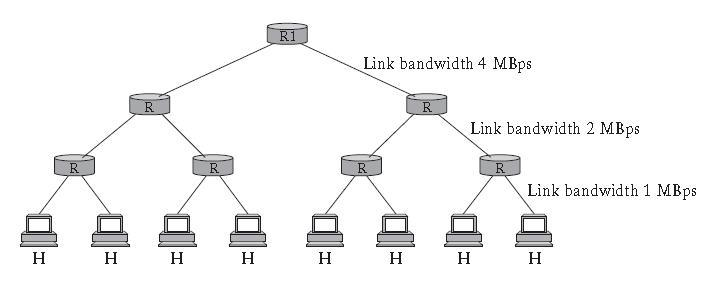
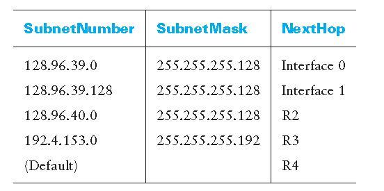
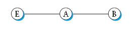
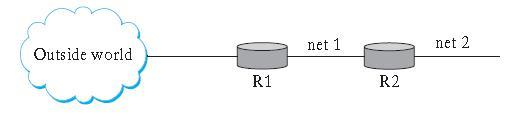

# 2009.pdf

> 8 trang

## Trang 1

Họ tên: ………………………………………..       ĐỀ KIỂM TRA CUỐI KỲ
                              MÔN MẠNG MÁY TÍNH 1 MSSV:………………………………...............
                                      Ngày thi: 16/06/2009  - Thời gian: 90 phút

Ghi chú :  - Sinh viên chỉ được phép sử dụng các tài liệu sau: bài giảng, sách và tập ghi chép
              - Mỗi câu hỏi, chỉ chọn một câu trả lời đúng nhất
              - Sinh viên phải sử dụng giấy trả lời trắc nghiệm cho phần trả lời
              - Sinh viên phải ghi tên và MSSV lên đề thi và nộp trở lại

                       ĐỀ 0001

Câu 1: Chọn phát biểu đúng về DNS:
  A. Mỗi Name Server chỉ phục vụ cho đúng một tên miền (Domain Name)
   B. Mỗi tên miền (Domain Name) được phục vụ bởi đúng một Name Server
  C. Một Name Server có thể phục vụ nhiều tên miền (Domain Name) khác nhau
  D. Tất cả tên miền (Domain Name) trên Internet đều được quản lý bởi duy nhất một Name Server
Câu 2: Ứng dụng nào sau đây phù hợp nhất với UDP :
  A. Video conference                        B. Truyền tải file qua mạng
  C. Thanh toán qua mạng                    D. Truyền tải email qua mạng
Câu 3: Xác định cách viết địa chỉ IP nào sau đây không đúng :
  A. 192.168.1.100      B. 192.168.1.100/24   C. 192.168.1::100     D. 192:168:1::100
Câu 4: Xem xét sơ đồ mạng như sau:

  Giả sử các routers có khả năng xử lý nhanh tất cả các dữ liệu đến và các đường links đều là dạng
full-duplex. Các routers nào sau đây có thể sẽ bị vấn đề tắc nghẽn (congestion) ở đường link output ?
  A. Tất cả các Routers
   B. Không có Router nào xảy ra vấn đề tắc nghẽn
  C. Tất cả các Router kết nối với đường link 2 Mbps
  D. Tất cả các Routers kết nối với đường link 4 MBps
Câu 5: Jitter cao ảnh hưởng nhiều nhất với loại ứng dụng nào sau đây:
  A. Email                                  B. Trình duyệt web
  C. Truyền tải file                          D. Hội thoại trực tuyến
Câu 6: Cho một subnet có sơ đồ như hình vẽ:

                                                                      Trang 1/8 - Mã đề thi 0001

## Trang 2

B           C

  A                 D

          F          E

  Giả sử giải thuật định tuyến Distance Vector Routing được sử dụng. Router C nhận được các
vector thông tin về delay (khoảng cách) từ các router B (5, 0, 8, 12, 6, 2), từ D (16, 12, 6, 0, 9, 10) và
từ F (7, 6, 3, 9, 4, 0). Mỗi vector biểu diễn thông tin về delay từ chính router gửi đến các router trong
mạng theo thứ tự ABCDEF. Delay từ C đến B, D và F đo được lần lượt là 6, 3 và 5. Hỏi, trong bảng
routing của C sau khi được cập nhật lại, delay từ C đến E là bao nhiêu, và đường đi phải qua router
nào trước?
  A. 12 – đi qua D       B. 12 – đi qua B      C. 7 – đi qua F        D. 9 – đi qua F
Câu 7: Cho đoạn mã sau:

      import java.net.*;
      public class XServer {
         public static void main(String[] args){
            ServerSocket theServer;
            Socket conn;
            try {
               theServer = new ServerSocket(7654);
               conn = theServer.accept();
               //doing something
               conn.close();
               theServer.close();
            }catch (Exception e) {
               System.err.println(e);
            }
         }
      }

  Với đoạn mã trên, trong một lần chạy, XServer có thể phục vụ tối đa:
  A. Không giới hạn số lượng client            B. 1 client
  C. 2 client                               D. Tất cả đều sai
Câu 8: Trong mô hình OSI, TCP và UDP thuộc tầng :

  A. Application        B. Transport          C. Data link          D. Network
Câu 9: Lớp (class) InetAddress được dùng:
  A. Cho các địa chỉ của ứng dụng trên máy tính
   B. Để quản lý kết nối giữa các ứng dụng trong Java
  C. Quản lý địa chỉ của một server trên Internet
  D. Cho các địa chỉ của máy tính trên Internet
Câu 10: Một router được thiết lập Bảng định tuyến như sau:

                                                                      Trang 2/8 - Mã đề thi 0001

## Trang 3

Một gói dữ liệu được gởi đến router này với địa chỉ IP nguồn là: 192.4.153.90. Router sẽ gởi gói
đến:
  A. R4                                     B. Interface 0
  C. R3                                   D. Tất cả đều không đúng
Câu 11: Khi so sánh Virtual-Circuit subnets với IP Datagram subnets:
  A. Virtual-Circuit subnets có thể đảm bảo chất lượng dịch vụ tốt hơn
   B. Khi xảy ra sự cố ở một Router nào đó trên đường truyền, khả năng phục hồi của Virtual-Circuit
subnets tốt hơn
  C. Virtual-Circuit subnets luôn cho throughput cao hơn IP Datagram subnets
  D. Tất cả đều đúng
Câu 12: Tầng nào trong mô hình OSI quyết định đường đi của các gói dữ liệu trong một subnet ?
  A. Physical           B. Datalink          C. Network          D. Transport
Câu 13: Ưu điểm của dịch vụ không kết nối (Connectionless service) khi so sánh với dịch vụ hướng
kết nối (Connection-oriented service) là:
  A. Giải quyết tắt nghẽn tốt hơn
   B. Chất lượng dịch vụ có thể được đảm bảo
  C. Không mất thời gian thiết lập và quản lý kết nối
  D. Độ tin cậy cao
Câu 14: Secure Socket Layer (SSL) thuộc tầng nào trong mô hình OSI?
  A. Application                             B. Transport
  C. Network                              D. SSL không tồn tại trong OSI
Câu 15: Một máy tính trong một mạng 6 Mbps được điều chỉnh bằng một token bucket. Tốc độ dữ
liệu đổ vào token bucket là 1 Mbps. Token bucket ban đầu đang ở trạng thái đầy với 8 Mb. Hỏi máy
tính có thể truyền dữ liệu với tốc đa là 6 Mbps trong bao lâu?
  A. 1,6 giây           B. 4/3 giây           C. 8/7 giây           D. 8 giây
Câu 16: Multi-Thread được sử dụng trong mô hình lập trình Client-Server với mục đích gì?
  A. Để Client có thể được phục vụ bởi nhiều Servers
   B. Để Server có thể phục vụ được đồng thời nhiều Clients
  C. Để Server có thể phục vụ nhiều Clients
  D. Để Client có thể phục vụ đồng thời nhiều Servers
Câu 17: Ứng dụng nào sau đây phù hợp với dịch vụ hướng không kết nối (Connectionless service)
  A. Trình duyệt web                         B. Hệ thống hội thảo video trực tuyến
  C. Hệ thống thanh toán qua mạng            D. Email
Câu 18: Địa chỉ IPv4 nào sau đây thuộc cùng một subnet với địa chỉ 192.168.1.28/27 ?
  A. 192.168.1.168      B. 192.168.1.135      C. 192.168.1.35       D. 192.168.1.18
Câu 19: Trong lập trình Web, JSP là:
  A. Một ngôn ngữ lập trình Web phía client     B. Một Web browser plugin
  C. Là một sản phẩm của Microsoft           D. Là từ viết tắt của Java Server Page
Câu 20: Trong mạng máy tính, cổng (port) dùng để xác định :
  A. Địa chỉ của một ứng dụng trên internet
   B. Địa chỉ của một máy tính trên internet
  C. Địa chỉ của một ứng dụng trên một máy tính
  D. Giao thức trao đổi thông tin giữa các ứng dụng trong mô hình client-server
Câu 21: Đoạn mã sau dùng để:

          <?php
                session_start();
                $_SESSION=array();
                session_destroy();
          ?>

  A. Tạo một Web session trong PHP
   B. Khởi tạo và đóng một Web session trong PHP
  C. Xóa một Web session trong Perl
                                                                      Trang 3/8 - Mã đề thi 0001

## Trang 4

D. Xóa một Web session trong PHP
Câu 22: Một mạng trên Internet có subnet mask là 255.255.240.0. Hỏi mạng này có thể có tối đa bao
nhiêu máy (host) ?
  A. 1024              B. 4096             C. 3072             D. 2048
Câu 23: Cho một DNS record như sau:

       hcmut-server.hcmut.edu.vn. 86400    IN    A     172.28.2.2

  Chọn phát biểu đúng:
  A. Thời gian sống của record là 1 ngày
   B. Record trên thuộc kiểu “Additional”
  C. Địa chỉ IP của tên miền “www.hcmut.edu.vn” là 172.28.2.2
  D. Tất cả đều sai
Câu 24: Phần TCP Header có vùng Sequence Number Field với độ dài 32 bits. Như vậy có thể đánh
số thứ tự cho (232 – 1) ≈ 4 tỷ bytes dữ liệu. Con số này rất lớn cho mỗi lần kết nối. Như vậy có thể
vẫn có những dãy số thứ tự không bao giờ được dùng. Trên thực tế số Sequence Number vẫn có thể
sử dụng cả số (232 – 1) và 0. Tại vì:
  A. Cả hai Transport Entities sẽ thỏa thuận một số Sequence Number cho mỗi lần kết nối, không
nhất thiết phải bắt đầu từ 0
   B. Sender dùng số từ lớn tới nhỏ và Receiver dùng số từ nhỏ tới lớn
  C. Số Sequence được dùng từ số lớn nhất đến số nhỏ nhất
  D. Lần kết nối nào thì số dữ liệu cần truyền cũng vượt (232 – 1) bytes
Câu 25: Trong cấu hình của Switch 24-port sử dụng cấu trúc VLANs:
  A. Chúng ta có thể ấn định nhiều VLANs khác nhau cho mỗi port
   B. Mỗi port dùng cho 1 VLAN
  C. Tất cả các port phải dùng cùng 1 VLAN
  D. Tất cả các câu trả lời trên đều không đúng
Câu 26: Một địa chỉ IPv4 là 192.168.1.1 có biểu diễn dưới dạng địa chỉ IPv6 là:
  A. ::C0A8:0101       B. ::C0:A8:01:01      C. :192.168.1.1:       D. ::192.168.1.1:
Câu 27: Chức năng của default gateway trong bảng định tuyến (Routing Table) là:
  A. Chỉ định đến địa chỉ tiếp theo (next hop) của gói dữ liệu nếu router hay host không biết đường
gởi đến đích
   B. Dùng để ấn định subnet mặc định cho mạng LAN
  C. Dùng xác định địa chỉ nguồn cho tất cả các gói dữ liệu gởi ra ngoài
  D. Là địa chỉ NAT của firewall khi kết nối các máy tính vào Internet
Câu 28: Độ trể delay ảnh hưởng đến hiệu năng Performance của Mạng máy tính. Ứng dụng nào sau
đây được cho là nghiêm trọng khi độ trể lớn, nếu các bạn sử dụng Internet:
  A. Gởi một thư điện tử email                 B. Copy một file dữ liệu
  C. Sử dụng trình duyệt Web                 D. Sử dụng chat voice qua mạng
Câu 29: SMTP sử dụng giao thức nào dưới đây của tầng Transport để truyền tải email:
  A. FTP               B. MTP             C. TCP              D. UDP
Câu 30: Cho bảng định tuyến dưới đây, sử dụng giải thuật CIDR (Classless InterDomain Routing) :
       -----------------------------
        Net/Mask Length     Next Hop
       -----------------------------
        196.80.0.0/12        A
        196.94.16.0/20       B
        196.96.0.0/12        C
        196.104.0.0/14       D

  Hỏi địa chỉ đến kết tiếp (Next Hop) là gì nếu địa chỉ IP đích là 196.109.49.46?
  A. A                 B. D                C. B                D. C
Câu 31: Cho đoạn mã HTML sau:

                                                                      Trang 4/8 - Mã đề thi 0001

## Trang 5

<ol>
          <li> Hàng thứ nhất </li>
          <li> Hàng thứ ba </li>
          <li> Hàng thứ hai</li>
          </ol>

  Khi hiển thị trên một Web browser, kết quả là:
  A. Một danh sách được đánh số thứ tự         B. Một danh sách không được đánh số thứ tự
  C. Các hàng sẽ được viết tự do              D. Tất cả đều sai
Câu 32: Một công ty BBB có 2 nhà máy sản xuất ở khoảng cách rất xa và 6 văn phòng bán hàng ở
các vị trí khác nhau. Mỗi văn phòng bán hàng cần có 25 địa chỉ IP. Mỗi nhà máy sản xuất cần 215 địa
chỉ IP. Kế hoạch phát triển của công ty cần tăng 20% số lượng địa chỉ IP. Tổng số subnet class C cần
thiết cho công ty này là bao nhiêu nếu mỗi vị trí có một subnet khác nhau?
  A. 9                 B. 10                C. 11               D. 12
Câu 33: Cho đoạn mã sau:

      import java.net.*;
      public class XServer {
         public static void main(String[] args){
            ServerSocket theServer;
            Socket conn;
            try {
               theServer = new ServerSocket(7654);
               while (true){
                   conn = theServer.accept();
                   //doing something
                   conn.close();
               }
               theServer.close();
            }catch (Exception e) {
               System.err.println(e);
            }
         }
      }

      Với đoạn mã trên, khi chạy, XServer có thể phục vụ tại một thời điểm tối đa:
  A. Không giới hạn số lượng client            B. 1 client
  C. 2 client                               D. 0 client
Câu 34: Trong phương pháp tạo chữ ký điện tử sử dụng giải thuật public-key, để tạo chữ ký người
gửi sẽ:
  A. Sử dụng private key của mình             B. Sử dụng public key của mình
  C. Sử dụng public key của người nhận        D. Sử dụng private key của người nhận
Câu 35: Trong mạng máy tính dạng switched network, chức năng chủ yếu của Spanning Tree
Protocol (STP) là dùng để:
  A. Cung cấp đường tối ưu nhất qua các switches đến máy destination
   B. Cung cấp đường duy nhất qua các switches đến máy destination
  C. Dùng để giải địa chỉ MAC ra IP và ngược lại
  D. Dùng ngăn chặn hình thành vòng lặp qua các switches
Câu 36: Secure Socket Layer (SSL) sử dụng
  A. Duy nhất giải thuật Symmetric-key
   B. Không sử dụng cả Public-key lẫn Symmetric-key
  C. Sử dụng cả hai giải thuật Public-key và Symmetric-key
  D. Duy nhất giải thuật Public-key
Câu 37: Địa chỉ IPv6: “0800:0000:0000:0000:0123:0000:0000:CDEF” có thể được biểu diễn bằng:
  A. 08::123::CDEF                          B. 800::123::CDEF
  C. 8::123:0000:0000:CDEF                 D. 800::123:0000:0000:CDEF

                                                                      Trang 5/8 - Mã đề thi 0001

## Trang 6

Câu 38: Cần bao nhiêu thời gian (giây) để truyền tải x KB trên đường truyền tốc độ y Mbps ?
  A. 8192.10-3.(x/y)     B. 10-3.(x/y)          C. 8192.10-6.(x/y)     D. 8. 10-3.(x/y)
* Câu 39: Một trong những ưu điểm khi sử dụng IMAP khi so sánh với POP3 là:
  A. Phù hợp hơn đối với người sử dụng hay di chuyển
   B. Thời gian kết nối ngắn hơn
  C. Dễ hiện thực hơn
  D. Sử dụng ít tài nguyên trên server hơn
Câu 40: Giải thuật Public-key sử dụng
  A. Duy nhất một khóa, mà khóa đó được giữ bí mật
   B. Sử dụng 2 khóa, và cả 2 khóa này được công bố rộng rãi
  C. Duy nhất một khóa, mà khóa đó được công bố rộng rãi
  D. Sử dụng 2 khóa, một trong 2 khóa này được công bố rộng rãi, còn khóa kia được giữ bí mật
Câu 41: Thông tin nào sau đây là địa chỉ IPv4 hợp lệ:
  A. 191.255.33.7       B. 208.151.256.0      C. 127.191.233.300    D. Tất cả đều đúng
Câu 42: Ưu điểm của giải thuật public-key so với giải thuật symmetric-key là:
  A. Dễ sử dụng và quản lý hơn                B. Thời gian xử lý nhanh hơn
  C. Mức độ an toàn cao hơn                 D. Tất cả đều đúng
Câu 43: Giả sử các Routers có chức năng Firewall được thiết kế như sau:

  Cấu hình như thế nào cho các Routers R1 và R2 sao cho:
  ✓  Cho phép các kết nối Telnet bên ngoài vào net2 (inbound của net2), và chặn tất cả các kết nối
Telnet vào các Host ở net1 (inbound của net1)

  Chặn các kết nối Telnet từ net2 đến net1 (outbound của net2 và inbound của net1)
  A. R1 và R2 đều chặn các kết nối Telnet
   B. R1 cho qua Telnet traffic, nhưng các Hosts của net1 không cài đặt Telnet, R2 chặn outbound
traffic
  C. R1 chặn inbound Telnet traffic, R2 chặn outbound Telnet traffic
  D. R1 chặn inbound Telnet traffic và forward Telnet traffic trên port kết nối đến R2, R2 chặn
outbound Telnet traffic
Câu 44: Khi phân giải từ tên miền sang địa chỉ IP sử dụng hệ thống DNS
  A. Ứng với mỗi tên miền chỉ có duy nhất một địa chỉ IP tương ứng
   B. Có thể có nhiều địa chỉ IP cho một tên miền
  C. Mỗi tên miền chỉ có thể được phục vụ bởi một DNS server duy nhất
  D. Tất cả đều sai
Câu 45: Một router wifi dùng cho gia đình được tích hợp modem ADSL, 4-port Switch, Router, Wifi
Access Point. Giải thuật kiểm tra lỗi trên đường truyền được dùng là Cyclic Redundancy Check
(CRC). Việc hiện thực giải thuật này nên ở tầng nào trong mô hình OSI là phù hợp:
  A. Tầng ứng dụng (Application)              B. Tầng vật lý (Physical)
  C. Tầng Datalink                          D. Tầng Mạng (Network)
Câu 46: Một subnet có sơ đồ đơn giản như sau:

  Các routers này trao đổi thông tin định tuyến dùng giải thuật “distance vector routing”. Trọng số
(cost) của các đường link đều là 1.
                                                                      Trang 6/8 - Mã đề thi 0001

## Trang 7

Giả sử đường link từ E sang A bị sự cố. Vấn đề gì sẽ xảy ra ?
  A. A và B được cập nhật thông tin nhanh chóng và hoạt động ổn định
   B. A biết vấn đề xảy ra, nhưng B thì không bao giờ biết.
  C. Routing loop sẽ xảy ra giữa A và B trong mọi trường hợp
  D. Routing loop sẽ xảy ra giữa A và B khi B gởi bảng thông tin Routing cho A trước khi A thông
báo cho B về đường link A-E
Câu 47: Trong lập trình Web, sự khác nhau giữa server-side-script và client-side-script là:
  A. Client-side-script được xử lý bởi cả Web server và Web browser, trong khi đó, server-side-
script chỉ được xử lý bởi các Web server
   B. Server-side-script được xử lý bởi các Web browser; client-side-script xử lý bởi Web server
  C. Server-side-script được xử lý bởi các Web server; client-side-script xử lý bởi Web browser
  D. Server-side-script được xử lý bởi cả Web server và Web browser, trong khi đó, client-side-
script chỉ được xử lý bởi các Web browser
Câu 48: Cho subnet sau:
                        1
            2   B              C    4
                       3        2       D                1     A
                                       1                           4          3                          F                 E

  Con đường ngắn nhất từ A đến D khi áp dụng giải thuật Dijkstra là:
  A. A->B->C->D       B. A->E->F->D       C. A->B->C->F->D   D. A->B->E->F->D
Câu 49: Một máy tính trên mạng 10Mbps được điều chỉnh bằng token bucket. Sức chứa (capacity)
của token bucket là 20 megabits. Tốc độ của các token đến là 5Mbps. Cho biết khoảng thời gian tối
đa mà máy tính nói trên có thể truyền với tốc độ cao nhất của mạng.
  A. 2 s                B. 4 s               C. 5 s               D. 10 s
Câu 50: Cho dòng lệnh sau:

    DatagramSocket xsocket = new DatagramSocket(9876)

  Khi thực thi, dòng lệnh trên sẽ:
  A. Tạo ra một UDP socket ở cổng 9876        B. Tạo ra một TCP socket ở cổng 9876
  C. Tạo ra một UDP socket ở cổng 6789       D. Tạo ra một TCP socket ở cổng 6789
Câu 51: Cho đoạn mã HTML sau:

       <form action="DoLogin.pl" method="POST">
       
Username <input type=text name="Username">

       
Password <input type=hidden name="Password">

       <input type= button value="Login">
       </form>

  Khi đoạn mã trên được hiển thị qua một Web browser, người dùng:
  A. Có thể điền thông tin “Username” và “Password” và ấn nút “Login”
   B. Chỉ có thể điền thông tin “Username” và ấn nút “Login”
  C. Chỉ có thể điền thông tin “Password” và ấn nút “Login”
  D. Chỉ có thể ấn nút “Login”
Câu 52: Chọn phát biểu đúng:
  A. World Wide Web và Internet là hai tên gọi khác nhau của một hệ thống
   B. World Wide Web là ứng dụng trên nền Internet
  C. Internet là ứng dụng trên nền World Wide Web
  D. Tất cả đều đúng
Câu 53: Vai trò của Protocol trong ứng dụng P2P Chat là:
  A. Để hạn chế dư thừa dữ liệu trong việc truyền tải
                                                                      Trang 7/8 - Mã đề thi 0001

## Trang 8

B. Để chat client và chat server có thể hiểu nhau
  C. Để 2 chat client có thể làm việc với nhau
  D. Để 2 chat server có thể làm việc với nhau
Câu 54: Khi giải phóng một kết nối ở tầng Transport:
  A. Luôn có thể đảm bảo rằng hiện tượng mất dữ liệu trên đường truyền không xảy ra
   B. Không thể đảm bảo dữ liệu sẽ không bị mất trên đường truyền
  C. Có tồn tại một giải thuật để đảm bảo dữ liệu không bị mất trên đường truyền
  D. Tất cả đều sai
Câu 55: Chọn phát biểu đúng về NAT:
  A. NAT dùng để ngăn chặn một máy tính từ Internet kết nối vào một mạng cục bộ nào đó
   B. NAT chỉ sử dụng IP header cho công việc của mình
  C. Chức năng của NAT tương tự như firewall
  D. Sau khi được xử lý bởi NAT, IP header của một gói dữ liệu sẽ bị thay đổi
Câu 56: Chọn phát biểu đúng về Border Gateway Protocol (BGP):
  A. BGP luôn tìm được con đường tối ưu nhất (về khoảng cách vật lý) giữa các hệ thống trên
Internet
   B. BGP chỉ được dùng cho việc định tuyến trong một mạng nội bộ (Autonomous System)
  C. BGP có thể không trả về con đường tối ưu nhất (về khoảng cách vật lý), vì bị giới hạn bởi chính
sách của các mạng nội bộ (Autonomous System)
  D. BGP dựa trên Link State Routing protocol
Câu 57: Trong Java, class ServerSocket:
  A. Chỉ được dùng cho server socket
   B. Được dùng để cho cả client socket và server socket
  C. Chỉ được dùng cho client socket
  D. Được dùng cho cả TCP và UDP socket
Câu 58: Địa chỉ IP “129.11.145.50” thuộc lớp IP nào dưới đây:
  A. A                 B. B                C. C                D. D
Câu 59: Hiện tượng collision chỉ xảy ra trong cấu hình mạng (topology) nào:
  A. Fast Ethernet       B. Token Ring        C. FDDI Ring        D. Tất cả đều đúng
Câu 60: Một công ty có 250 máy tính, dãy địa chỉ IP 192.168.1.x. Công ty này muốn kết nối tất cả
các máy tính này vào Internet. Phòng quản trị IT phải chọn giải pháp nào là hiệu quả nhất về chi phí?
  A. Dùng một server DHCP
   B. Dùng một server làm Proxy cho tất cả các máy tính, không cần phải đăng ký public IP
  C. Đăng ký một địa chỉ public IP để làm Internet gateway cho tất cả các máy tính còn lại
  D. Đăng ký cho mỗi máy một địa chỉ public IP riêng

-----------------------------------
                                               ----------- HẾT ----------

                                                                      Trang 8/8 - Mã đề thi 0001
