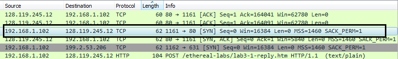
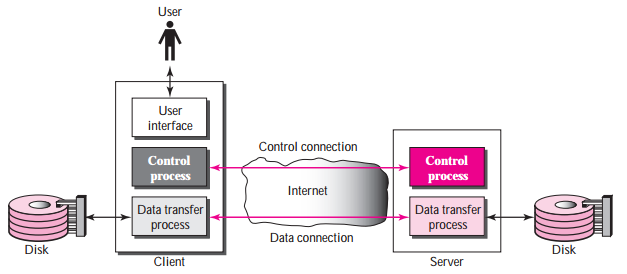
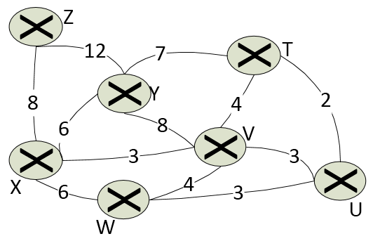
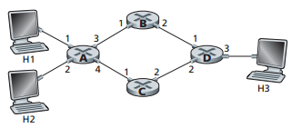
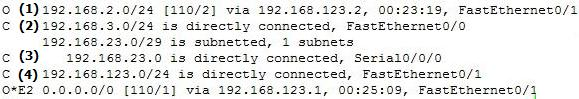

# DE_0132_HK2-1819.pdf

> 7 trang

## Trang 1

ĐẠI HỌC QUỐC GIA TP.HCM            ĐỀ THI CUỐI KỲ 2 NĂM HỌC 2018-2019
   TRƯỜNG ĐẠI HỌC BÁCH KHOA                   Tên môn thi: Mạng máy tính
                                                              Thời gian làm bài: 90 phút;
 KHOA KHOA HỌC & KỸ THUẬT MÁY TÍNH                          (60 câu trắc nghiệm)

 Lưu ý:
        Thí sinh KHÔNG được sử dụng tài liệu.                               Mã đề thi 0132
        Thí sinh phải nghi MSSV và Tên vào đề thi và NỘP lại đề cùng với bài làm

    Họ, tên thí sinh:..................................................................... Mã sinh viên: .............................

I. Các khái niệm cơ bản trong lĩnh vực mạng máy tính

Câu 1: Một thông điệp (message) có kích thước 200 bytes được gửi thông qua mạng internet theo mô hình TCP/IP
protocol. Giả sử rằng kích thước của header được thêm vào gói tin khi đi qua mỗi tầng là 20 bytes. Bạn hãy cho
biết tổng số bytes tầng vật lý nhận được trước khi gửi đi là bao nhiêu?
    A. 200 bytes          B. 240 bytes                  C. 260 bytes                 D. 280 bytes

Câu 2: Trong các giao thức: UDP, TCP, IP, Ethernet giao thức nào có khả năng kiểm tra lỗi và gửi lại gói tin?
    A. UDP                                           B. TCP
    C. IP                                           D. Ethernet

Câu 3: Giả sử ta có một gói tin truyền từ host A đến host B thông qua hai bộ chuyển mạch (switch) lắp nối tiếp
nhau. Tốc độ truyền dữ liệu từ host A đến switch và từ switch về host B là R, tốc độ truyền dữ liệu giữa hai switch
gấp 3 lần tốc độ truyền dữ liệu từ host đến switch. Giả sử rằng switch hoạt động theo cơ chế “store-and-forward
packet switching”. Bạn hãy cho biết tổng thời gian để chuyển hết gói tin có chiều dài L từ A đến B là bao nhiêu ?
(bỏ qua tất các thời gian trễ tại switch và thời gian lan truyền tín hiệu trong dây dẫn)
    A. L /5R                     B. 7L/3R                    C. 5R /L                    D. 7R/5L

Câu 4: Những thiết bị nào trong các thiết bị sau thuộc vùng ngoại vi mạng (network edge)
    A. Máy tính (computer), Điện thoại thông minh (smartphone), Laptop
    B. Máy tinh (computer), Bộ chuyển mạch (switch), Bộ định tuyến (router)
    C. Điện thoại thông minh (smartphone), Điểm đa truy cập (access point), Bộ định tuyến (router)
    D. Bộ chuyển mạch (switch), Dây dẫn, Bộ định tuyến (router)

Câu 5: Mất bao nhiêu thời gian để chuyển một đoạn dữ liệu có kích thước 1 280 000 bits từ host A sang host B
trong network? Giả sử rằng tất cả các đường truyền trong network sử dụng phương thức chia kênh truyền theo thời
gian (TDM) với 24 khung thời gian và tốc độ đường truyền là 7,680 Mbps (bỏ qua thời gian thiết lập kết nối từ
host A đến host B).
    A. 0.17 giây                  B. 4 giây             C. 10 giây                  D. 17 giây

Câu 6: Giả sử rằng có một nhóm 4 người sử dụng chung kênh truyền với tốc độ đường truyền là R Mbps, nhưng
khi sử dụng kênh truyền thì tốc độ của một người dùng chỉ đạt R/4 Mbps và thời gian của một người sử dụng kênh
truyền là 30%. Bạn hãy cho biết xác suất tại một thời điểm bất kỳ nào đó mà cả 4 người đều đồng thời sử dụng
kênh tuyền là bằng bao nhiêu?
A. 0.0256                        B. 0.0081             C. 0.3                      D. 0.09

II. Nguyên lý hoạt động của các ứng dụng phổ biến trên Internet

Câu 7: Trong một mạng (network), một tiến trình (process) đang chạy trên một thiết bị đầu cuối (host A) sử dụng
thông tin nào trong các thông tin sau để xác định một tiến trình (process) đang chạy ở một thiết bị đầu cuối khác
(host B).
    A. IP của host A và cổng (port) của socket trong process đang chạy ở host A
    B. IP của host B và cổng (port) của socket trong process đang chạy ở host B
    C. Cổng (port) của socket trong process đang chạy ở máy A
    D. Cổng (port) của socket trong process đang chạy ở máy B

                                                                                    1
Đề thi môn Mạng máy tinh – Mã đề thi 0132

## Trang 2

Câu 8: Sử dụng phần mềm Wireshark để bắt gói tin ta thu được thông tin của gói tin (gói tin trong khung hình chữ
nhật) như sau:

Bạn hãy cho biết phát biểu nào sau đâu là đúng
    A. Đây là gói tin gửi yêu cầu nội dung của một trang Web
    B. Đây là gói tin được sử dụng trong quá trình tạo kết nối
    C. Đây là gói tin được sử dụng trong quá trình yêu cầu ngắt kết nối
    D. Đây là gói tin quảng bá (broadcast)

Câu 9: An có địa chỉ email tại máy chủ mail A, Bình có địa chỉ email tại máy chủ mail B. An sử dụng trình duyệt
Web để truy cập vào email của mình và gửi email cho Bình. Bình sử dụng chương trình đọc mail có sử dụng giao
thức POP3 để truy cập vào mail server của mình. Bạn hãy cho biết phát biểu nào sau đây có thể miêu tả đúng nhất
về quá trình gửi và đọc email này.
    A. Email của An được gửi từ máy chủ mail A đến máy chủ mail B thông qua giao thức SMTP, ngay sau khi
nhận được email, máy chủ mail B gửi nội dung email đến chương trình đọc mail của Bình thông qua giao thức
POP3.
    B. Email của An được gửi từ máy chủ mail A đến máy chủ mail B thông qua giao thức SMTP, ngay sau khi
nhận được email, máy chủ mail B gửi nội dung email đến chương trình đọc mail của Bình thông qua giao thức
HTTP hoặc HTTPS khi có yêu cầu từ chương trình đọc email.
    C. Email của An được trình duyệt Web gửi lên máy chủ mail A thông qua giao thức HTTP hoặc HTTPS. Máy
chủ mail A sẽ gửi nội dung email đến máy chủ mail B thông qua giao thức SMTP. Sau đó máy chủ mail B sẽ
chuyển mail đến chương trình đọc mail của Bình thông qua giao thức POP3.
    D. Email của An được trình duyệt Web gửi lên máy chủ mail A thông qua giao thức HTTP hoặc HTTPS. Máy
chủ mail A sẽ gửi nội dung email đến máy chủ mail B thông qua giao thức SMTP. Sau đó máy chủ mail B sẽ
chuyển mail đến chương trình đọc mail của Bình thông qua giao thức HTTPS hoặc HTTPS.

Câu 10: Cho model như hình sau:

Bạn hãy cho biết đây có thể là model của ứng dụng nào trong các ứng dụng sau
    A. FTP               B. Web Server                C. Skype                   D. Torrent

Câu 11: Ứng dụng DNS sử dụng giao thức nào ở tầng Vận Chuyển?
    A. TCP               B. UDP        C. TCP hoặc UDP           D. DNS protocol

Câu 12: Khi sử dụng lệnh nslookup thihockymmt.hcmut.edu.vn ta thu được kết quả như sau:

                     nslookup thihockymmt.hcmut.edu.vn
                       Server: wifi-cse.hcmut.edu.vn
                     Address: 172.28.211.1

                   ***  wifi-cse.hcmut.edu.vn  can't  find  thihockymmt.hcmut.edu.vn:  Non-

                                                                                    2
Đề thi môn Mạng máy tinh – Mã đề thi 0132

## Trang 3

existent domain

Kế quả được hiển thị ở trên cho biết:
    A. Địa chỉ IP 172.28.211.1 là của máy tính hiện tại
    B. Địa chỉ IP 172.28.211.1 là của DNS server trả lời câu truy vấn
    C. Địa chỉ IP 172.28.211.1 là của domain thihockymmt.hcmut.edu.vn
    D. Domain thihockymmt.hcmut.edu.vn còn có tên khác là wifi-cse.hcmut.edu.vn

III. Nguyên lý hoạt động của các bộ giao thức TCP và UDP

Câu 13: Host A gửi 2 phân đoạn (segment) TCP back to back đến host B thông qua kết nối TCP. Phân đoạn thứ
nhất có SEQ là 190, phân đoạn thứ 2 có SEQ là 210. Giả sử rằng phân đoạn thức nhất bị mất, phân đoạn thức 2 đến
được host B. Bạn hãy cho biết giá trị của ACK phản hồi về máy A sau khi máy B nhận được phân đoạn thứ 2?
    A. 190               B. 210                       C. 20                D. Giá trị bất kỳ

Câu 14: Chọn phát biểu đúng
    A. Kích thước của Receive Window (rwnd) trong phân đoạn TCP sẽ không thay đổi trong suốt thời gian kết
nối.
    B. Kích thước của Receive Window (rwnd) được lưu trong header của phân đoạn TCP.
    C. Khi gửi một file có kích thước lớn từ host A đến host B qua kết nối TCP. Nếu SEQ của một gói tin có giá
trị n thì SEQ của gói tin ngay sau nó phải có giá trị n + 1.
    D. Giả sử rằng giá  trị cuối cùng của SampleRTT trong kết nối TCP bằng 2, thì giá  trị hiện  tại của
TimeoutInterval của kế nối TCP này phải lớn hơn 2.

Câu 15: Khi gửi một file có kích thước 𝐿= 216 bytes từ host A sang host B thông qua kết nối TCP với kích thước
lớn nhất của phần đoạn (MSS) là 512 bytes và tổng số bytes mào đầu (header) được thêm vào mỗi gói tin trong quá
trình gửi dữ liệu là 56 bytes. Bạn hãy cho biết tổng số bytes được gửi từ host A sang host B trong trường hợp này
là bao nhiêu?
    A. 65536 bytes        B. 65592 bytes        C. 72704 bytes        D. 70720 bytes

Câu 16: Bạn hãy cho biết giá trị EstimatedRTT là bao nhiêu, nếu ta biết được giá trị của SampleRTT là 106 ms,
alpha = 0,125 và EstimatedRTT của lần gửi gói tin trước đó là 100ms?
    A. 120,99 ms          B. 100,75 ms                 C. 5,06 ms                  D. 103,15 ms

Câu 17: Giả sử DNS server có địa chỉ IP là X nhận được một yêu cầu từ DNS client thông qua UDP datagram và
server cũng phản hồi lời yêu cầu đó bằng một gói tin thông qua UDP datagram. Nếu client B sử dụng IP giả mạo Y
của một DNS client khác thay vì địa chỉ IP của mình là Z thì DNS server sẽ gửi gói tin phản hồi về IP nào?
    A. IP Y               B. DNS Server không gửi được gói tin về client vì xác định được IP giả mạo
    C. IP Z              D. DNS server không phản hồi vì DNS server không sử dụng giao thức UDP

Câu 18: UDP header có giá trị ở dạng hexa như sau: CB84000D001C001C
Bạn hãy cho biết giá trị của cổng nguồn (source post) trong trường hợp này là bao nhiêu?
    A. 8400              B. 84                        C. 52100                   D. 3201

Câu 19: UDP header có giá trị ở dạng hexa như sau: CB84000D001C001C. Bạn hãy cho biết tổng kích thước của
gói tin UDP trong trường hợp này là bao nhiêu?
    A. 8                         B. 10                        C. 28                       D. 18

Câu 20: Kích thước của gói tin UDP không thể lớn hơn bao nhiêu bytes?
    A. 1028 bytes         B. 2048 bytes                C. 6000 bytes                D. 65536 bytes

Câu 21: Trường dữ liệu nào có trong header của UDP và cả trong header của TCP?
    A. Cổng nguồn, cổng đích và checksum             B. Cổng nguồn, cổng đích và số ACK
    C. Cổng nguồn, cổng đích và số SEG              D. Cổng nguồn, cổng đích và chiều dài của header

Câu 22: UDP socket có thể nhận dữ liệu từ:
    A. Chỉ một UDP socket                             B. Nhiều UDP socket
    C. Chỉ một TCP socket                            D. TCP hoặc UDP socket

                                                                                    3
Đề thi môn Mạng máy tinh – Mã đề thi 0132

## Trang 4

IV. Nguyên lý hoạt động của các giao thức định tuyến phổ biến

Câu 23: Cho network như hình bên dưới. Đường đi ngắn nhất từ z đến u theo giao thuật Dijkstra là:

    A. Z -> Y -> T -> U                                B. Z -> Y-> V-> U
    C. Z -> X -> W -> U                              D. Z -> X -> V - > U

Câu 24: Một datagram network sử dụng 32 bit làm địa chỉ. Giả sử rằng router có 4 interface (4 liên kết) được đánh
số từ 0 đến 3, các gói tin được chuyển đến các interface theo bảng định tuyến sau:
                      Destination Address Range                   Link Interface
                    11001000   00010111   00010000   00000000  0
                      through
                    11001000 00010111 00010111 11111111
                    11001000   00010111   00011000   00000000  1
                      through
                    11001000 00010111 00011000 11111111
                    11001000   00010111   00011001   00000000  2
                      through
                    11001000 00010111 00011111 11111111
                      Otherwise                                  3
Khi một gói tin có địa chỉ IP của đích đến là 200.23.24.170 đi vào router thì sẽ được router chuyển qua interface
nào?
    A.0                         B. 1                         C. 2                       D.3

Câu 25: Hãy cho biết sự khác nhau cơ bản giữa router và link-layer switch:
    A. Địa chỉ MAC được sử dụng trong việc xác định cổng ra của gói tin trong link-layer switch. Địa chỉ IP đích
được sử dụng trong việc xác định cổng ra của gói tin trong router
    B. Bảng liên kết giữa địa chỉ MAC và cổng ra trong link-layer switch do nhà quản trị mạng thiết lập. Bảng
định tuyến trong router luôn luôn được tạo ra bằng giải thuật RIP.
    C. Trong link-layer switch cổng ra của gói tin được xác định ngẫu nhiên. Trong router địa chỉ IP của cổng
nguồn được sử dụng trong việc xác định cổng ra của gói tin
    D. Router là một tên gọi khác của link-layer switch.

Câu 26: Hãy cho biết đâu là 3 chức năng quan trọng trong virtual-circuit network?
    A. call setup, forwarding và routing                          B. forwarding, routing và sending
    C. sending, network control và congestion control             D. Không tồn tại virtual-circuit network

Câu 27: Giao thức OSPF (Open Shorted Path First) sử dụng giải thuật:
    A. Distance vector                                         B. Link state
    C. Cả Distance vector và Link state                         D. Không sử dụng các giải thuật trên

Câu 28: Phát biểu nào sau đây SAI khi nói về IPv6 header:
    A. Độ dài của IPv6 header không thay đổi so với độ dài của IPv4.
    B. Header của IPv6 có ít trường dữ liệu hơn header của IPv4.
    C. Header của IPv6 sử dụng 128 bit để chứa địa chỉ của nguồn.
    D. Cả (A), (B) và (C) đều đúng.

Câu 29: Cookies thường không dùng để chứa nội dung gì trong các nội dung sau?
    A. Thông tin ủy quyền                       B. Mã lỗi trả về từ phía máy chủ

                                                                                    4
Đề thi môn Mạng máy tinh – Mã đề thi 0132

## Trang 5

C. Giỏ mua sắm trực tuyến                  D. Trạng thái phiên làm việc người dùng (Web e-mail)

Câu 30: Phát biểu nào sau đây là ĐÚNG khi đề cập đến giao thức định tuyến RIP:
    A. Router sẽ gửi gói tin quảng bá thông tin định tuyến đến tất cả các router khác trong cùng AS
    B. Router chỉ gửi gói tin quảng bá thông tin định tuyến đến các router hàng xóm của nó
    C. Router sẽ gửi gói tin quảng bá thông tin định tuyến ra các router ngoài AS
    D. Router chỉ gửi gói tin quảng bá thông tin cho những router nào mới gia nhập vào AS

Câu 31: Địa chỉ IP đầu và địa chỉ IP cuối của một network tương ứng là 146.102.29.0 và 146.102.32.255. Bạn hãy
cho biết số lượng IP trong network trên là bao nhiêu?
    A. 255               B. 256                       C. 512              D.1024

Câu 32: Cho địa chỉ IP 12.23.24.78/8. Bản hãy cho biết đâu là subnet mask của IP trên?
    A. 255.255.255.0             B. 255.255.0.0                 C.255.0.0.0           D. 0.0.0.255

Câu 33: Cho network như hình sau:

Giả sử đây là mạng chuyển mạch (virtual circuit network). Bạn hãy cho biết forwarding table nào dưới đây trong
router A, sao cho tất cả các gói tin đi từ H1 đến H3 phải đi qua interface 3 trong khi đó tất cả các gói tin từ H2 đi
tới H3 phải đi qua interface 4.

    A. Không thể thiết lập forwarding table thoải mãn điều kiện trên

  B  Incoming interface   Incomming VC#    Outgoing interface  Outgoing VC#
       1                 24               3                31
       2                 13               4                22

  C  Incoming interface   Incomming VC#    Outgoing interface  Outgoing VC#
       3                 12               1                22
       4                 23               2                18

  D  Incoming interface   Incomming VC#    Outgoing interface  Outgoing VC#
       3                 12               3                22
       3                 23               4                18

Câu 34: Địa chỉ IP trong một dãy IP là 110.23.120.14/20. Bạn hãy cho biết đâu là địa chỉ IP đầu của network
     A.110.23.120.0/20                                         B. 110.23.112.0/20
    C. 110.23.120.14/20                                     D. 110.23.112.14/20

Câu 35: Địa chỉ IP trong một dãy IP là 110.23.120.14/20. Bạn hãy cho biết đâu là địa chỉ IP cuối của network
    A. 110.23.120.255/20                               B. 110.23.127.255/20
    C. 110.23.120.14/20                              D. 110.23.112.255/20

Câu 36: Đâu không phải là format của IPv4
    A. 11.10.10.20        B. 111.56.45.78       C. 221.34.7.8         D. 192.168.256.255

Câu 37: Địa chỉ IP nào trong các địa chỉ IP sau thuộc Class C
    A. 227.12.14.87       B. 200.14.56.22       C. 14.23.120.8        D. 252.5.15.111

Câu 38: Câu lệnh nào trong các câu lệnh sau có thể được sử dụng để cấu hình định tuyến RIP trong router
    A. rip router     B. network 192.168.1.0        C. the end              D. show running-config

                                                                                    5
Đề thi môn Mạng máy tinh – Mã đề thi 0132

## Trang 6

Câu 39: Số hop tối đa mà gói tin định tuyến RIP có thể đi được là bao nhiêu?
    A. 10                B.15                        C.25            D. không xác định

Câu 40: Giao thức định tuyến nào trong các giao thức sau có thể được sử dụng trong các router thuộc AS khác
nhau?
    A. RIP               B. OSPF                     C. BGP              D. IP

Câu 41: Câu lệnh nào trong các câu lệnh sau được sử dụng để cấu hình định thuyến theo giao thức OSPF trong
router cho network 172.28.1.0/24?
    A. network 172.28.1.0   255.255.255.0                      B. network 172.28.1.0   0.0.0.255
    C. network 172.28.1.0                                    D. network 172.28.1.0   24

Câu 42: Câu lệnh nào có thể được sử dụng để hiển thị thông tin chung về các tiến trình định tuyến OSPF (OSPF
routing processes) của router?
    A. show interface brief                       B. show ospf
    C. show ospf neighbor                       C. show ospf interface

Câu 43: Trong khi cấu hình định tuyến theo OSPF ta sử dụng câu lệnh: network 192.168.0.0  0.0.0.3. Bạn hãy cho
biết có bao nhiêu IP được đưa vào tiến trình đinh tuyến OSPF trong hợp này?
    A. 2                         B. 3                  C. 65534                   D. Không xác định

Câu 44: Giả sử rằng X là số của vlan (vlan number). Câu lệnh nào có thể được sử dụng trong quá trình cấu hình
VLAN cho interface?
    A. vlan X             B. switchport access vlan X           C. vlan name         D. show vlan X

Câu 45: Sau khi thực hiện lệnh: sh ip route trên router ta thu được kết quả:

Bạn hãy cho biết đâu là dòng kết quả cho biết router có cấu hình OSPF?
    A. dòng 1                    B. dòng 2                    C. dòng 3                   D. dòng 4

Câu 46: Địa chỉ IPv6 nào sau đây hợp lệ?
    A. 2043::1685:2123::1428:57ab                                    B. 2043:99:ab:1:99:2:1:9
    C. 2043:1428:57ab:1685:2123:1428:57ab                          D. 2043:99:ab:1:99:2:1:9h

Câu 47: Nguyên nhân nào sau đây có thể dẫn đến sự mất gói và độ trễ trong bộ định tuyến?
    A. Các gói tin cạnh tranh nhau trong qua trình truyền tải
    B. Tốc độ đầu vào vượt quá tốc độ đầu ra
    C. Bộ định tuyến không tương thích với các thiết bị còn lại
    D. Trong mạng có quá nhiều thiết bị sử dụng mạng

V. Nguyên lý hoạt động của các giao thức thuộc tầng liên kết dữ liệu

Câu 48: Trong mạng Ethernet sử dụng CSMA/CD sau lần đụng độ thứ 4 thì xác suất để một node chọn hệ số K =
2 là bao nhiêu?
    A. 1/2                       B. 1/16               C. 1/4               D. Không xác định

Câu 49: Trong mạng Ethernet sử dụng CSMA/CD sau lần đụng độ thứ 5, nếu một node chọn K = 8 thì thời gian
chờ của node đó là bao nhiêu nếu đốc độ mạng là 5 Mbps?
    A. 8,01 micro giây                                         B. 104,2 micro giây
    C. 819,2 micro giây                                      D. 200,4 micro giây

Câu 50: Không gian địa chỉ IPv6 có thể có là bao nhiêu?
    A. 232                B. 248                       C. 264                      D. 2128

Câu 51: Kích thước nhỏ nhất của Ethernet frame là bao nhiêu?
                                                                                    6
Đề thi môn Mạng máy tinh – Mã đề thi 0132

## Trang 7

A. 18 bytes                   B. 46 bytes                   C. 64 bytes           D. 128 bytes

Câu 52: Bạn hãy cho biết đâu là địa chỉ đích multicast trong các địa chỉ Ethernet MAC sau đây?
    A. 4A:30:10:21:10:1A                              B. 47:20:1B:2E:08:EE
    C. FF:FF:FF:FF:FF:FF                            D. 00.00.00.00.00.00

Câu 53: Phương pháp truy cập nào được sử dụng trong Standard Ethernet?
    A. CSMA             B. CSMA/CD                C. CSMA/CA               D. CSMA/AB

Câu 54: Phương pháp truy cập nào được sử dụng trong Wireless LAN?
    A. CSMA             B. CSMA/CD                C. CSMA/CA               D. CSMA/AB

Câu 55: Trong 802.11 frame có bao nhiêu vùng chứa địa chỉ?
    A. 0                  B. 2                         C. 3                        D. 4

 VI. Các vấn đề liên quan đến an ninh mạng máy tính

Câu 56: Trojan có thể được lây nhiễm như thế nào?
    A. Là phần ẩn của một phần mềm hữu dụng khi người dùng cài đặt
    B. Lây nhiễm qua việc nhận thụ động đối tượng và có thể tự kích hoạt bản thân
    C. Lây nhiễm qua việc nhận các đối tượng (vd: tệp đính kèm trong e-mail), chạy độc lập và chủ động
    D. Trojan không lây nhiễm

Câu 57: Được biết, giải thuật mã hóa công khai (public key cryptography) được sử dụng để tạo ra chữ ký số.
Trong qui trình này, khóa nào (công khai (public key), cá nhân (private key)) được sử dụng để tạo ra chữ ký?
    A. Công khai                 B. Cả hai khóa đều được sử dụng
    C. Cá nhân                        D. Không khóa nào được sử dụng

Câu 58: Secure Socket Layer (SSL) sử dụng?
    A. Duy nhất giải thuật Public-key             B. Sử dụng cả hai giải thuật Public-key và Symmetric-key
    C. Duy nhất giải thuật Symmetric-key         D. Không sử dụng cả Public-key lẫn Symmetric-key

Câu 59: Giả sử có một nhóm N người. Mỗi người trong nhóm muốn giao tiếp với ( N – 1 ) người khác bằng cách
sử dụng mã hóa khóa đối xứng. Tất cả các dữ liệu trao đổi giữa bất kỳ hai người bất kỳ m, n đều hiển thị cho tất cả
những người khác trong nhóm N người này nhưng không ai khác ngoại trừ hai người m, n này có thể giải mã được
giao tiếp. Bạn hãy cho biết có ít nhất bao nhiêu khóa được sử dụng trong hệ thống?
    A. N                 B. N*(N-1)/2                 C. 2N               D. 1

Câu 60: Giả sử có một nhóm N người. Mỗi người trong nhóm muốn giao tiếp với ( N – 1 ) người khác bằng cách
sử dụng mã hóa khóa công khai. Tất cả các dữ liệu trao đổi giữa bất kỳ hai người bất kỳ m, n đều hiển thị cho tất
cả những người khác trong nhóm N người này nhưng không ai khác ngoại trừ hai người m, n này có thể giải mã
được giao tiếp. Bạn hãy cho biết có ít nhất bao nhiêu khóa được sử dụng trong hệ thống?
    A. N                 B. N*(N-1)/2                 C. 2N               D. 1

                          ----------------------------------------HẾT---------------------------------------

               Khoa/ Bộ môn                             Cán bộ ra đề

                                                                                    7
Đề thi môn Mạng máy tinh – Mã đề thi 0132
