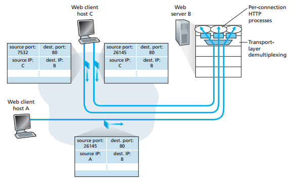
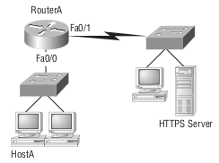
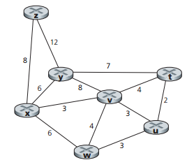
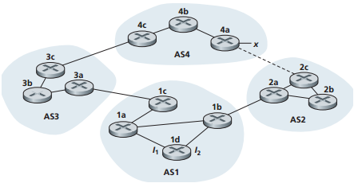

# Final-Exam-Questions-and-Answers-1921.pdf

> 8 trang

## Trang 1

Lecturer:                                            (Date)              Approved by:                               (Date)
  (Signature & Fullname)                                                                               (Signature, Position & Fullname)

                                        (The above part must be hidden when copying for exam)

                  FINAL EXAM  Semester/Academic year  2  2019-2020
                                                          Date                    23 July 2020
                                  Course title    Computer Networks

 UNIVERSITY OF TECHNOLOGY - VNUHCM Course ID     CO3003
         FACULTY OF CSE           Duration       90 mins.   Question sheet code   1921
Notes: - Closed book (No supporting documents allowed to use)
          - Choose the most appropriate answer and shade ONE letter only for each question.
          - Make sure you put your answer in line with the correct question number.
          - Submit the question sheet together with the answer sheet.

Question 1.   (L.O.1.2) A collection of various interconnected computers that seems a single
coherent system to its client is considered as?
a) computer network                                     c) networking system
b) distributed system                                   d) mail system
Question 2.   (L.O.1.2) Which is a device that forwards packets between networks by processing
the routing information included in the packet?
a) bridge                                                  c) router
b) firewall                                             d) hub
Question 3.   (L.O.1.2) What is the function of DSLAM?
a) Convert analog signals into digital signals             c) Amplify digital signals
b) Convert digital signals into analog signals            d) De-amplify digital signals
Question 4.   (L.O.1.2) Home Access can be provided by?
a) DSL                                                   c) Cable
b) FTTP                                               d) All of the mentioned
Question 5.   (L.O.5.1) Which of the following is the multiple access protocol for channel access
control?
a) CSMA/CD                                             c) Both CSMA/CD & CSMA/CA
b) CSMA/CA                                         d) HDLC
Question 6.   (L.O.3.1) Choose the correct statement bout Transmission control protocol (TCP)?
a) is a connection-oriented protocol                      c) receives data from application as a single
b) uses a three-way handshake to establish a            stream
connection                                            d) all of the mentioned
Question 7.   (L.O.5.1) If link transmits 4000 frames per second, and each slot has 8 bits, the
transmission rate of this TDM circuit is?
a) 32kbps                                                 c) 500kbps
b) 500bps                                             d) 32bps
Question 8.   (L.O.1.2) Which of the following delay is faced by the packet in travelling from one
end system to another?

Question sheet code: 1921
                                                                                      1

## Trang 2

a) Propagation delay                                      c) Transmission delay
b) Queuing delay                                      d) All of the mentioned
Question 9.   (L.O.5.1) For a 10Mbps Ethernet link, if the length of the packet is 32bits, the
transmission delay is ____________ (in microseconds)
a) 3.2                                                     c) 0.32
b) 32                                                  d) 320
Question 10.  (L.O.1.2) Given L = number of bits in the packet, a = average rate and R =
transmission rate. The Traffic intensity in the network is given by ____________
a) La/R                                                   c) R/La
b) LR/a                                               d) Ra/L
Question 11.  (L.O.1.2) If end to end delay is given by dend-end = N*(dproc + dtrans + dprop) on a
non-congested network. The number of routers between source and destination is?
a) N/2                                                    c) N-1
b) N                                                  d) 2N
Question 12.  (L.O.1.2) In a network, If P is the only packet being transmitted and there was no
earlier transmission, which of the following delays could be zero?
a) Propagation delay                                      c) Transmission delay
b) Queuing delay                                      d) Processing delay
Question 13.  (L.O.2.1) Which one of the following is an application architecture paradigm?
a) Peer to peer                                            c) HTTP
b) Client-server                                        d) Both Peer-to-Peer & Client-Server
Question 14.  (L.O.2.1) Application developer has permission to decide the which of the following
on transport layer side?
a) Transport layer protocol
b) Maximum buffer size
c) Both Transport layer protocol and Maximum buffer size
d) None of the mentioned
Question 15.  (L.O.2.1) Which is a time-sensitive service?
a) File transfer                                            c) E-mail
b) File download                                      d) Internet telephony
Question 16.  (L.O.2.1) Which one of the following protocols delivers/stores mail to receiver
server?
a) simple mail transfer protocol                          c) internet mail access protocol
b) post office protocol                                 d) hypertext transfer protocol
Question 17.  (L.O.2.2) In the process of fetching a web page from a server the persistent HTTP
request/response takes how many RTTs?
a) 2                                                       c) 4
b) 1                                                   d) 3
Question 18.  (L.O.2.2) Which of the following is NOT correct?
a) Web cache doesn’t have its own disk space
b) Web cache can act both like server and client
c) Web cache might reduce the response time
d) Web cache contains copies of recently requested objects

Question sheet code: 1921
                                                                                      2

## Trang 3

Question 19.  (L.O.2.2) If you have to send multimedia data over SMTP it has to be encoded into
which format?
a) Binary                                                 c) ASCII
b) Signal                                              d) Hash
Question 20.  (L.O.2.2) When the sender and the receiver of an email are on different systems,
what do we need ?
a) One MTA                                             c) Two UAs and one MTA
b) Two UAs                                           d) Two UAs and two MTAs
Question 21.  (L.O.2.2) Choose the statement which is wrong in case of SMTP?
a) It requires message to be in 7bit ASCII format
b) It is a pull protocol
c) It transfers files from one mail server to another mail server
d) SMTP is responsible for the transmission of the mail through the internet
Question 22.  (L.O.2.2) What happens if a server has no clue about where to find the address for a
hostname?
a) server asks to the root server                           c) request is not processed
b) server asks to its adjacent server                     d) none of the mentioned
Question 23.  (L.O.2.2) Which one of the following is not true?
a) multiple hostnames may correspond to a               c) a single hostname may correspond to a single
single IP address                                    IP address
b) a single hostname may correspond to many IP        d) none of the mentioned
addresses
Question 24.  (L.O.2.2) IP assigned for a client by DHCP server is ______
a) for a limited period                                    c) not time dependent
b) for an unlimited period                              d) none of the mentioned
Question 25.  (L.O.2.2) When a host acquires multiple offers of IP addresses from different DHCP
servers, the host will broadcast a DHCP request identifying the server whose offer has been
accepted. The DHCP server can provide the _______ of the IP addresses.
a) dynamic allocation                                     c) static allocation
b) automatic allocation                                 d) all of the mentioned
Question 26.  (L.O.3.1) In TCP, sending and receiving data is done as which data format?
a) Stream of bytes                                        c) Lines of data
b) Sequence of characters                              d) Packets
Question 27.  (L.O.3.1) TCP process may not write and read data at the same speed. So, what do
we need for storage?
a) Packets                                                c) Segments
b) Buffers                                             d) Stacks
Question 28.  (L.O.3.1) To achieve reliable transport in TCP, which mechanism is used to check
the safe and sound arrival of data?
a) Packet                                                 c) Segment
b) Buffer                                              d) Acknowledgment

Question sheet code: 1921
                                                                                      3

## Trang 4

Question 29.  (L.O.3.1) Suppose a TCP connection is transferring a file of 1000 bytes. The first
byte is numbered 10001. What is the sequence number of the segment if all data is sent in only one
segment?
a) 10000                                                  c) 12001
b) 10001                                              d) 11001
Question 30.  (L.O.3.1) The receiver of the data controls the amount of data that are to be sent by
the sender is referred to as?
a) Flow control                                           c) Congestion control
b) Error control                                        d) Error detection
Question 31.  (L.O.3.1) Which field allows TCP to detect lost segments and in turn recover from
that loss?
a) Sequence number
b) Acknowledgment number
c) Checksum
d) Both Sequence & Acknowledgment number
Question 32.  (L.O.3.1) What is the main advantage of UDP?
a) More overload                                         c) Low overhead
b) Reliable                                            d) Fast connection
Question 33.  (L.O.3.1) Which is the correct expression for the length of UDP datagram?
a) UDP length = IP length – IP header’s length
b) UDP length = UDP length – UDP header’s length
c) UDP length = IP length + IP header’s length
d) UDP length = UDP length + UDP header’s length
Question 34.  (L.O.3.1) In Go-Back-N window, when the timer of the packet times out, several
packets have to be resent even some may have arrived safe. Whereas in Selective Repeat window,
the sender resends which packets?
a) Packets which are not lost                             c) Packets from starting
b) Only those packets which are lost or                 d) All the packets
corrupted
Question 35.  (L.O.3.1) In the slow-start algorithm, the size of the congestion window increases
__________ until it reaches a threshold.
a) exponentially                                          c) multiplicatively
b) additively                                           d) suddenly
Question 36.  (L.O.2.2) A web cookie is a small piece of data that is _______
a) sent from a website and stored in user’s web browser while a user is browsing a website
b) sent from user and stored in the server while a user is browsing a website
c) sent from root server to all servers
d) sent from the root server to other root servers
Question 37.  (L.O.4.1) Which of the following is not applicable for the single Internet Protocol
(IP)?
a) Error reporting                                         c) Datagram format
b) Handle addressing conventions                      d) Packet handling conventions
Question 38.  (L.O.4.1) Which field helps to check rearrangement of the fragments for an IP
packet?

Question sheet code: 1921
                                                                                      4

## Trang 5

a) offset                                                  c) TTL
b) flag                                                d) identifier
Question 39.  (L.O.4.2) Suppose two IPv6 nodes want to interoperate using IPv6 datagrams, but
they are connected to each other by intervening IPv4 routers. What is the best solution used?
a) Use dual-stack approach                               c) No solution
b) Tunneling                                          d) Replace the system
Question 40.  (L.O.3.1) Which of the following is false with respect to Connectionless service of
transport layer protocol?
a) Packets are not numbered                              c) No acknowledgement
b) Packets are not delayed                              d) Packet may arrive out of sequence
Question 41.  (L.O.4.2) Internet Control Message Protocol (ICMP) has been designed to
compensate what from Internet Protocol (IP)?
a) Error-reporting                                        c) Host and management queries
b) Error-correction                                     d) All of the mentioned
Question 42.  (L.O.4.2) The Time-to-Live (TTL) field in IP header has value 10. How many
routers (max) can process this datagram?
a) 11                                                      c) 10
b) 5                                                   d) 9
Question 43.  (L.O.4.2) IPv6 does not use which type of address?
a) Broadcast                                              c) Any cast
b) Multicast                                           d) Unicast
Question 44.  (L.O.4.2) You have an IP address of 172.16.13.5 with a 255.255.255.128 subnet
mask. What is your class of address, subnet address, and broadcast address?
a) Class A, Subnet 172.16.13.0, Broadcast address 172.16.13.127
b) Class B, Subnet 172.16.13.0, Broadcast address 172.16.13.127
c) Class B, Subnet 172.16.13.0, Broadcast address 172.16.13.255
d) Class B, Subnet 172.16.0.0, Broadcast address 172.16.255.255
Question 45.  (L.O.4.2) If you wanted to have 12 subnets with a Class C network ID, which subnet
mask would you use?
a) 255.255.255.252                                       c) 255.255.255.240
b) 255.255.255.255                                    d) 255.255.255.248
Question 46.  (L.O.4.2) Your router has the following IP address on Ethernet0: 172.16.2.1/23.
Which of the following can be valid host IDs on the LAN interface attached to the router?
i. 172.16.1.100                                                              iii. 172.16.2.255
ii. 172.16.1.198                                                iv. 172.16.3.0
a) i only                                                  c) iii and iv only
b) ii and iii only                                       d) ii only
Question 47.  (L.O.4.2) What is the maximum number of IP addresses that can be assigned to
hosts on a local subnet that uses the 255.255.255.224 subnet mask?
a) 14                                                      c) 16
b) 15                                                  d) 30
Question 48.  (L.O.4.2) You have an interface on a router with the IP address of
192.168.192.10/29. Including the router interface, how many hosts can have IP addresses on the
LAN attached to the router interface?

Question sheet code: 1921
                                                                                      5

## Trang 6

a) 6                                                       c) 30
b) 8                                                   d) 32
Question 49.  (L.O.4.1) Where should we use default routing?
a) On stub networks- which have only one exit path out of the network
b) Which have more than one exit path out of the network
c) Minimum five exit paths out of the network
d) Maximum five exit paths out of the network
Question 50.  (L.O.4.1) What is route poisoning?
a) It sends back the protocol received from a router as a poison pill, which stops the regular updates. The
use of variable length subnet masks is permitted
b) It is information received from a router that can’t be sent back to the originating router.RIPv2 supports
classless routing
c) It prevents regular update messages from reinstating a route that has just come up
d) It describes when a router sets the metric for a downed link to infinity
Question 51.  (L.O.3.2) Which methods are commonly used in Server Socket class?
a) Public Output Stream get Output Stream ()            c) Public synchronized void close ()
b) Public Socket accept ()                              d) Public void connect ()
Question 52.  (L.O.3.2) Which constructor of Datagram Socket class is used to create a datagram
socket and binds it with the given Port Number?
a) Datagram Socket(int port)                             c) Datagram Socket()
b) Datagram Socket(int port, Int Address                d) Datagram Socket(int address)
address)
Question 53.  (L.O.3.2) What does the client in socket programming must know?
a) IP address of Server                                   c) Both IP address of Server & Port number
b) Port number                                        d) Only its own IP address
Question 54.  (L.O.2.1) Cookies were originally designed for?
a) Client-side programming
b) Server-side programming
c) Both Client-side programming and Server-side programming
d) Socket programming
Question 55.  (L.O.4.2) The computation of the shortest path in OSPF is usually done by which
algorithm?
a) Bellman-ford algorithm                                c) Dijkstra’s algorithm
b) Routing information protocol                        d) Distance vector routing
Question 56.  (L.O.4.2) In OSPF, which protocol is used to discover neighbor routers
automatically?
a) Link state protocol                                     c) Routing information protocol
b) Error-correction protocol                            d) Hello protocol
Question 57.  (L.O.4.2) An OSPF router receives an LSA, the router checks its sequence number,
and this number matches the sequence number of the LSA that the receiving router already has.
What does the receiving router do with the LSA?
a) Ignores the LSA                                       c) Sends newer LSU update to source router
b) Adds it to the database                              d) Floods the LSA to the other routers
Question 58.  (L.O.4.1) The outcome of Dijkstra’s calculation is used to populate the which table?

Question sheet code: 1921
                                                                                      6

## Trang 7

a) Topology table                                         c) Neighbor table
b) Routing table                                       d) Adjacency table
Question 59.  (L.O.2.1) MIB is a collection of groups of objects that can be managed by which
protocol?
a) SMTP                                                 c) SNMP
b) UDP                                               d) TCP/IP
Question 60.  (L.O.2.1) ICMP is used in which application?
a) Ping                                                   c) Ifconfig
b) Traceroute                                          d) Both Ping & Traceroute
Question 61. ISP exchanges internet traffic between their networks by?
a) internet exchange point                                c) ISP end point
b) subscriber end point                                 d) internet end point
Question 62.  (L.O.1.2) Host A wants to send a request to a Web server HTTPS. Which of the
followings could be the source address when the Server
receives the data frame?
a) MAC address of the switch connected to host A
b) MAC address of the switch connected to Server
c) MAC address of the router A at interface Fa0/0
d) MAC address of the router A at interface Fa0/1

Question 63.  (L.O.3.1) Consider the figure below.
What are the source/destination port values and the
source/destination IP addresses in the network-layer datagrams (carrying the transport-layer
segments) flowing from the server back to the clients’ processes?

a)  Source port: 80, IP Source: B; Destination port: 26145, Destination IP: A
b)  Source port: 26145, IP Source: A; Destination port: 80, Destination IP: B
c)  Source port 80, IP Source: A; Destination port: 26145, Destination IP: B

Question sheet code: 1921
                                                                                      7

## Trang 8

d)  Source port 80, IP source C; Destination port: 7532, Destination IP: B
Question 64.  (L.O.4.1) Consider the following network. With the indicated link costs, what is the
shortest path from z to u is found using Dijkstra’s shortest-path algorithm?
a)  z -> x -> v - > u
b)  z -> y -> v -> u
c)  z -> x -> w -> u
d)  z -> y ->  t -> u

Question 65.  (L.O.4.1) Consider the network shown below. Suppose AS3 and AS2 are running
OSPF for their intra-AS routing protocol. Suppose AS1 and AS4 are running RIP for their intra-
AS routing protocol. Suppose eBGP and iBGP are used for the inter-AS routing protocol. Initially
suppose there is no physical link between AS2 and AS4. Router 3c learns about prefix x from which
routing protocol: OSPF, RIP, eBGP, or iBGP?

             a) OSPF
            b) eBGP
             c)  iBGP
            d)  RIP

                                                    --- END ---

Question sheet code: 1921
                                                                                      8

