# Final 211.pdf

> 14 trang

## Trang 1

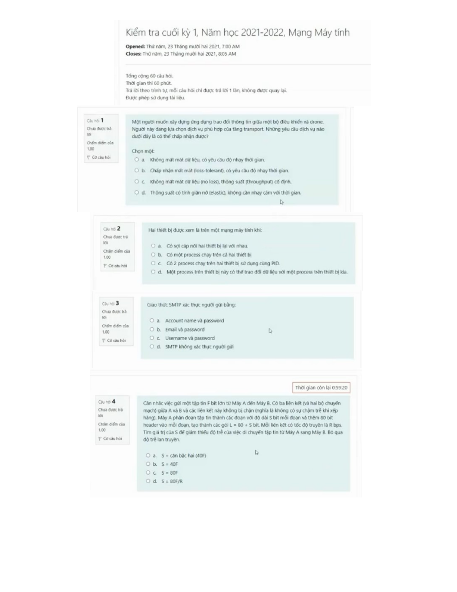

Kiểm tra cuối kỳ 1, Năm học 2021-2022, Mạng Máy tính

Opened: Thứ năm, 23 Tháng mười hai 2021, 700 AM.
‘Closes: Thử nặm, 23 Tháng mười hai 2021, 805 AM

Tổng cộng 60 câu hoi.

Thời gian thi 60 phút.

Trả lời theo trình tự, mỗi câu hỏi chi được trả lới 1 lần, không được quay lại.
Được phép sử dụng tài itu

cnet
Chea được trẻ

Chấm điển của
1®

F C6 cu hồi

cone’
Chúa được trả

Chăm điểm của
100

Y Coctuhdt

cored
“Chưa được trả
m

“Chấm điểm của
1

Y Coctunsi

cua 4
“Cửa được tá

Chăm điểm của
106

Y Coctu hỏi

Một người muốn xây dựng ứng dụng trao đổi thông tin giữa một bộ điều khiến và drone.
"Người này đang lựa chọn dịch vụ phú hợp của tầng transport. Những yêu cầu dich vụ nào.
cdưới đây là có thể chấp nhận được?

Chọn một:
© a Không mat mat dữ liệu, có yêu cầu độ nhạy thời gian.

© Bb. Chấp nhận mất mắt (loss-tolerant), có yêu cầu độ nhạy thời gian.

© & _ Không mất mát dữ liệu (no loss), thông suất (throughput) cố định.

Od. Thông suất cô tính giãn nd (elastic, không cần nhạy cảm với thời gian.
b

Hai thiết bị được xem là tiên một mạng máy tính khi:

©. Cổ sợi cáp nối hai thiết bị lại với nhau.

© Bb, Có một process chạy trên cả hai thiết bị

© © Có 2 process chay trên hai thiết bị sử dụng cùng PID.

'O đ. Một process trên thiết bị nay có thế trao đổi dữ liêu với một process trên thiết bị kia,

Giao thức SMTP xác thực người gửi bằng:

© a. Account name và password

© b, Email vd password b
© € Username và password

© SMTP không xác thực người git

Thời gian còn lại 059:20

Can nhắc việc gửi một tập tin F bit lớn tử Máy A đến Máy B. Có ba liên kết (và hai bộ chuyển.
mạch) giữa A và B và các liên kết này khôg bị chân (nghfo là không có sự châm trể khi xếp.
hàng). Máy A phân đoạn tập tin thành các đoạn với độ đài S bit mỗi đoạn và thêm 60 bit
header vào mỗi đoạn, tạo thành các gồi L = 80 + S bit Mới liên kết có tốc độ truyền là R bps.
Tìm giá trị của S để giảm thiếu độ trề của việc ơi chuyển tập tin từ May A sang Máy B, BO qua
độ trễ lan truyền.

Oa S= cân bic hai (40) :
Ob S=40F
Oc srz8
Od S=80f/R

> Văn bản trang này được nhận dạng bằng OCR. Cần kiểm tra lại các ký tự/số liệu.

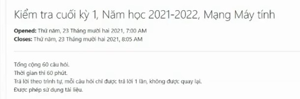

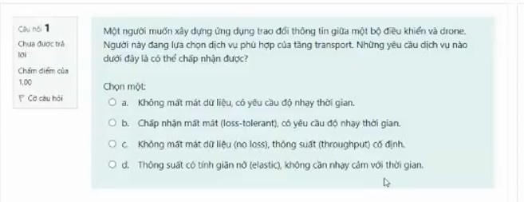

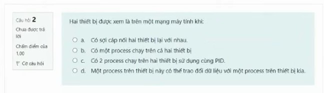

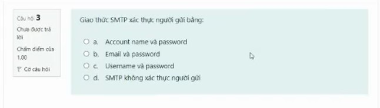

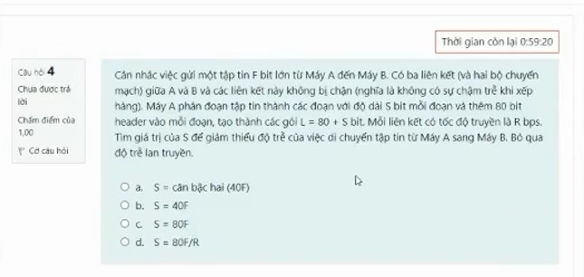

## Trang 2

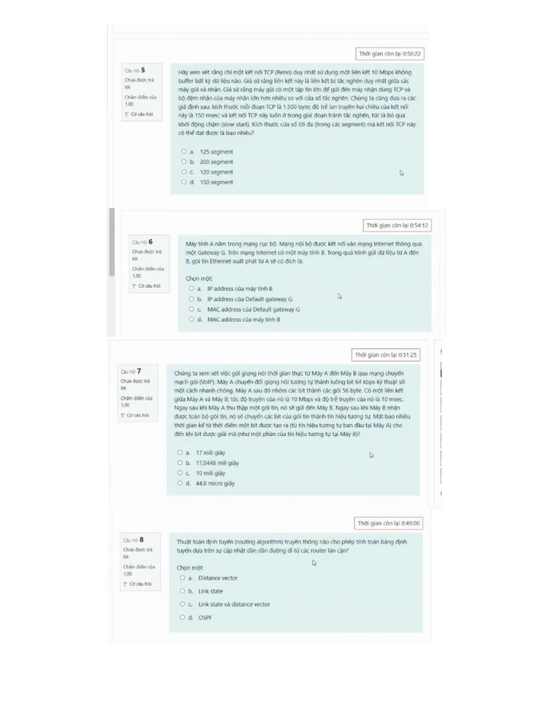

“Câu nà Š
“Cua được trả

Chăm đim của
100

Y Coctunst

“Câu hồ 6
hứa được trả
‘ei

Chăm điểm của
106

Y Coctunsi

cre T
Chua được trả.

Chăm điểm của
100

Y Cu hỏi

cones
Chae được trả

Chăm điểm của
100

Ý Có chu hài

Thời gian còn lại 05622

'Hãy xem xét rằng chi một kết nổi TCP (Reno) đuy nhất sử dung một lien kết 10 Mops không,
‘buffer bất kỳ dữ liệu nào. Giả sử rằng liên kết này là liên kết bị tốc nghẽn duy nhất gida các
“mây gửi và nhận. Giá sử rằng may gửi cô một tập tin lớn để gửi đến máy nhận dùng TCP và
"bộ đệm nhận của máy nhận lớn hơn nhu so vi cửa số tác nghẽn. Chúng ta cũng đưa ra các
lô định sau: kích thước tmỗi đoạn TCP là 1.500 byte; độ trễ lan truyền hai chiều của kết nơi
‘ity là 150 msec; và kết nối TCP nay luôn 6 trong giai đoạn tránh tác nghen, tức 14 bỏ qua
khởi động chậm (slow start) Kích thước cửa sổ tối đa (trong các segment) mà kết nối TCP này

có thể đạt được là bao nhiêu?

Oa. 125segment
© b. 200 segment
Oc 120 segment
Od 150 segment

Thời gian còn lại 0:54:12

‘May tính A nằm trong mạng cục bộ. Mang nội bộ được kết nối và› mạng Internet thông qua
“một Gateway G. Trên mang Internet có một máy tính B. Trong quá trình gửi dữ liệu từ A đến.

', gói tin Ethemet xuất phát tử A sẽ cô đích là:

Chọn một:

© a IPaddress của máy tinh B

© b, IP address của Default gateway G
© © MÁC address của Default gateway G
Od. MAC address của máy tinh 8

Thời gian còn lại 05125

Chúng ta xem xét việc gửi giọng nói thời gian thực từ Máy A đến Máy B qua mạng chuyển.
“mạch gói (VoIP), May A chuyến đối giọng nôi tương tự thành luỡng bit 64 Kops kỹ thuật số
“một cách nhanh chóng. Máy A sau đó nhóm các bit thành các gói 56 byte. Có một liên kết
giữa May A và Máy 8; tốc độ truyền của nó là 10 Mbps va độ trễ truyền của nó là 10 msec,
'Ngay sau khí Máy A thu thập một gói tin, nó sẽ gửi đến Máy B. Ngay sau khi Máy B nhận.
được toàn bộ gói tin, nó sẽ chuyển các bit của gói tin thành tín hiệu tương tự. Mất bạo nhiêu
thời gian kể từ thời điểm một bít được tạo ra (từ tín hiệu tương tự ban đầu tại Máy A) cho.
đến khi bit được giải mã (như một phần của tín hiệu tương tự tại Máy 8)?

Oa 17mil giây
© b. 170448 mili giây
Oc 10 mili gity

Ô d. 448 micro giây

Thời gian còn lại 0:49:00

Thuật toán định tuyến (routing algorithm) truyền thống nào cho phép tinh toán bảng định.

tuyến đựa trên sự cập nhật dan dan đường đi từ các router lần cận?

Chon một.
© a Distance vector

© b. Unk state
© Link state va distance vector
Od OSPF

&

> Văn bản trang này được nhận dạng bằng OCR. Cần kiểm tra lại các ký tự/số liệu.

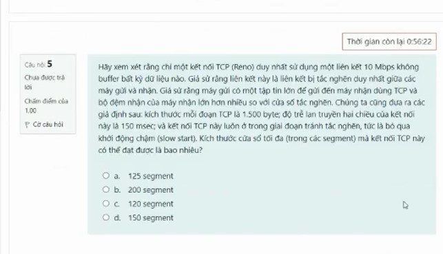

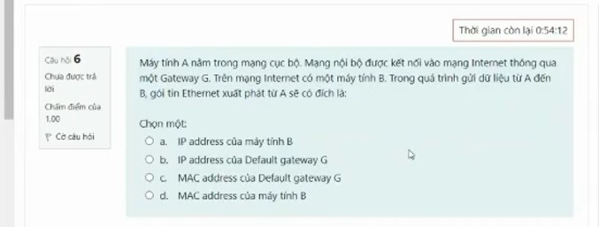

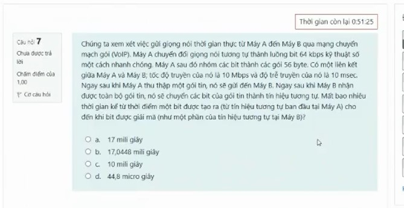

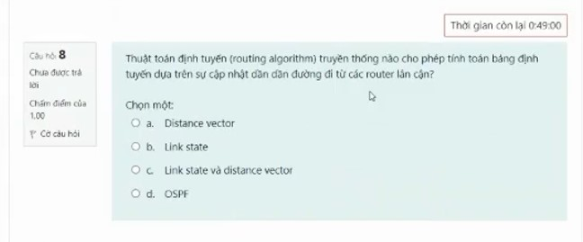

## Trang 3

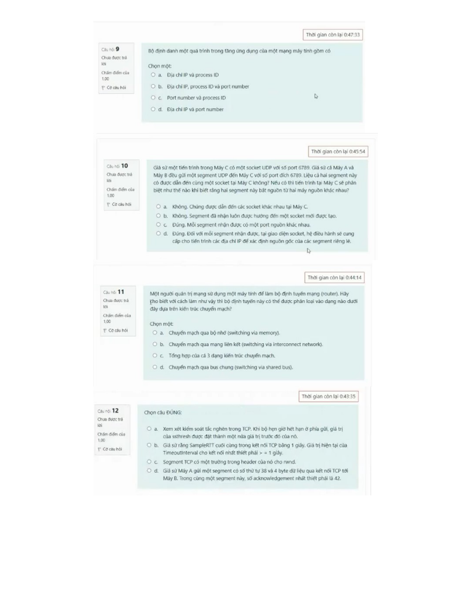

can 9
Chưa được trả
ei

Chăm đim của
100

Y Cỡ câu bội

cure 10
Chưa được trả

“Chấm điểm của
1œ

Y Coctu si

Cure 19
“Chưa được trả
cy

“Chấm điểm của
106

Cô du hôi

Sa nà 12
chun được tà

Chăm điểm của
166

Y Cỡ chu hồi

Thời gian còn lại 0:47:33

"Bộ định danh một quá trình trong tang ứng dụng của một mạng máy tính gồm có
Chọn một:

© a Dia chiiP và process 1D

© b, Địa chilP, process 1D và port number

© © Port number và process 1D b

O đ. Địa chỉIP và port number

Thời gian còn lại 045-54

Gia sử một tiến trình trong May C có một socket UDP với số port 6789. Giá sử cả May A và
'Mấy B đều gửi một segment UDP đến Máy C với số port dich 6789. Liệu cả hai segment này.
.cÓ được dẫn đến cùng một socket tại May C không? Nếu có thi tiến trình tại May C sẽ phân.
biệt như thế nào khi biết rang hai segment này bắt nguồn từ hal máy nguồn khác nhau?

(© a.. Không. Chúng được dẫn đến cic socket khắc nhau tại Máy C.
(© bb.. Không. Segment đã nhận luôn được hướng đến một socket mới được tao.
© © Đứng Mỗi segment nhận được có một port nguồn khác nhau.
© d.. Đóng. Đối với mỗi segment nhận được, tại giao điện socket, hệ điều hành sẽ cung
cấp cho tiến trình các dia chí IP để xác định nguõn gốc của các segment riêng lê.
b

Thời gian còn lại 0:44:14

Một người quan trị mạng sử dụng một may tính để làm bộ định tuyến mang (router). Hay
Tho biết với cách làm như vậy thì bộ định tuyến này có thể được phân loại vào dạng nào dưới
“đây dựa trên kiến trúc chuyển mach?

“Chọn mộc.

© a Chuyến mạch qua bộ nhớ (switching via memory).

© b. Chuyển mach qua mang liên kết (switching via interconnect network).
 € ˆ Tổng hợp của cá 3 dang kiến trúc chuyển mạch.

© ở. Chuyển mạch qua bus chung (switching via shared bus).

Thời gian còn lại 0:43:35

Chọn câu ĐỨNG:

© a. Xem xét kiểm soát tắc nghên trong TCP, Khi bộ hẹn gid hết hạn ở phía gửi, giá trị
“tủa ssthresh được dat thành một nữa giá trị trước đô của nó.

© b.. Giâ sử tằng SampleRTT cuối cùng trong kết nối TCP bảng † giy. Giá trị hiện tại của
Timeoutinterval cho kết nối nhất thiết phái > = 1 giây.

© .C Segment TCP có một tường trong header của nó cho rwnd.
'Ô đ.. Giả sử May A gửi một segment có số thử tự 39 và 4 byte dữ liệu qua kết nổi TCP tối
‘My B. Trong củng một segment này, số acknowledgement nhất thiết phải là 42.

> Văn bản trang này được nhận dạng bằng OCR. Cần kiểm tra lại các ký tự/số liệu.

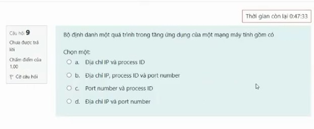

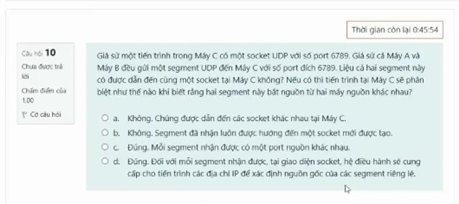

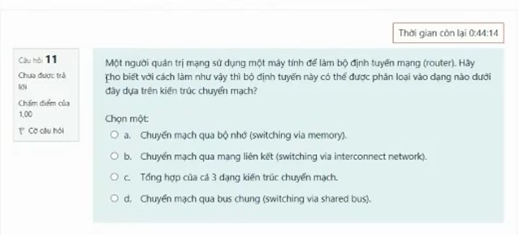

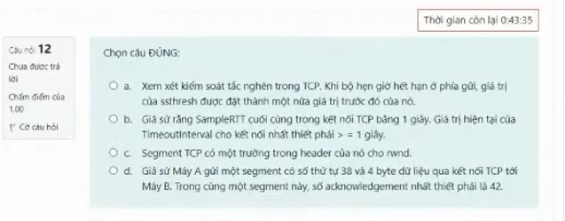

## Trang 4

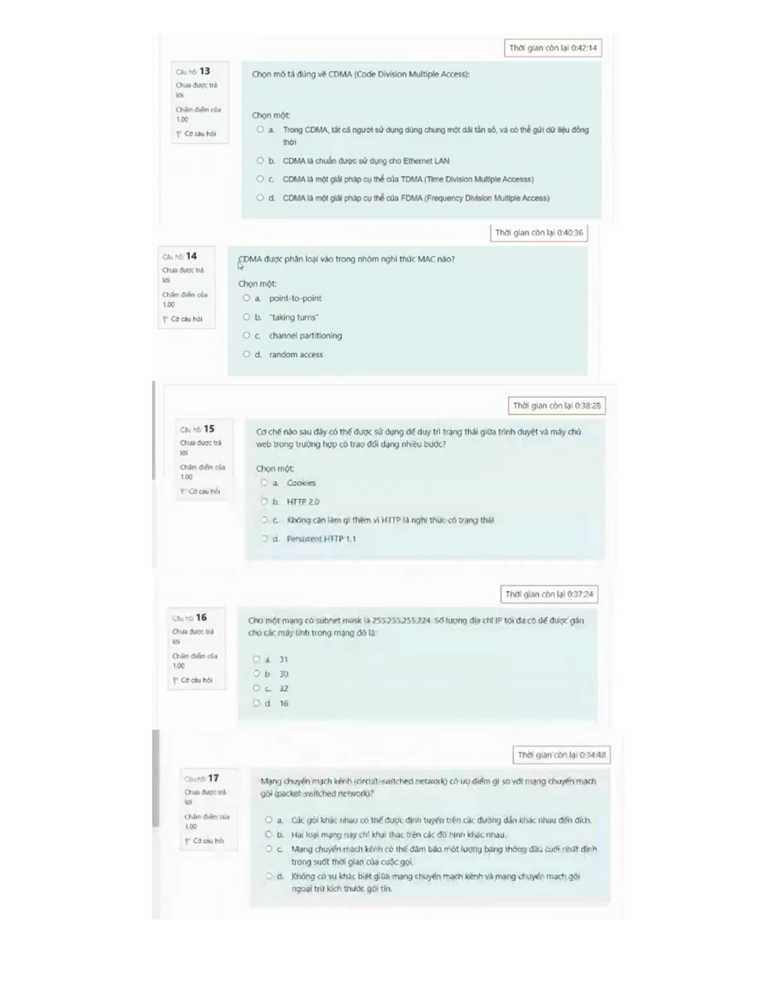

cau nó 13
Chữa được tả
m

Chăm đim của
100

Ý Cỡ câu bài

cau nà 14
“Chưa được trả

“Chăm điểm của
1

Câu hài

owe 16
Chưa được trả

Chăm đếm của
100

Pecocwns

ura T6
“Chưa được trẻ

Chie điểm của
1

Cô du bội

cure IT
Chưa được và

“Chấm điểm sua
100

Y Caouhải

Chọn mô tá đúng về CDMA (Code Division Multiple Access):

Chọn một:
© a. Trong CDMA, tắt cả người sử đụng dùng chưng một dải tần số, và có thể gửi đ Hau đồng,
thời

© b._ CDMAlà chuẩn được sử dung cho Ethernet LAN

Thời gian còn lại 042-14

© C CDMAIâ mot giải pháp cụ thể của TOMA (Time Division Multiple Access)
© đ._ CDMA là một giái pháp cụ thể của FDMA (Frequency Division Multiple Access)

{§PMA được phân loại vào trong nhóm nghỉ thức MAC nào?

Chọn một.

© a point-to-point
© Đ. “taking turns”
© € channel partitioning
© đ random access

Thời gian còn lại 0:40:36

Thời gian còn lại 038.28.

Ca chế nào sau diy có thể được sử đụng để duy tr trạng thái gida tỉnh đuyệt và máy chủ.

web trong trường hợp có trao đối dạng nhiều bước?

Chon mot
Da Cowes

Ob HTTP20
5... Không căn lâm gi thềm vi HTTP là nghí thức cô trang thái
DG Pensstee(HTTP 1.1

Thời gian còn lại 02724

Cho một mạng có subnet mask là 255.255.255.224 Số lượng địa chí tối đa cd để được gần.
cho các may tinh trong mang đó là-

Da
5b
Oc
Oa

#sk8g.

Thời giai còn lại 34:48

Mang chuyén mach kênh (circuit-saritched.netwark) cÓ uv điểm gi so với mang chuyénmach
904 (packet-switched network?

Oa
Ob
Oc

=)

“ắc gi khắc nhau có thé được định tuyế trên cặc đường dẫn khắc nhau đến địth.
Hat loại mạng này chỉ khái thật tiên các 60 hịnh khóc nhau,
‘Mang chuyển qrech kênh cớ thể đảm báo mét luflg bang théng đầu cues (thất định.

trong suớt thời gian của cuộc gợi.

'Không có sự khác biệt giGa mang chưyến mạch kénh va mạng chuyén mạch đói

ngoại trừ kích thước gói tin

> Văn bản trang này được nhận dạng bằng OCR. Cần kiểm tra lại các ký tự/số liệu.

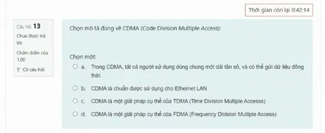

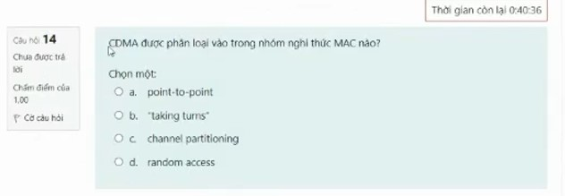

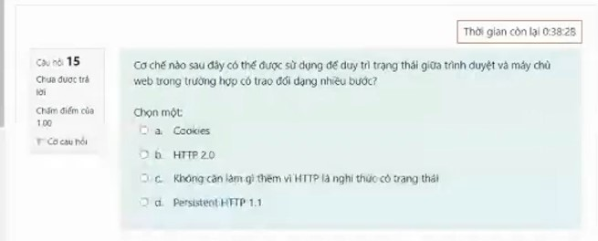

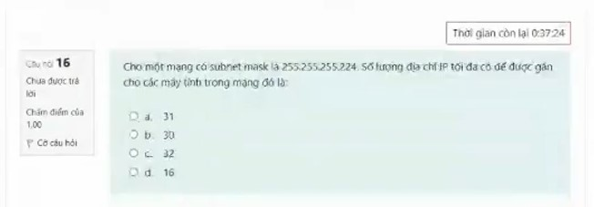

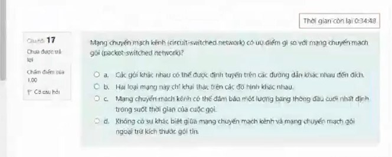

## Trang 5

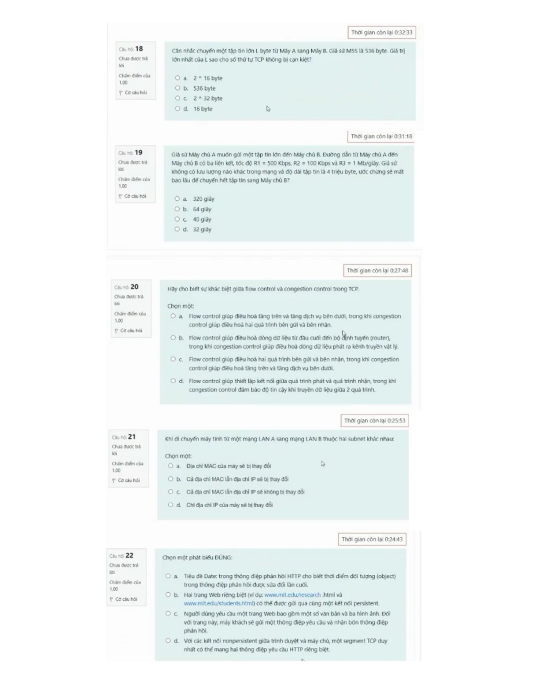

cá sẻ 18
Chase được trẻ.
li

Chăm điểm của
100

Ý Có cu hài

ca sẻ T9.
Chae được trẻ

Chăm aiden của
100

Y Cẽcâu bối

cau nà 201
Chúa được tả

Chăm điểm của
1

YY Cỡ câu bái

Cau nà 21
Chua được trả

Chăm đin của
106

Ý Cỡ câu bài

ca nè 22
Chu được trả

Chăm điểm của
100

Y Cẽcâu hài

Thời gian còn lại 0:32:33

‘Can nhắc chuyển một tập tin lớn L byte từ May A sang Máy B. Giá sử MSS là 536 byte. Giá trị
lớn nhất của L sao cho số thứ tự TCP không bị cạn kiệt?

Oa 2^16byte
Ob. 526 byte
Oc 2^32byke
Od byte b

"Thời gian còn lại 031:18

id sử Máy chủ A muốn gửi một tập tin lớn đến Máy chủ B. Đường dẫn từ Máy chủ A đến.
Máy chủ B có ba liên kết, tốc độ R1 = 500 Kops, R2 = 100 Kops và R3 = 1 Mb/gidy. Gis sử
không có lưu lượng nào khác trong mạng vô độ dài tập tin là 4 triệu byte, ước chung sẽ mat
bạo lâu để chuyển hết tập tin sang Máy chủ B?

Oa 320giy
Ob. 64giây
Oe 40giây
Od 32giáy

Thời gian còn lại 02748

Hay cho biết sự khác biệt giữa flow control và congestion control trong TCP.

Chọn một:
© a. Flow control giúp điều hoà tàng trên và tang dich vy bên dưới, trong khi congestion

control giúp điều hoà hai quả trình bên gửi và bên nhận.

© Flow control glip điều hoà đông da itu tử đầu cuối đến bộ Han tuyến router,
trong khi congestion control giúp điều hoà dòng dữ liệu phát ra kênh truyền vật lý.

.Ô € Flow control giúp điều hoa hai quả trình bên gửi và bên nhận, trong khi congestion

control giúp điều hoà tầng trên và tăng dich vụ bên dưới.

Od. Flow control giúp thiết lập kết nổi giữa quá trình phát và quá trình nhận, trong khỉ
‘congestion control đảm bảo độ tin cậy khí truyền da liệu giữa 2 quá trình.

Thời gian còn lại 25:53

Khi đi chuyến máy tính từ một mang LAN A sang mang LAN B thuộc hal subnet khác nhau:

Chọn mot:
© a. Dia chi MAC của máy sẽ bj thay đổi ồ

© b, Cả địa chi MAC lẫn địa chi IP sẽ bị tay đổi
© € _ Cả địa chỉ MAC lẫn địa chỉ IP sẽ không bị thay đổi
© dd. Chỉđịa chỉ IP của máy sẽ bị thay đổi

Chọn một phát biểu DUNG:

Thời gian còn lại 02443

© a. Tiêu đề Date: trong thông điệp phan hồi HTTP cho biết thời điểm đối tượng (object)

trong thông điệp phan hồi được sửa đổi lần cuối.

Hai trang Web riêng bit (ví dy: wwewe.nit.edu/rexeatch tml về
war miLedu/students.ntmi) cô thế được gửi qua cùng một kết nối persistent,

'Người dùng yêu cầu một trang Web bao gồm một số văn bản va ba hình ảnh. Đối
Với trang này, máy khách sẽ gửi một thông điệp yêu cầu và nhận bốn thông điệp.

phản hồi.

Voi các kết nối nonpersistent giữa trinh duyệt và mây chủ, một segment TCP duy.

nhất có thể mang hai thông điệp yêu cầu HTTP riêng biết.

"

> Văn bản trang này được nhận dạng bằng OCR. Cần kiểm tra lại các ký tự/số liệu.

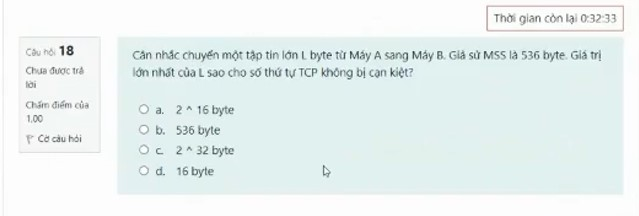

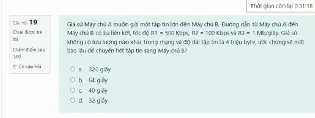

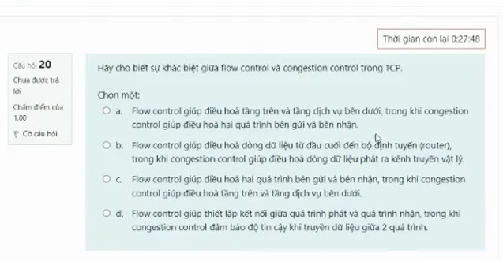

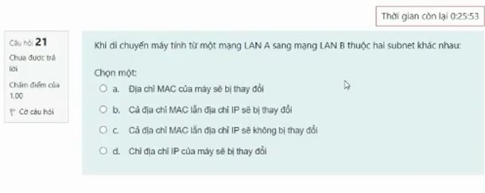

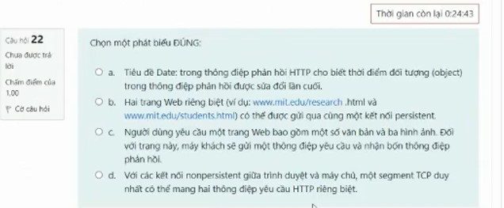

## Trang 6

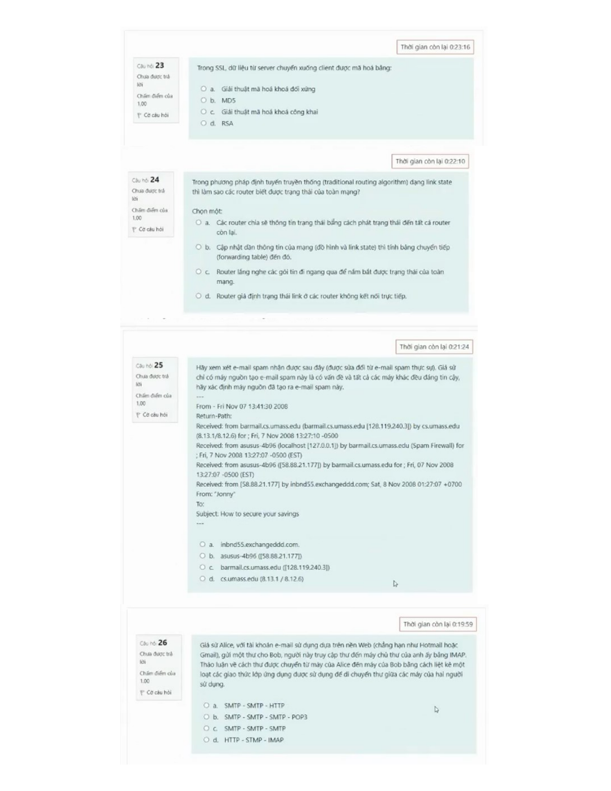

Cound 23
“Chưa được trả

Chăm điểm của
19

 Cếcâu bài

Cound 24
Chae được trả.

“Chăm điểm của
106

Y Cu bài

cau re 25
“Chưa được trả

Chăm điểm của
100

Ý Cẽcâu hài

ca sò 26
Chase được trả
we

(Chăm điểm của.
190

'Y Cổ câu hài

“Tong SSL. dữ liệu từ server chuyển xuống) client được mã hoá bing:

© a. Giải thuật ma hod khoá đối xứng.

© _ Giải thuật ma hoá khoả công khai

Thời gian còn lại 023:16

Thời gian còa lại 0:22:10

From - Fri Nov 07 13⁄41:30 2008

Subject: How to seawe your savings

inbndSS.exchangeddd.com.
asusus-4b96 ([58.88.21.177])
barmailcs.umass.edu (128.119.2403)
cSumass edu (8.13.1 / 8.126)

5g8s
gees

Trong phương pháp định tuyến truyền thống (traditional routing algorithm) dang link state
thì làm sao các router biết được trạng thái của toàn mang?

“Các router chia sẽ thông tin trang thai bẩng cách phát trạng thái đến tất cá router
“Cập nhật dan thông tin của mạng (đồ bình và link state) thì tính bảng chuyến tiếp
forwarding table) đến đô.

Router lắng nghe các gồi tin đi ngang qua để nắm bắt được trạng thai của toàn

Router giả định trạng thái link ở các router khôog) kết nối trực tiếp.

Thời gian còn lại 0:21:24

‘Hay xem xét e-mail spam nhận được sau đây (được sửa đối từ e-mail spam thực sự). Giả sử.
chỉ có máy ngườn tạo e-mail spam này là có vấn đề và tất cả các máy khác đều đáng tin cày,
"hãy xác định may ngudn đã tạo ra e-mail spam nay.

Received: from barmailcs.umass.edu (barmailcs.umass.edu [128.119240.3)) by cs.ưmass edu.
(8.13.1/8.126) for ; Fri, 7 Nov 2008 13:27:10 -0500

Received: from asusus-4b96 (localhost {127.0.0.1)) by barmailcs.umass.edu (Spam Firewall) for
+ Fri, 7 Nov 2008 13:27:07 -0500 (EST)

Received: from asusus-4b96 ({58.88.21.17)) by barmail cs umass.edu for ; Fri, 07 Nov 2008
13:27:07 -0500 (EST)

Received: from (58.88.21.177] by inbnd55.exchangeddd.com; Sat, 8 Nov 2008 07:27:07 +0700

Thời gian còn lại 0:19:59

'Gi sử Alice, với tài khoán e-mail sử dung dựa trên nền Web (chẳng hạn như Hotmall hoặc

mai), gửi một thư cho Bob, người này truy cập thư đến may chủ thư cửa anh ấy bang IMAP.
Thảo luận về cách thư được chuyển từ mây của Alice đến may của Bob bằng cách liệt kẻ một
loạt các giao thức lớp ứng dụng được sir dụng đế đi chuyến thư giữa các may của hai người

> Văn bản trang này được nhận dạng bằng OCR. Cần kiểm tra lại các ký tự/số liệu.

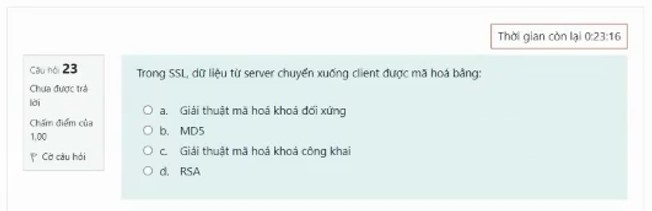

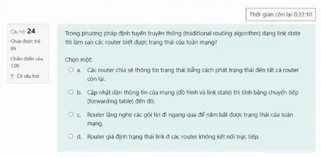

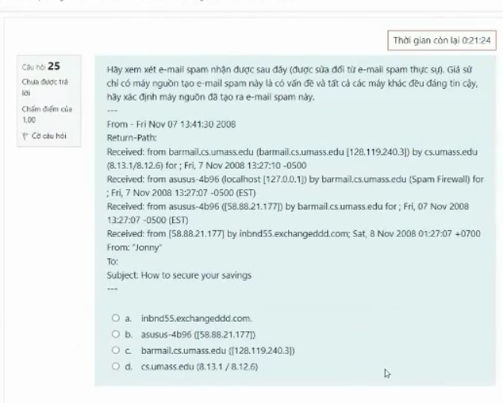

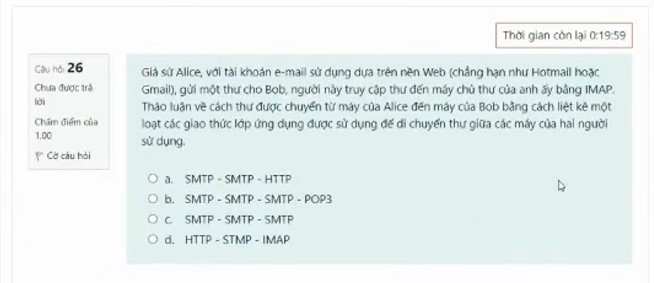

## Trang 7

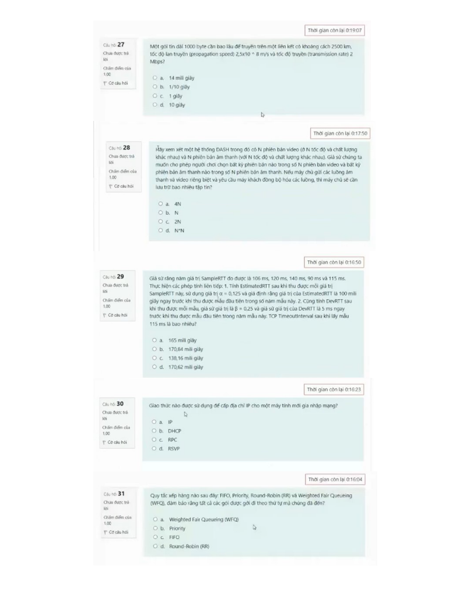

củ sẻ Z7
Chua được trẻ.
lại

Chấm điểm của
1®

Y C6câu hếi

“Cau nó 28.
(Chưa được trả.
ei

Chăm điểm của
1

Y Coctu hài

cau nó 29
“Chúa được trả

Chăm điểm của
10

Y Coctu bài

ca nè 30
‘Chua được trả

Chăm điểm của
1

Y Cu bài

ca se 33
Chun được trẻ

Chăm điểm của.
1œ

† Cau hếi

Thời gian còn lại 01907

[Mot gol tin đôi 1000 byte cần bao lâu đế truyền trên một iên kết có khoáng cách 2500 km,
Ốc độ lan truyền (propagation speed) 2,5x10 ^ 8 m/s và tóc độ truyền (transmission rate) 2
‘Mbps?

Oa tmili giấy
Ob 1/10g8y

Oc 1g8y
Od 10giay

Thời gian còn lại 0:17:50

‘fay xem xét một hệ thống DASH trong đó cô N phiên bán video (ở N tốc độ và chất lượng,
khác nhau) và N phiên bin âm thanh (với N tốc độ và chất lượng khác nhau), Giả sử chúng ta
“muốn cho phép người chơi chọn bat kỳ phiến bán ndo trong số N phiên bản video và bất kỳ
phiên bản âm thanh nào trong số N phiên bản ám thanh. Nếu máy chủ gửi các luồng âm.
thành và video riêng biệt và yêu cầu máy khách dong bộ hóa các lường, thì máy chủ sẽ căn.
ưu trữ bao nhiêu tập tin?

Oa 4N
ObN
Oc w
Od NN

Thời gian còn lại 0:16:50

Gia sử rằng năm giá trị SampleRTT đo được là 106 ms, 120 ms, 140 ms, 90 ms và 115 ms,
'Thực hiện các phép tính liên tiếp: 1. Tinh EstimatedRTT sau khi thu được mỗi giá trị
‘SampleRTT này, sử đụng giá trị c= 0,125 va giả định rng giá trị của EstimatedRTT là 100 mili
lay ngay trước khi thu được mau đầu tiên trong số nam mau này. 2, Cũng tính DevRTT sau.
khi thu được mỗi mẫu, giả sử giá trị là B = 0,25 và giá sử gi trị của DevRTT là 5 ms ngay
rước khi thu được mẫu đầu tiên trong năm mẫu này. TCP Timeoutinterval sau khi lấy mẫu.
'115 ms là bạo nhiêu?

a 165 mill giây

O b. 17084 mili giây
© & 138,16 mil giây
© d. 170,62 mili giây

Thời gian còn lại 01623

'Giao thức nào được sử dung để cấp địa chỉ IP cho một máy tính mới gia nhập mang?
R

Oa ep
Ob. DHCP
Oc RC
Od RSVP

Thời gian còn lại 0:16:04

‘Quy tắc xếp hàng nào sao đây: FIFO, Priority, Round-Robin (RR) và Weighted Fair Queueing
(WFQ), dim bảo râng tất cà các gói được gới đi theo thứ tự ma chang đã đến?

O a Weighted Fair Queueing (WFQ)
©b. Priority 2
Oc FFO

Od. Round-Robin (RR)

> Văn bản trang này được nhận dạng bằng OCR. Cần kiểm tra lại các ký tự/số liệu.

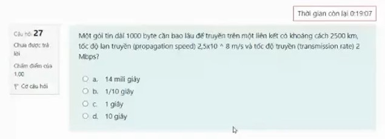

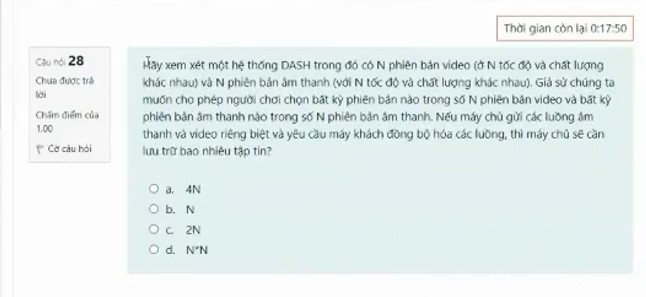

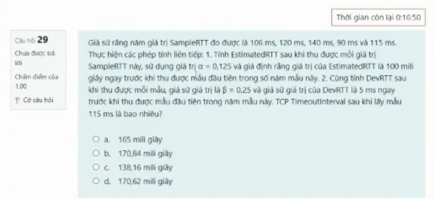

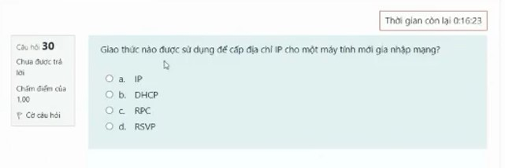

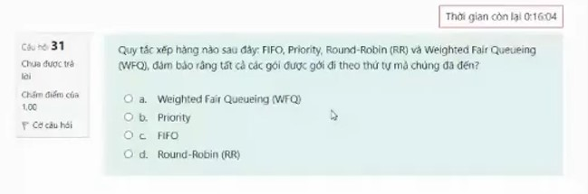

## Trang 8

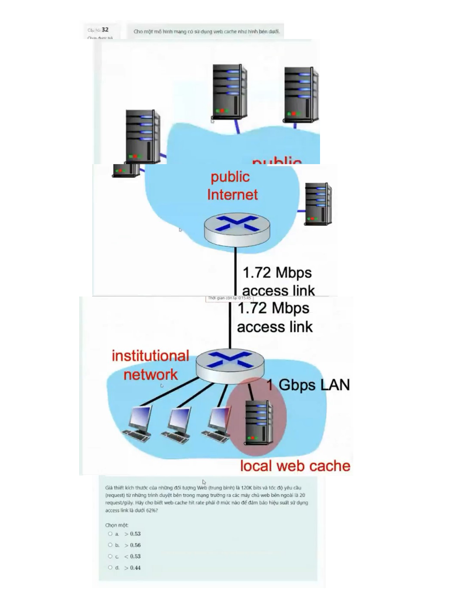

Cho một mô hinh màng có sử dung web cache như hình bén dưới.

1.72 Mbps
.....1 access link

1.72 Mbps
access link

local web cache

CÓ ie Hen thước củ những đi tượng Wed (run Kink 120 BS và lóc độ yêu âu
(request) tử những trình duyệt bền trong mang trường ra các máy chủ web bên ngoài là 20.
+equest/gjiây. Hay cho biết web cache hit rate phải ở mức nào để đảm bảo hiệu suất sử dụng
access link là đưới 62⁄7

Chon một.

Oa >0488
Ob >056
Oc <088
Od >O44

> Văn bản trang này được nhận dạng bằng OCR. Cần kiểm tra lại các ký tự/số liệu.

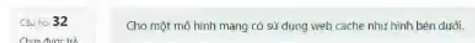

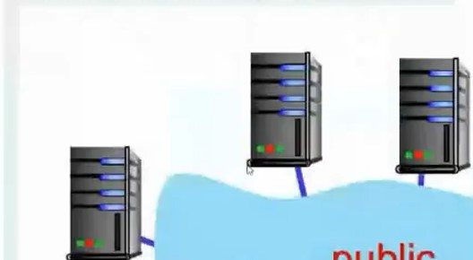

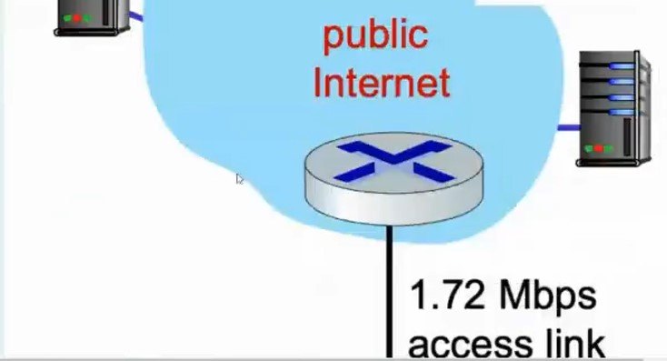

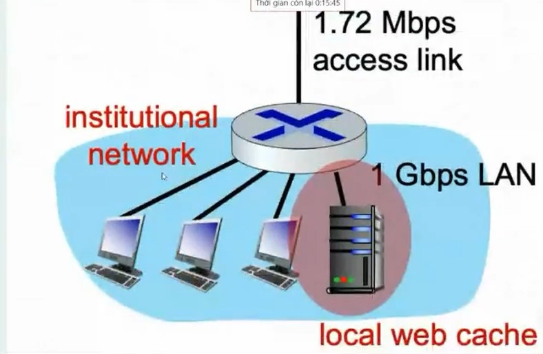

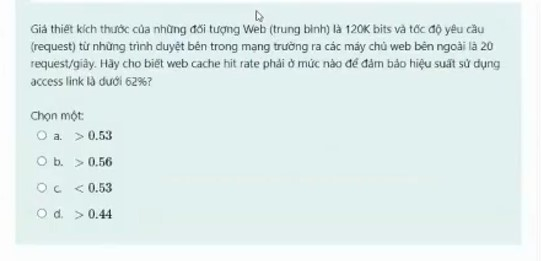

## Trang 9

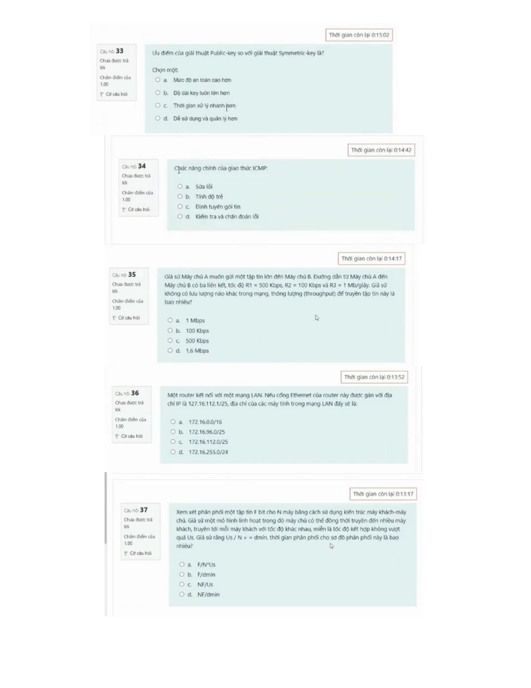

Thời gian còn lại 0:15:02

caro 38 (Uy điểm của giải thuật Public-key so với giải thuật Symmetic-key là?
“Chưa được trẻ
xẻ Chọn một:
khu gxe © a. Mức đan toan cao hơn
Y Cẽ câu hải © b. Độ đãi key luôn lớn hơn.
© € That gan xử nhanhhơn
© đ. Dễ sử dng va quản lý hơn
can 34 Chúc nang chính của giao thức ICMP:
Chưa được trả.
kì Oa sual
.. Ob. Tínhđộ trẻ
Y Gan © €_ Đính tuyến gi tin
© đ. Kiếm tra và chấn đoán tôi
Thời gian còn lại 0:14:17
ca nó 88 Gla sử May chủ A muốn gửi một tập tin lớn đến May chủ B. Đường aan từ Máy chủ A đến.
hae được tà Máy chủ B có ba liên kết, tốc độ R1 = 500 Kops, R2 = 100 Kbps và R3 = 1 Mb/giôy. Giả sử
_ không có lưu lượng nao khác trong mạng, thông lượng (throughput) để truyền tập tin này là
Chăm Oe của bạo nhiêu?
109
Used Oa 1 Mbps &
Ob. 100 Kbps
CC S00 Kbps
© đ. 16Mbps
Thời gian còn lại 0:13:52
count 36 [Mot router kết nối với một mang LAN. Nếu cống Ethemet của router nay được gián với địa
Bí hệ chỉIP là 127.16.112.1/25, địa chỉ của các máy tính trong mang LAN đấy sẽ là:
ome Oa 172160016
TC Ob. 17216960/25
Oc 1?2161120/25
Od 172162550/24
Thời gian còn lại 0:13:17
cung 37 Xem xét phân phối một tập tin F bít cho N may bang cách sử dung kiến trúc máy khách-máy,
hu được tà “chủ. Giả sử một mô hình lin hoạt trong đó máy chủ có thé đồng thời truyền đến nhiều máy.
Lod khách, truyền tới mỗi máy khách với tóc độ khác nhau, miễn là tốc độ kết hợp không vượt
Chăm đim của ‘qu Us. Giả sử rằng Us / N > = dmin, thời gian phân phối cho sơ đồ phản phối này là bao.
= nhiều? &
Ý Có câu hải
Oa F/N*US
Ob. F/ểmin
Oc NF/Us

O đ. NF/dmin

> Văn bản trang này được nhận dạng bằng OCR. Cần kiểm tra lại các ký tự/số liệu.

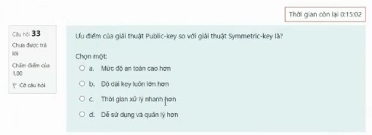

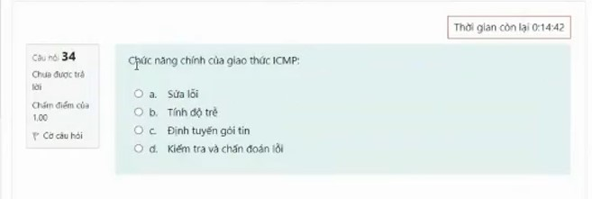

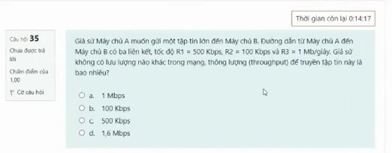

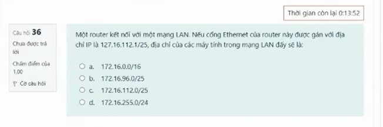

## Trang 10

cau nó 38.
Chưa được trả
(Chăm điểm của.
100

Cổ câu hỏi

ca nà 39
Chae được tả

Chăm đếm của
100

Ý Cơ chu bội

ca nó 40
Che được tá
m

chấm điểm của
100

Ý C6 câu bái

cana
‘Chua được trả

Chăm đim của
100
Y Cau hội

core 42
“Chúa được trả

Chấm điểm của
10

Y Có cu hỏi

Thời gian còn lại 0:12:57

'Gi sử bạn muốn thực hiện giao dịch từ máy khách ở xa đến một máy chủ cảng nhanh cảng

tớ Bạn sẽ sử dụng UDP hay TCP? Tại sao?

© a. TP. Với ICP, chi cần một round trip time (RTT).

© b.. UDP, Dữ liệu giao dich này có thé được định tuyến trên một tuyến đường cụ thế nếu
các bộ định tuyến phát hiện ra UDP trong payload của gói tin.

© & UDP.Với UDP, giao địch có thế được hoàn thành trong một round trip time (RTT).

(© TCP. Các ứng dụng sử dụng TCP làm giao thúc lớp truyén tai luôn nhanh hơn các

giao thức khác.

'Những phat biếu nào sau đây là đúng với SON?

‘Chon mot:
© sa, . Các router tinh bảng định tuyến của mình một cách độc lập.

Thời gian còn lại 0:11:57

© b, Các router có thé chạy thudt toán định tuyến sở hữu riêng bởi các hãng.
©  _ Linh hoạt và cô tính thích nghỉ cao trong việc định tuyến luồng da liệu trên mạng.
© a. Đường đi của gói tin tương ứng với một cập địa chí nguồn, địa chỉ dich là duy nhất.

[Glad thức SMTP:

© a. SMTP không mã hoa dư liệu
© b. Mãhoä dữ bệo ping DEC
De Mã bod deren bằng RSA
1... Mã hoa dirlitu Đáng SSt

Thời gian còn lại 01133

Thời gian còn lại 01239

"rong HTTP/! 1, vấn đề chan Head of Line (HOU 18 Fide tập tin lớn trong trang web (ví dự.
‘video clip) sẽ mat nhiều thời gian để di qua đường liên kết chậm do đó nó chặn các đối
tượng (objects) nhỏ khác đẳng sau nó. HTTP/2 cố gắng giải quyết nó như thế nào?

(© a. Bang cách chia từng thông điệp thành các khung tin nhỏ và xen kề các thông điệp.

yeu cầu và phản hôi

 b.. Bằng cách tạo các hàng đợi khác nhau cho các kích thước thông điệp khác nhau.
© © _ Bằng cách phan loại các yêu cầu khác nhau theo thứ tự uu tiên.
(© d. Bang cách gửi thông điệp nhỏ trước các thông điệp lớn hơn.

Thời gian còn lại 0-1035

Gia sử rằng một gói đến khớp với hai hoặc nhiều entry trong bang chuyến tiếp của bộ định
tuyến Với chuyến tiếp đựa trên địa chỉ IP đích truyền thống, bộ định tuyến áp dung quy tác

nào để xác định cổog đầu ra mã gói tin đến sẽ được chuyển sang?

© a. Entry đầu tiên trong bing chuyển tiếp
© b. Shortest prefix matching

© & Longest prefix matching

© đ. Cổng đầu ra mặc định

> Văn bản trang này được nhận dạng bằng OCR. Cần kiểm tra lại các ký tự/số liệu.

## Trang 11

cane 43
Chúa được trẻ

Chăm điểm của
108

PF CarMuhỏi

cá se 44
Chủa được tá

Chăm điểm của
1

'Ệ Cờcâu bái

¬ 45
Chưa được trẻ.

“Chấm điểm của
1

 Cẽcâu bái

ca, so 46.
Chứa được trả
“

Chăm điểm của
00

'Y Cỡ câu bêi

‘Hay xem xét chười ky tự ASCII sau đáy đã được Wireshark ghi lại khi trình đuyệt gửi thông.
cđiệp HTTP GET (đây là nội dung thực tế cửa thông điệp HTTP GET). Chọn câu trả lời KHONG
UNG:

GET /c6453/Index.htrnl HTTF/1.1

Host Qaia.cs.umass.edu_

(User-Agent: Mozila/S0 ( WineowsU, Windows NT 5.1; en-US; 1v:},7.2) Gecka/20040804
Netscape/72 (a1)

Acceptext/xml, applicattor/xtml, applicatonyxhtml+xmi, text /ntmiq=0:8, text/plain =0.8,
‘image/png, */'2q=0.5.

‘Accept-Longuage: en-us errq=0.SAcceptEncodingy. ip deflate

‘Accept-Charset: ISO -8659-1.uf-8iq=0.7,“xị<07

‘Keep -Altve: 300 Connectionskeep-alive

^ a Trinh duyệt đang yêu cầu một ket nổi liền tục (persistent),

Ob ‘URL của tài liệu được trình duyệt yêu cầu: tISD.//04Í3.£tun3sse<u/cgdS3/4ndex hn)

1  _ Trinh đuyệt đang chạy phiên bản HTTP 1.1
© đi Trình duyệt dang chạy trên may cÔ ten mien Ia gala.cs-umass.edu

Thời gian còn lại 0:08:59

‘Cho mật mạng kết nối m máy lúc nào cũng có sẵn gói tin đế truyền. Nghi thức được sử dụng.
là slotted ALOHA với xốc suất truyền lại là p = 0.5. Xác suốt có một node truyền được trong,
stot kế tiếp nếu slot trước đã bị đựng độ (collision) là.

chon một.
Oa nxos*?
Ob 08"
Oc nxoset
Od nx0§*

Thời gian còn lại 0:08:44

“Chuẩn nào sau đây đã giải quyết được vấn đề HOL trong HTTP?
Chon một:

Oa HITB/LO

Ob, HỈTP/2

Oc HT

O d. Pipelined HTTP/1.1

Thời gian còn lại 0:08:34

Chọn câu DUNG:

© a. Giả sử Máy A đang gửi Máy B một tập tin lớn qua kết nối TCP. Số lượng byte chưa.
được xác nhận mà A gửi không được vượt quá kích thước của buffer nhận.

© bí. Kích thudk của rand TCP không bèo giờ thay đới trong sướt thời gian kết nối.

© © Máy A đang gửi cho May 8 một tập tin lớn qua kết nổi TCP. Giả sử Máy 8 không có
0G liệu để gửi Máy A. Máy B sẽ không gửi xác nhận đến Máy A vì Máy B không thé
mang các thông điệp xác nh:ận trên dữ liệu.

> Văn bản trang này được nhận dạng bằng OCR. Cần kiểm tra lại các ký tự/số liệu.

## Trang 12

Thời gian còn lại 0:08:05

cune47 ronŠ khi DSL sử đụng cơ sở hạ tầng điện thoại nội hạt hiện có của công ty telco, truy cập.
Chủa được trả Internet dạng cáp sử dụng cơ sở hạ tang truyền hình cáp hiện có của công ty truyền hình.
. cáp. Bởi vi cá cp quang và cáp đồng trục đều được sử dụng trong hệ thống nay, nên nó.
eee thường được gọi là cáp đồng trục sợi lal (HFC). Chon câu KHONG ĐỨNG về HFC.
Eade © a Có đụng độ (collision) ở kênh downstream
© b. Trên kênh downstream, tất cả các gói tin gỡi ra từ một nguồn duy nhất, cụ thể là
head end.

©  _Biang thông HFC được chia sé gj0a những người dùng).
© d. Cáp quang kết nổi các điểm head end, từ đó cáp đông trục truyền thống được sử:
dung để tiếp cận các ngôi nhà và căn hộ riêng lẻ.

Thời gian còn lại 0:07:49

cur 48 Mãy xem xét một ứng dụng khách HTTP muốn truy xuất tal liệu Web tại một URL nhất định.
Chúa được tê la chỉ IP của máy chủ HTTP ban đầu không xác địch. Giao thức lớp ứng dụng và truyền tải
- nào ngoài HTTP là cần thiết trong trưởng hợp nay?

Chăm đin của
eo Oa HITP/Tep vai /TeP
jaded! © b. DNS/ TCP va HTTP / TCP
O € DNS/UDP và HTTP / TCP
Od TCP/IP vàiP / ARP
Thời gian còn lại 0:07.24
cured Một gói dữ liêu cổ địa chí mang tiêng có nên xuất hiện trong mgng Pubic Internet không?
hus được tr Tại sao?
Bi
¬—¬ © a. Kina. Vi địa chi mạng riêng có thể được sử dựng bởi nhiều thiết bị mang trong các
mạng riêng.
pi nade (Ob. Đứng. NO có thé được sử dụng trong trường địa chỉ IP nguồn.
©  _ Đứng. Nó có thế được sử đụng trong trường địa chỉ IP đích.
© đ. Không. Vi địa chí mang riêng chỉ được sử dung trên mạng không day,
Thời gian còn lại 006:39
can 50 'Web Cookie được lưu trữ ở:
“Cửa được tà
tr © a. Proxy server
nm tm cn óc
Tu © © Webbrowsdr
©đ Web server
Thời gian côn lại
ca na ST "Thông tin định tuyến của (nhóm) địa chỉ đích bên ngoài một AS lưu trên.
Chúa được tà
= “Chọn một.
Gaiam © a. các gateway router của AS. Lý do là router bên trong chỉ cần chưyển tiếp gói tin đến

XE Say. gateway router và gateway router lo chuyện côn lại.

(© b.. các gateway router và cả router bên trong AS. Lý do là các router cần biết để có thé
tính toán bảng chuyến tiếp (forwarding table) tốt nhất.

Ô © _ Các phát biếu trong các lựa chọn khác đều sai.

© đ. các gateway router và cá router bên trong AS. Ly do là các router bên trong cần biết
gateway router nào tương ứng với (nhóm) địa chỉ dich để chuyển tiếp đến.

> Văn bản trang này được nhận dạng bằng OCR. Cần kiểm tra lại các ký tự/số liệu.

## Trang 13

cau sẻ Số
hứa được tả
Xm

Chăm đim của
00

Y Coctunsi

cau nà 53.
“Chưa được trả

Chăm điển của
1%

Yr Coctunsi

count S4
Chae được trả

Chăm điểm của
1

'Y Ccâu bối

ca, nó SS
“Chưa được trẻ

Chăm đếm của
100

Y Coctunsi

cure SE
Chae được trẻ

Chăm điển của
100

'Y C8 câu bếi

Thời gian còn lại 006:14

Gia sử Máy A gửi Máy B một segment TCP được đóng gồi trong một gói IP. Khi Máy B nhận.

được datagram, làm thế nào để lớp mang trong Máy B biết nó nên chuyến segment (nghia là.
ay|oad của gO! dỡ liệu IP) cho TCP chứ không phải cho UDP hoặc một số giao thức lớp trên
khác?

© a. Có thông tin trong payload cho biết segment này cho TCP hoặc UDP.

© b. Giao thức truyền tải mộc định là TOP

© © Lớp truyền ải sẽ xác định xem TCP hoặc UDP có nhận được segment này hay không,
© dd. Trưởng giao thức 8-bít trong gối IP

Thời gian còn lại 05:56

'Đđi với ứng đụng chia sẽ tập tin P2P, bạn có đông ý với phát biếu “Không có khái niệm vẽ:
‘pha may khách và máy chủ của một phiên giao tiếp” không? Tại sao hoặc tại sao không?

Ô a.. Không. Luôn có một máy chủ quản lý việc trao đối dữ liệu của các peers.
® b.. Đúng. Các phan của tập tin di chuyến từ một peer này đến một peer khác cho.
Khi toát bộ tập tin đều được tất cả các peers nhận.
© © _Khdng, Trong ứng dụng chia sẻ tập tin P2P, ứng dụng nhận tập tin thường là máy.
khách và ứng dung gửi tập tin thường là máy chủ.
Ô d._ Đứng. Không có sự khác biệt giữa các peers về dich vy truyền thông.
‘Gear my choice

Thời gian còn lại 0:05:53

Khả nang nào của CDMA trong mạng không dây có thể giúp tránh được nhiều loạn.
(interference) qua lại giữa nhiều sender?

Chọn một.

© a Các vecto ma hoá (chipping sequence) của những sender khác nhau là trực giao với
nhau.

© b.. Các node hoạt động ở những dai tan số khúc nhau.
© © Cie node truyền trên những khung thời gian khác nhau.
© d. Mỗi nođe có một mã riêng (chipping sequence).

Thời gian còn lại 0:05:48

“Giả Sử 3 người dùng chia sé liên kết 2 Mbps trên mạng chuyến mach gói và mỗi người đừng,
truyền liên tục với tốc độ 1 Mbps khi truyền, nhưng mỗi người dùng chỉ truyền 20 phần tam
thời gian. VỊ nang đợt tang lên khí tất cá người đùng đang truyền, hãy tìm xác suất đế tại bất
kỹ thời điểm nào, tất cả 3 người đùng đang truyền đồng thời?

©a 08
Ob 06
Oc 0008
Od a

Thời gian còn lại 0:05:36

Hay xem xét một peer mới Alice tham gia mang BitTorrent ma không sở hữu bất kỳ chunk
indo, Nếu không có bất kỳ chunk nào, cô ấy không thế trở thành top-four uploader đối với
"bất ky peer nào khác, vì cô ấy không) cô gì để tải lên. Lâm thế nào để sau đô Alice sẽ cô được.
chunk đầu tiên của minh?

© a. _ Trong Bitforršnt, một peer sẽ chọn ngẫu nhiên một peer khác và unchoke peer đó
trong một khoảng thời gian ngắn.

(© b. Mây chủ cung cấp chunk đầu tiên cho bất ky peer mới nào tham gia mạng
BitTorrent.

O € Peer Alice sé hỏi trực tiếp một trong những peer Kin cận của cổ ấy về chunk đầu tiên.

Od. Mỗi peer sẽ kiểm tra xem lin cặn của nó có trồng không và unchoke chúng.

> Văn bản trang này được nhận dạng bằng OCR. Cần kiểm tra lại các ký tự/số liệu.

## Trang 14

Ea

ca nà ST
‘crue được tủ.
8

--

core S8.
‘chs được và
„
_ Chăm điển của
140

Y Coctuhai

> Văn bản trang này được nhận dạng bằng OCR. Cần kiểm tra lại các ký tự/số liệu.

