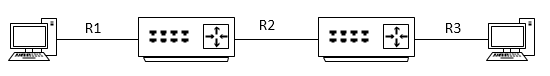
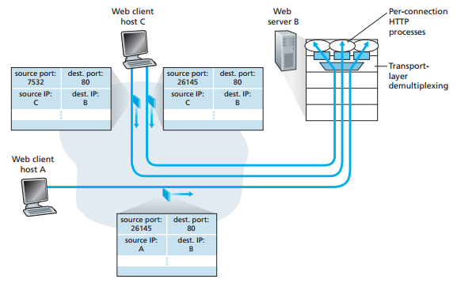
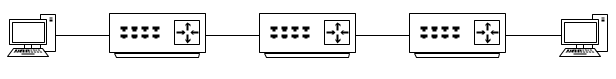
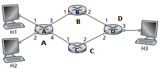
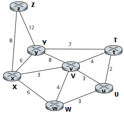
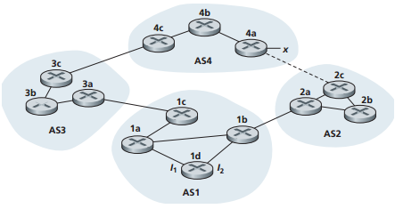
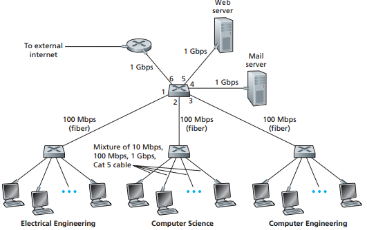
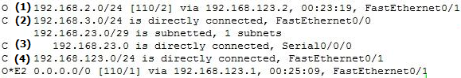
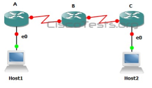

# HK2-1819_MMT_0132_v2.pdf

> 8 trang

## Trang 1

ĐẠI HỌC QUỐC GIA- ĐẠI HỌC          ĐỀ THI CUỐI KỲ 2 NĂM HỌC 2018-2019
     BÁCH KHOA TP.HCM                      Tên môn thi: Mạng máy tính
                                                          Thời gian làm bài: 90 phút;
 KHOA KHOA HỌC VÀ KỸ THUẬT                           (60 câu trắc nghiệm)
        MÁY TÍNH
Lưu ý:
    •   Thí sinh KHÔNG được sử dụng tài liệu;
                                                        Mã đề thi 0132
    •  Trả lời các câu hỏi trên phiếu trả lời trắc nghiệm;
    •   Thí sinh phải nghi MSSV và Tên vào đề thi và NỘP lại đề cùng với bài làm.

Họ, tên thí sinh:..................................................................... Mã sinh viên: .............................

Câu 1: Trong các ứng dụng hội thoại trực tuyến (video conferencing), thông số nào là quan trọng nhất để đảm bảo
chất lượng dịch vụ tối ưu?
A. Độ tin cậy (Reliability).                           B. Phần mềm tiện lợi (Software).
C. Thiết bị chất lượng tốt (Devices).                  D. Độ trễ của dữ liệu (Delay).

Câu 2: Phương pháp nào dùng để ngăn chặn các thâm nhập trái phép từ mạng và có thể lọc bỏ các gói tin?
A. Encryption         B. Bảo vệ hạ tầng vật lý        C. Firewall           D. Login/ password

Câu 3: Giả sử ta có một gói tin truyền từ host A đến host B thông qua bộ chuyển mạch (switch). Tốc độ truyền dữ
liệu từ A đến switch là R1 và từ switch đến B là R2. Tổng thời gian để chuyển hết gói tin có chiều dài là L từ A đến
B là bao nhiêu ? (bỏ qua tất các thời gian trễ tại switch và thời gian lan truyền tín hiệu trong dây dẫn)
A. L /(R1+R2)        B. L/R1 + L/R2               C. (R1 + R2) /L       D. R1/L + R2/L

Câu 4: Mạng chuyển mạch có ưu điểm gì so mới mạng chuyển gói?
A. Không có ưu điểm gì nổi trội so với mạng chuyển gói
B. Có khả năng đảm bảo lượng băng thông nhất định cho mỗi kết nối
C. Có thể cho phép số lượng người sử dụng lớn hơn
D. Có khả năng bảo mật cao

Câu 5: TDM ưu điểm gì so với FDM trong mạng chuyển mạch?
A. Không đòi hỏi yêu cầu cao về phần cứng so với FDM        B. Không có ưu điểm gì so với FDM
C. Tốc độ truyền dẫn nhanh hơn                           D. Đảm bảo được độ trễ

Câu 6: Giả sử ta có host A gửi một file 4000000 byte đến host B. Đường đi từ A đến B gồm 3 liên kết (link) tương
ứng với tốc độ truyền dẫn R1 = 500 kbps, R2 = 2 Mbps và R3 = 1 Mbps. Bạn hãy cho biết mất bao lâu để gói tin đi
đến B (trong điều kiện không có host nào khác tham gia đường truyền, bỏ qua thời gian đợi ở các router và thời
gian lan truyền dữ liệu trong dây dẫn)?

A. 64 giây            B. 20 giây                   C. 256 giây                 D. 16 giây

Câu 7: Hãy cho biết đâu là thứ tự các tầng theo thứ tự từ trên xuống dưới (top-down) trong mô hình Internet:
A. Message, Segment, Datagram, Fragment, Physical
B. Application, Transport, Network, Data Link, Physical
C. Physical, Link, Network, Transport, Application
D. Physical, Fragment, Datagram, Segment, Message

Câu 8: Phát biểu nào sau đây SAI khi đề cập đến ứng dụng chia sẻ file P2P:
A. Các máy trong mạng P2P không có vai trò server hay client một cách rõ ràng
B. Các máy trong mạng P2P có vai trò tương tự nhau, nhưng phải có một số máy chạy thường trực
C. Các máy trong mạng P2P đều có server process và client process
D. Cả (A), (B) và (C) đều sai

Câu 9: Lý do nào trong các lý do sau giải thích cho câu hỏi “Tại sao các ứng dụng sử dụng giao thức HTTP, POP3,
SMTP ở tầng ứng dụng phù hợp hơn với giao thức TCP ở tầng Vận chuyển so với giao thức UDP?”
A. Tất cả các ứng dụng trên đều đòi hỏi dữ liệu phải Vận chuyển theo thứ tự và không bị mất gói
B. Tất cả các ứng dụng trên do người lập trình tạo ra
C. Dữ liệu của tất cả các ứng dụng trên cần được bảo mật
D. Cả (A), (B) và (C) đều sai.

                                                                          Trang 1/8 - Mã đề thi 0132

## Trang 2

Câu 10: Giả sử rằng bạn An đăng nhập vào email của trường ĐH Bách khoa thông qua trình duyệt Web để gửi thư
cho Bình, Bình thường đọc mail trên điện thoại thông qua ứng dụng sử dụng giao thức POP3 để kết nối với mail
server. Bạn hãy cho biết đâu là giao thức ở tầng Vận chuyển (Transport) được sử dụng trong tình huống trên?
A. UDP              B. TCP         C. Cả UDP và TCP         D. Không dùng UDP lẫn TCP

Câu 11: Giao thức TCP có thể kế hợp với giao thức SSL để cung cấp dịch vụ bảo mật thông tin từ tiến trình đến
tiến trình (process to process) bằng cách mã hóa thông tin. Bạn hãy cho biết SSL được hiện thực tại tầng nào trong
các tầng sau:
A. Tầng ứng dụng       B. Tầng vận chuyển          C. Tầng mạng         D. Tầng data link

Câu 12: Một TCP server cần bao nhiêu socket để có thể hỗ trợ đồng thời N kết nối từ N client khác nhau?
A. 1                  B. n                  C. n + 1              D. Không xác định

Câu 13: HTTP Client muốn tải nội dụng của một trang Web theo địa chỉ URL với tên miền xác định, nhưng địa chỉ
IP tương ứng với URL chưa được xác định. Bạn hãy cho biết giao thức nào được sử dụng ở tầng Vận chuyển trong
trường hợp này để xác định địa chỉ IP tương ứng với trang Web?
A. UDP              B. TCP        C. Có thể UDP hoặc TCP            D. DNS và TCP

Câu 14: Dịch vụ DNS sẽ được sử dụng khi bạn sử dụng trình duyệt Web để truy cập vào trang Web theo một địa
chỉ URL lần đầu tiên. Giả sử rằng n DNS server được truy vấn trước khi trình duyệt của bạn nhận được địa chỉ IP
từ hệ thống DNS với thời gian truy vấn lần lượt là RTT1, RTT2,…RTTn và RTT0 là Round Trip Time (RTT) giữa
trình duyệt Web và server chứa trang Web. Bạn hãy cho biết sau bao nhiêu lâu bạn sẽ có được nội dung của trang
Web nếu trên trang Web đó chỉ có một đoạn văn nhỏ với 20 ký tự?
A. RTT0 + RTT1 + …+ RTTn                       B. 2RTT0 + RTT1 + .. RTTn
C. RTT1 + RTT2 + …+ RTTn                      D. RTT0

Câu 15: Chọn phát biểu ĐÚNG:
A. Khi người dùng sử dụng Web browser để truy cập vào một trang Web có một vài dòng văn bản và 4 tấm hình thì
Web browser chỉ gửi một nội dung yêu cầu đến server và sẽ nhận được 5 nội dung phản hồi từ server tương ứng
với các đối tượng trên trang Web đó.
B. Nội dung phản hồi trong gói tin HTTP trả lời từ server (HTTP response) đến Web browser sẽ luôn luôn có nội
dung (phần body sẽ luôn luôn có dữ liệu).
C. Nội dung của hai đối tượng khác nhau của một trang Web có thể được gửi từ Web server về Web browser trên
cùng một kết nối TCP .
D. Cả (A), (B) và (C) đều sai.

Câu 16: Cho hình vẽ

Hãy cho biết những giá trị của địa chỉ IP và cổng trong gói tin trả về từ phía server đến client A?
A. cổng nguồn: 80, IP nguồn: B; cổng đích: 26145, IP đích: A
B. cồng nguồn: 26145, IP nguồn: A; cổng đích 80, IP đích: B
C. cổng nguồn 80, IP nguồn: A; cổng đích: 26145, IP đích: B
D. cổng nguồn 80, IP nguồn C; cổng đích: 7532, IP đích: B

                                                                          Trang 2/8 - Mã đề thi 0132

## Trang 3

Câu 17: Giả sử host A gửi 2 TCP segment kế tiếp nhau cho host B. Segment thứ nhất có SEQ là 120, segment thứ
2 có SEQ là 140. Bạn hãy cho biết có bao nhiêu byte dữ liệu trong segment thứ nhất?
A. 120 byte                  B. 20 byte            C. 140 byte          D. Không xác định

Câu 18: Giả sử host A gửi 2 segment kế tiếp nhau cho host B theo qua kết nối TCP. Segment thứ nhất có SEQ là
100, segment thứ 2 có SEQ là 110. Gói tin thứ nhất không đến được B, nhưng gói tin thứ 2 đến được B. Bạn hãy
cho biết giá trị ACK được host B trả về cho host A khi nhận được gói tin thứ 2 là bao nhiêu?
A. 100                       B. 101                C. 110               D. 111

Câu 19: Chọn phát biểu ĐÚNG trong các phát biểu sau:
A. Host A gửi dữ liệu cho host B thông qua kết nối TCP. Nếu host B không có dữ liệu gửi cho host A thì sẽ không
có bất kỳ gói dữ liệu từ host B gửi về host A.
B. Kích thước của gói tin TCP (segment) không bao giờ thay đổi trong suốt thời gian kết nối.
C. Khi gửi dữ liệu từ host A đến host B thông qua kết nối TCP thì kích thước của gói dữ liệu (segment) không được
lớn hơn kích thước bộ nhớ đệm dùng để tiếp nhận dữ liệu của host B.
D. Khi gửi dữ liệu từ host A đến host B thông qua kết nối TCP, nếu số SEQ của segment X là m thì số thứ tự của
segment tiếp theo X phải là m + 1.

Câu 20: Host A và host B trao đổi dữ liệu thông qua kết nối TCP và host B đã nhận được tất cả các byte dữ liệu từ
0 cho đến byte thứ 126 từ host A. Giả sử rằng host A sau đó gửi 2 segment kế tiếp nhau cho host B chứa lần lượt 80
byte và 40 byte dữ liệu. Trong segment đầu tiên có số SEQ là 127, số cổng nguồn là 3033 và số cổng đích là 80.
Bạn hãy cho biết segment thứ 2 từ host A gửi về cho host B có chứa SEQ, cổng nguồn, cổng đích là bao nhiêu?
A. SEQ: 207, cổng nguồn: 3033, cổng đích: 80  B. SEQ: 207, cổng nguồn: 80, cổng đích: 3033
C. SEQ: 247, cổng nguồn: 3033, cổng đích: 80  D. SEQ: 247, cổng nguồn: 80, cổng đích: 3033

Câu 21: Host A và host B trao đổi dữ liệu thông qua kết nối TCP và host B đã nhận được tất cả các byte dữ liệu từ
0 cho đến byte thứ 126 từ host A. Giả sử rằng host A sau đó gửi 2 segment kế tiếp nhau cho host B chứa lần lượt 80
byte và 40 byte dữ liệu. Trong segment đầu tiên có số SEQ là 127, số cổng nguồn là 3033 và số cổng đích là 80.
Nếu host B nhận được phân đoạn thứ 2 trước khi nhận phân đoạn thứ nhất thì trong gói tin trả về cho host A có
ACK bằng bao nhiêu?
A. 127                       B. 207                C. 247               D. 167

Câu 22: Giả sử ta có 3 giá trị tương ứng của SampleRTT theo thứ tự lần lượt là 106 ms, 120 ms, 140 ms. Bạn hãy
cho biết giá trị EstimatedRTT của lần sau cùng là bao nhiêu, nếu ta biết được giá trị alpha = 0.125, EstimatedRTT
của lần gửi trước khi gửi gói đầu tiên trong 3 gói trên là 100ms?
A. 106,71 ms                 B. 105,45 ms          C. 107,67 ms         D. 103,15 ms

Câu 23: Giả sử ta có 2 giá trị tương ứng của SampleRTT theo thứ tự lần lượt là 106 ms, 120 ms. Bạn hãy cho biết
giá trị DevRTT của lần sau cùng là bao nhiêu, nếu ta biết được giá trị alpha = 0.125, beta = 0.25, EstimatedRTT,
DevRTT của lần gửi trước khi gửi gói đầu tiên trong 2 gói trên tương ứng là 100ms và 5 ms?
A. 8 ms               B. 5 ms               C. 0,12 ms                  D. 10 ms

Câu 24: Giả sử server A nhận được một yêu cầu từ client B thông qua UDP datagram và server cũng phản hồi lời
yêu cầu đó bằng một gói tin thông qua UDP datagram. Nếu client B sử dụng IP giả mạo Y thay vì sử dụng IP thật
là X thì server A sẽ gửi gói tin phản hồi về IP nào?
A. IP Y               B. Server không gửi được gói tin về client vì xác định được IP giả mạo
C. IP X              D. Server không phản hồi yêu cầu vì đó là gói tin UDP

Câu 25: Hãy cho biết sự khác nhau cơ bản giữa router và link-layer switch:
A. Trong router gói tin được chuyển đi dựa vào địa chỉ IP, trong link-layer switch gói tin được chuyển đi dựa vào
địa chỉ MAC.
B. Bảng định tuyến trong router do người quản trị thiết lập, bảng định tuyến trong link-layer switch do nhà sản xuất
thiết lập.
C. Trong router có bảng map giữa cổng ra và IP, trong link-layer switch không có bảng map giữa MAC và cổng ra.
D. Router và link-layer switch là một.

Câu 26: Host A kết nối với host B thông qua 3 router. Một gói tin IP datagram được gửi từ host A tới host B sẽ đi
qua bao nhiêu network interface nếu bỏ qua việc phân mảnh IP daragram.

A. 8                         B. 6                         C. 4                       D. 2

                                                                          Trang 3/8 - Mã đề thi 0132

## Trang 4

Câu 27: Host A kết nối với host B thông qua 3 router. Có bao nhiêu bảng định tuyến (forwarding table) được sử
dụng để chuyển một gói tin IP datagram được gửi từ host A tới host B .

A. 1                         B. 2                         C. 3                       D. 4

Câu 28: Phát biểu nào sau đây SAI khi nói về IPv6 header:
A. Độ dài của IPv6 header thay đổi tùy theo kích thước gói tin.
B. Header của IPv6 có ít trường dữ liệu hơn header của IPv4.
C. Header của IPv6 sử dụng 128 bit để chứa địa chỉ của nguồn.
D. Cả (A), (B) và (C) đều đúng.

Câu 29:Phát biểu nào sau đây ĐÚNG khi đề cập đến các router trong cùng một AS (Autonomous System):
A. Các router dùng chung giao thức định tuyến trong nội bộ AS (intra-AS routing protocol).
B. Các router có chung giao thức định tuyến đi ra ngoài AS (extra-AS routing protocol).
C. Các router có chung chi phí khi đi ra ngoài AS.
D. Cả (A), (B) và (C) đều sai.

Câu 30: Phát biểu nào sau đây là ĐÚNG khi đề cập đến giao thức định tuyến OSPF:
A. Router sẽ gửi gói tin quảng bá thông tin định tuyến đến tất cả các router khác trong cùng AS
B. Router chỉ gửi gói tin quảng bá thông tin định tuyến đến các router hàng xóm của nó
C. Router sẽ gửi gói tin quảng bá thông tin định tuyến ra các router ngoài AS
D. Router chỉ gửi gói tin quảng bá thông tin cho những router nào mới gia nhập vào AS

Câu 31: Một datagram network sử dụng 8 bit làm địa chỉ. Router sử dụng kỹ thuật “longest prefix matching” và
chuyển gói tin đến các interface theo bảng định tuyến sau:
                                           Prefix match       Interface
                                   00             0
                                   010            1
                                   011            2
                                   10             2
                                   11             3
Bạn hãy cho biết số lượng địa chỉ có thể có thể đi qua interface 2 là bao nhiêu
A. 32                 B. 64                 C. 96                D. 128

Câu 32: Cho network như hình vẽ (sử dụng cho câu 32 và câu 33)

Giả sử đây là mạng chuyển gói (datagram network). Bạn hãy thiết lập forwarding table trong router A, sao cho tất
cả các gói tin đi từ H1 đến H3 phải đi qua interface 3 trong khi đó tất cả các gói tin từ H2 đi tới H3 phải đi qua
interface 4.
A. Không thể thiết lập được forwarding table thỏa mãn điều kiện trên

B     Destination address         Interface
     H3                    3

C     Destination address         Interface
     H2                    2

D     Destination address         Interface
     H1                    1

                                                                          Trang 4/8 - Mã đề thi 0132

## Trang 5

Câu 33: Sử dụng sơ đồ mạng như Câu 32, giả sử đây là mạng chuyển mạch (virtual circuit network). Bạn hãy thiết
lập forwarding table trong router A, sao cho tất cả các gói tin đi từ H1 đến H3 phải đi qua interface 3 trong khi đó
tất cả các gói tin từ H2 đi tới H3 phải đi qua interface 4.

A. Không thể thiết lập forwarding table thoải mãn điều kiện trên

B     Incoming interface   Incomming VC#    Outgoing interface  Outgoing VC#
      1                 12               3                22
      2                 23               4                18

C     Incoming interface   Incomming VC#    Outgoing interface  Outgoing VC#
      3                 12               1                22
      4                 23               2                18

D     Incoming interface   Incomming VC#    Outgoing interface  Outgoing VC#
      3                 12               3                22
      3                 23               4                18

Câu 34: Một datagram network sử dụng 32 bit làm địa chỉ. Giả sử rằng router có 4 interface (4 liên kết) được đánh
số từ 0 đến 3, các gói tin được chuyển đến các interface theo bảng định tuyến sau:
                    Destination Address Range                   Link Interface
                 11100000 00000000 00000000 00000000         0
                    through
                 11100000 00111111 11111111 11111111
                 11100000 01000000 00000000 00000000         1
                    through
                 11100000 01000000 11111111 11111111
                 11100000 01000000 00000000 00000000         2
                    through
                 11100000 01000000 11111111 11111111
                    otherwise                                   3
Bạn hãy cho biết khi gói tin đến có địa chỉ: 11100001 01000000 11000011 00111100 sẽ được chuyển đến cổng ra
nào?
A. 0                  B. 1                  C. 2                 D. 3

Câu 35: Cho một subnet có prefix 223.1.17/24 có thể hỗ trợ được 90 interface. Bạn hãy cho biết địa chỉ nào sau
đây thỏa mãn điều kiện trên?
A. 192.168.1.192/25           B. 192.168.1.128/25      C. 223.1.17.128/25      D. 223.1.17.192/28

Câu 36: Một datagram network sử dụng 32 bit làm địa chỉ. Giả sử rằng router có 4 interface (4 liên kết) được đánh
số từ 0 đến 3, các gói tin được chuyển đến các interface theo bảng định tuyến sau:
                    Destination Address Range                   Link Interface
                  11100000 00000000 00000000 00000000         0
                    through
                  11100000 00111111 11111111 11111111
                  11100000 01000000 00000000 00000000         1
                    through
                  11100000 01000000 11111111 11111111
                  11100000 01000000 00000000 00000000         2
                    through
                  11100000 01000000 11111111 11111111
                    Otherwise                                  3
Bạn hãy cho biết đâu là câu trả lời đúng khi ta sử dụng định dạng a.b.c.d/x để mô tả khung địa chỉ đi qua interface 0
A. 224.0/10           B. 224.64/24             C. 224/8            D. 225.1.128/9

Câu 37: Cho subnet có prefix 128.119.40.128/26. Bạn hãy cho biết địa chỉ IP nào sau đây thuộc subnet trên?
A. 128.119.40.182       B. 128.119.40.192      C. 128.119.40.202      D. 128.119.40.222

Câu 38: Có bao nhiêu fragment được tạo ra khi gửi 2600 byte datagram vào đường truyền có MTU 600 byte?
A. 5                   B. 4                   C. 3                     D. 2

                                                                          Trang 5/8 - Mã đề thi 0132

## Trang 6

Câu 39: Bạn hãy cho biết kích thước của fragment (bao gồm cả header) cuối cùng được tạo ra khi gửi một
datagram có 2400 byte vào đường truyền có MTU là 700 byte?
A. 360               B. 700                C. 680                     D. 340

Câu 40: Bạn hãy cho biết offset của fragment cuối cùng được tạo ra khi gửi một datagram có 2400 byte vào đường
truyền có MTU là 700 byte?
A. 255               B. 254                C. 240               D. 360

Câu 41: Kích thước của một datagram bao gồm header được gửi từ host A đến host B là 1500 byte. Bạn hãy cho
biết có bao nhiêu datagram được tạo ra khi ta gửi một file có kích thước 5000000 byte, biết rằng IP header có kích
thước 20 byte?
A. 3425              B. 3334              C. 3379              D. 3340

Câu 42: Cho network như hình sau:

Khi dùng thuật toán Dijkstra, con đường đi ngắn nhất từ z đến u tìm được là:
A. Z -> X -> V - > U     B. Z -> Y-> V-> U          C. Z -> X -> W -> U      D. Z -> Y -> T -> U

Cho network như hình vẽ (hình được sử dụng cho câu 43 và câu 44):

Câu 43: Giả sử rằng AS3 và AS2 sử dụng OSPF để định tuyến trong nội bộ; AS1 và AS4 sử dụng RIP để định
tuyến trong nội bộ; eBGP và iBGP được sử dụng để định tuyến giữa các AS với nhau. Giữa AS4 và AS2 không có
kết nối vật lý trực tiếp nào.
Bạn hãy cho biết router 3c học được đường đi đến x bằng cách sử dụng giải thuật định tuyến nào?
A. OSPF                     B. eBGP                     C. iBGP             D. RIP

Câu 44: Giả sử rằng AS3 và AS2 sử dụng OSPF để định tuyến trong nội bội; AS1 và AS4 sử dụng RIP để định
tuyến trong nội bộ; eBGP và iBGP được sử dụng để định tuyến giữa các AS với nhau. Giữa AS4 và AS2 không có
kết nối vật lý trực tiếp nào. Bạn hãy cho biết router 3a học được đường đi đến x từ giải thuật định tuyến nào?
A. OSPF                     B. eBGP                     C. iBGP             D. RIP

Câu 45: Trong mạng Ethernet sử dụng CSMA/CD sau lần đụng độ thứ 5 thì xác suất để một node chọn hệ số K = 4
là bao nhiêu?
A. 1/32                      B. 1/5                C. 1/4        D. Không xác định

Câu 46: Trong mạng Ethernet sử dụng CSMA/CD sau lần đụng độ thứ 5, nếu một node chọn K = 4 thì thời gian
chờ của node đó là bao nhiêu nếu đốc độ mạng là 10 Mbps?
A. 204,8 micro giây           B. 120,4 micro giây     C. 40,8 micro giây       D. 200,4 micro giây

                                                                          Trang 6/8 - Mã đề thi 0132

## Trang 7

Câu 47: Không gian địa chỉ MAC có thể có là bao nhiêu?
A.                   B.                           C.                         D.

Câu 48: Số lượng VLAN tối đa có thể cấu hình trên switch hỗ trợ 802.1Q protocol là bao nhiêu?
A.                          B.                   C.                  D. Không xác định

Câu 49: Câu lệnh nào trong các câu lệnh sau được sử dụng trong cấu hình định tuyến OSPF trên router?
A. ip address 192.168.1.1 255.255.255.0              B. network 192.168.0.0 255.255.255.0
C. network 192.168.123.1 0.0.0.0 area 0              D. default-router 192.168.2.254

Câu 50: Câu lệnh nào trong các câu lệnh sau được sử dụng trong cấu hình DHCP trên router?
A. ip address 192.168.1.1 255.255.255.0                     B. network 192.168.0.0 255.255.255.0
C. vlan 10                                             D. no shutdown

Câu 51: Câu lệnh nào trong các câu lệnh sau được sử dụng để cấu hình định tuyến RIP trên router?
A. network 192.168.12.0                                   B. network 192.168.12.1
C. ip address 192.168.24.2 255.255.255.0                   D. no shutdown

Câu 52: Cho network như hình vẽ:

Có bao nhiêu subnet trong mạng này?
A. 2                  B. 3                         C. 4                 D. 5

Câu 53: Sau khi thực hiện lệnh: sh ip route trên router ta thu được kết quả:

Bạn hãy cho biết đâu là dòng kết quả cho biết router có cấu hình OSPF?
A. dòng 1             B. dòng 2                    C. dòng 3                   D. dòng 4

Câu 54: Secure Socket Layer (SSL) sử dụng?
A. Duy nhất giải thuật Public-key             B. Sử dụng cả hai giải thuật Public-key và Symmetric-key
C. Duy nhất giải thuật Symmetric-key         D. Không sử dụng cả Public-key lẫn Symmetric-key

Câu 55: Lệnh nào trong các lệnh sau được sử dụng để thiết lập hostname cho Router trong Packet Tracer?
A. Router(config)#name R1                  B. Router#hostname R1
C. Router(config)#hostname R1              D. Router#name R1

                                                                          Trang 7/8 - Mã đề thi 0132

## Trang 8

Câu 56: Host 1 đang thử tạo kết nối với Host 2. Nhưng e0 interface của router C không hoạt động vì một lý do nào
đó

Hảy chọn câu trả lời đúng:
A. Router C sẽ gửi một gói tin ICMP thông báo đến Host 1 rằng Host 2 không trả lời
B. Router C sẽ gửi gói tin ICMP thông báo đến Router B rằng Host 2 không trả lời
C. Router C sẽ gửi gói tin ICMP thông báo đến Router A và Router B rằng Host 2 không trả lời
D. Cả (A), (B) và (C) đều sai.

Câu 57: Khi sử dụng lệnh ping đối với domain google.com ta thu được kết quả:
  Pinging google.com [221.133.0.238] with 32 bytes of data:
  Request timed out.
  Request timed out.
  Request timed out.
  Request timed out.

  Ping statistics for 221.133.0.238:
     Packets: Sent = 4, Received = 0, Lost = 4 (100% loss),

Từ kết quả trên ta có thể kết luận điều gì?
A. Domain google.com không tồn tại
B. Không có hồi đáp trả về từ máy chủ có domain google.com
C. Không có hồi đáp trả về từ máy chủ làm host cho domain google.com
D. Không thể kết nối đến máy chủ

Câu 58: Trong kỹ thuật mã hóa đối xứng:
A. Nếu khóa Ka được sử dụng để mã hóa thì phải có một khóa Kb ( Khóa Kb khác Ka) để giải mã
B. Nếu khóa Kb được sử dụng để mã hóa thì phải có một khóa Ka ( Khóa Ka khác Kb) để giải mã
C. Nếu khóa Ka được sử dụng để mã hóa thì cũng chính khóa Ka được sử dụng để giải mã
D. Mã hóa đối xứng không sử dụng key để mã hóa và giải mã.

Câu 59: Chức năng của Default gateway trong bảng định tuyến (Routing Table) là:
A. Chỉ định đến địa chỉ IP tiếp theo (next hop) của gói dữ liệu nếu router hay host không biết đường gởi đến đích
B. Dùng để ấn định subnet mặc định cho mạng LAN
C. Dùng xác định địa chỉ nguồn cho tất cả các gói dữ liệu gởi ra ngoài
D. Là địa chỉ NAT của firewall khi kết nối các máy tính vào Internet

Câu 60: Trong hệ thống cơ sở dữ liệu của DNS, các resource record loại nào giúp phân giải từ hostname sang địa
chỉ IP?
   A. A                    B. NS                   C. MX                 D. CNAME

-----------------------------------------------
                                                       ----------- HẾT ----------

         Xác nhận của Khoa/Bộ môn                   Cán bộ phụ trách

                                                                          Trang 8/8 - Mã đề thi 0132

