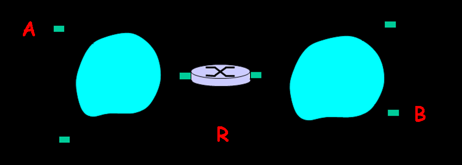
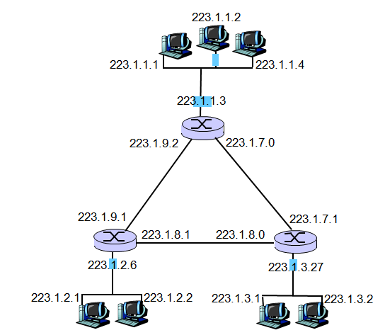
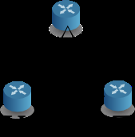
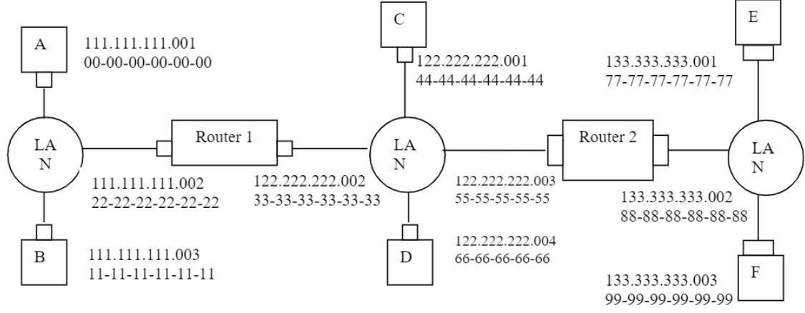
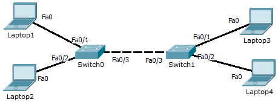
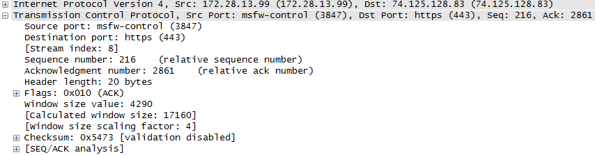

# Made_2121_HK2_2122_Câu-hỏi-thi_Đáp-án.pdf

> 8 trang

## Trang 1

Giảng viên ra đề:                     (Ngày ra đề)                Người phê duyệt:                          (Ngày duyệt đề)
 (Chữ ký và Họ tên)                                                                        (Chữ ký, Chức vụ và Họ tên)

                                                     (phần phía trên cần che đi khi in sao đề thi)

                    THI CUỐI KỲ        Học kỳ/năm học  2   2021-2022
                                                          Ngày thi           26/06/2022
                             Môn học                   Mạng máy tính

 TRƯỜNG ĐH BÁCH KHOA – ĐHQG-HCM  Mã môn học                    CO3093
      KHOA KH & KT MÁY TÍNH
                                    Thời lượng      90 phút    Mã đề            2121
Ghi chú:              - KHÔNG được sử dụng tài liệu
                          - Chọn một câu trả lời ĐÚNG NHẤT
                          - Nộp lại đề thi cùng với phiếu trả lời trắc nghiệm

Câu 1. Giao thức được dùng như thành phần chủ yếu trong các ứng dụng mạng. Giao thức quy định về…
A. Định dạng, thứ tự dữ liệu được truyền tải
B. Phương thức kết nối giữa các đối tượng trao đổi dữ liệu
C. Hoạt động liên quan đến truyền nhận dữ liệu
D. Cả A, B và C đều đúng
Câu 2. Ứng dụng nào sau đây có thể được xem là một ứng dụng theo mô hình Peer-to-Peer?
A. Web site của Trường ĐHBK tại:                     C. BitTorent
http://hcmut.edu.vn                                 D. Cả A, B và C đều đúng
B. Skype
Câu 3. Kết nối Wi-Fi được IEEE qui định bởi chuẩn tương ứng là:
A. IEEE 802.3             B. IEEE 802.11            C. IEEE 802.15            D. IEEE 802.16
Câu 4. Cho một sơ đồ mạng như sau:

Giả sử mạng dùng công nghệ chuyển gói, và các router hoạt động theo cơ chế “Store-and-Forward”. Một
gói tin có kích thước là L và giả sử như các đường truyền đều có tốc độ là R. Thời gian để chuyển gói tin
này từ máy tính bên trái đến máy tính bên phải là:
A. L/R                    B. 2L/R                   C. 3L/R                  D. 3R/L
Câu 5. Chương trình Traceroute sử dụng thông tin phản hồi cung cấp bởi giao thức nào để biết được đường
đi và độ trễ của các gói tin trong mạng?
A. UDP                   B. TCP                    C. IP                    D. ICMP
Câu 6. Khi một đơn vị dữ liệu của một giao thức được chuyển từ một tầng (layer) cao hơn xuống một tầng
thấp hơn theo mô hình TCP/IP, thì …
A. Gói dữ liệu sẽ được bổ sung thêm header mới         C. Gói dữ liệu sẽ được loại bỏ bớt đi header
B. Gói dữ liệu không bị thay đổi                       D. Tất cả (A), (B) và (C) đều đúng
Câu 7. Trong mạng Ethernet, điều gì sẽ xảy ra khi hai máy đồng thời gửi dữ liệu, và đụng độ xảy ra?
A. Switch tự động lưu trữ các gói tin bị đụng độ và sẽ gửi lại dữ liệu
B. Router tự động lưu trữ các gói tin bị đụng độ và sẽ gửi lại dữ liệu
C. Dữ liệu sẽ được tái tạo lại một cách tự động tại máy nhận
D. Các máy gửi sẽ gửi lại dữ liệu sau một thời gian chờ

                                                              Mã đề thi: 2121

                                                                                            1

## Trang 2

Câu 8. Với giao thức TCP, tính từ khi bắt đầu tiến hành thiết lập kết nối, sau ít nhất bao nhiêu gói tin được
trao đổi giữa bên gửi (bên yêu cầu thiết lập kết nối) và bên nhận thì bên gửi có thể gửi dữ liệu đi nếu thiết
lập kết nối thành công?
A. 0                        B. 1                    C. 2                    D. 3
Câu 9. Trong lĩnh vực mạng máy tính, một ứng dụng được xem như sử dụng mô hình Client-Server khi:
A. Ứng dụng có một server chạy thường trực, và các client phải kết nối đến server này để trao đổi dữ liệu
B. Các thành phần của ứng dụng có vai trò như nhau, không cần thiết phải có một server chạy liên tục để ứng
dụng hoạt động
C. Ứng dụng có một client chạy liên tục, và các server phải kết nối đến client để hoạt động
D. Các client có thể tương tác trực tiếp với nhau không cần đến sự tồn tại của một server trung tâm
Câu 10. Giải thuật mã hóa công khai (public key cryptography) được sử dụng để tạo ra chữ ký số. Trong
quá trình này, khóa nào (công khai (public key), riêng (private key)) được sử dụng để tạo ra chữ ký:
A. Khóa công khai                                  C. Cả hai khóa đều được sử dụng
B. Khóa riêng                                      D. Không khóa nào được sử dụng
Câu 11. Trường SYN trong gói tin TCP được sử dụng trong trường hợp nào dưới đây?
A. Thiết lập kết nối                                 C. Đóng kết nối
B. Gửi dữ liệu có đánh số thứ tự                       D. Được sử dụng cho cả ba trường hợp trên
Câu 12. Cho hai đoạn tin TCP và UDP có cùng một kích thước, lượng dữ liệu mang bởi gói tin UDP nhiều
hơn lượng dữ liệu trong gói tin TCP ít nhất là:
A. 4 byte                    B. 8 byte                C. 12 byte               D. 16 byte
Câu 13. Trong giao thức TCP, thông số timeout được chọn thường có giá trị:
A. Nhỏ hơn Round Trip Time                           B. Bằng Round Trip Time
C. Lớn hơn Round Trip Time                         D. Lớn hơn nhiều lần Round Trip Time
Câu 14. Khi xem xét để xác định cổng ra cho các khung tin, địa chỉ nào được Switch sử dụng?
A. Source MAC address                             C. Network address
B. Destination MAC address                          D. Subnetwork address
Câu 15. Công nghệ mạng LAN nào sử dụng phương pháp CSMA/CD?
A. Ethernet                  B. Token Ring            C. ATM                 D. MPLS
Câu 16. Giao thức điều khiển truy cập (Multiple Access Control Protocol) nào sau đây cần có sự đồng bộ
về thời gian giữa các máy:
A. CSMA/CD               B. Token Ring            C. Slotted ALOHA        D. MPLS
Câu 17. Điều gì xảy ra khi máy tính A gửi broadcast ARP request để tìm địa chỉ MAC của máy tính B
trong cùng một mạng LAN?
A. Máy chủ DNS sẽ trả lời A với địa chỉ MAC của B
B. Tất cả các máy tính trong mạng đều nhận được yêu cầu (ARP request) và tất cả sẽ trả lời A với địa chỉ MAC
của B
C. Tất cả các máy tính trong mạng đều nhận được yêu cầu (ARP request) nhưng chỉ có B mới trả lời A với địa
chỉ MAC của mình
D. Các Router gần nhất nhận được yêu cầu (ARP request) sẽ trả lời A với địa chỉ MAC của B hoặc sẽ gửi tiếp
yêu cầu này tới các router khác
Câu 18. Máy tính A và Z có địa chỉ IP trên 2 subnet khác nhau. Điều gì xảy ra nếu máy tính A gửi broadcast
ARP request đi tìm địa chỉ MAC của máy tính Z.
A. Không có trả lời (no response)
B. Router sẽ trả lời với địa chỉ MAC của Z

                                                              Mã đề thi: 2121

                                                                                            2

## Trang 3

C. Router sẽ trả lời với địa chỉ MAC của mình
D. Router sẽ gửi tiếp yêu cầu (ARP request) tới subnet của Z và lúc đó Z có thể trả lời A
Câu 19. Chọn mô tả đúng nhất về cách giao thức Ethernet quản lý việc sử dụng kênh truyền vật lý?
A. Phân chia kênh truyền theo thời gian
B. Phân chia kênh truyền theo tần số
C. Phát hiện tranh chấp kênh truyền, khi có tranh chấp thì hoãn gửi, sẽ gửi lại sau một khoảng thời gian
D. Phát hiện tranh chấp kênh truyền, xếp lại thứ tự các nút gửi
Câu 20. Trường nào sau đây không tồn tại trong phần header của một Frame Ethernet IEEE 802.3?
A. Preamble                                       C. Số thứ tự của Frame
B. Địa chỉ MAC của máy nhận (đích)                  D. Loại hình Frame
Câu 21. Khi một khung dữ liệu (frame) được chuyển đến một LAN switch và địa chỉ đích đến không có trong
bảng địa chỉ MAC (MAC address table) thì switch trên sẽ làm gì?
A. Chuyển frame đến cổng đầu tiên sẵn sàng (available)
B. Chuyển frame đến tất cả các cổng ngoại trừ cổng mà frame đến
C. Gởi thông điệp ngược lại nguồn gởi frame để hỏi địa chỉ đích đến
D. Loại bỏ frame đó
Câu 22. Đặc điểm nào mô tả KHÔNG ĐÚNG một kết nối trong mạng không dây:
A. Cường độ tín hiệu sẽ suy giảm dần khi đi xa nguồn tín hiệu
B. Tốc độ truyền dữ liệu là một hằng số, không phụ thuộc khoảng cách giữa hai điểm truyền và nhận
C. Tín hiệu từ điểm nguồn có thể đến điểm đích bằng nhiều đường khác nhau
D. Chất lượng tín hiệu phụ thuộc rất nhiều vào môi trường xung quanh
Câu 23. Cho sơ đồ mạng như hình vẽ:

Có bao nhiêu bảng ARP (ARP table) trong bộ định tuyến (router) R?
A. 0                        B. 1                    C. 2                    D. 3
Câu 24. Multi-Thread được sử dụng trong mô hình lập trình khách chủ (client server) với mục đích gì?
A. Để máy khách có thể được phục vụ đồng thời nhiều máy chủ
B. Để máy khách có thể được phục vụ bởi nhiều máy chủ
C. Để máy chủ có thể chạy nhiều ứng dụng mạng
D. Để máy chủ có thể phục vụ được đồng thời nhiều máy khách
Câu 25. Router sử dụng giải thuật định tuyến dạng Vector khoảng cách (Distance Vector - DV) khác với
router sử dụng giải thuật định tuyến dạng Trạng thái liên kết (Link State - LS) ở điểm:
A. Router DV hiểu biết về tổng thể kết nối của toàn mạng.
B. Router DV tính toán đường đi tối ưu (best route) từ các routers LS.
C. Đường đi tối ưu sẽ được router DV tính toán dựa trên những đường đi được gởi đến từ các routers lân cận.
D. Dùng giải thuật tìm đường đi ngắn nhất (Shortest Path First) để xác định đường đi tối ưu.

                                                              Mã đề thi: 2121

                                                                                            3

## Trang 4

Câu 26. Chọn phát biểu ĐÚNG về NAT?
A. NAT dùng để ngăn chặn một máy tính từ Internet kết nối vào một mạng cục bộ nào đó
B. NAT chỉ sử dụng IP header cho công việc của mình
C. Chức năng của NAT tương tự như firewall
D. Sau khi được xử lý bởi NAT, một số trường trong header của một gói dữ liệu sẽ bị thay đổi
Câu 27. Mục tiêu của tường lửa là gì?
A. Bảo vệ một mạng máy tính trước các nguy cơ bảo mật từ bên ngoài
B. Ngăn chặn dữ liệu lưu thông ra khỏi mạng.
C. Giám sát lưu thông mạng
D. Xác thực người dùng
Câu 28. Có bao nhiêu subnets trong sơ đồ mạng sau:

A. 1                        B. 3                    C. 6                    D. 10
Câu 29. Một nhà cung cấp dịch vụ có cung cấp cho 4 tổ chức 4 dải địa chỉ như sau:
                     Cơ quan     Dãy IP
                         1              200.23.16.0/23
                         2              200.23.18.0/23
                         3              200.23.20.0/23
                         4              200.23.22.0/23
Nhà cung cấp trên sử dụng giải pháp “gộp tuyến”(route aggregation) để rút gọn bảng định tuyến của mình. Chọn
địa chỉ IP của tuyến gộp:
A. 200.23.16.0/20            B. 200.23.16.0/21         C. 200.23.18.0/23         D. 200.23.22.0/20
Câu 30. Tại sao một truy vấn ARP (address resolution protocol) lại được gửi trong một frame quảng bá
(broadcast frame)?
A. Vì truy vấn ARP luôn được gửi trong frame quảng bá (broadcast frame)
B. Vì host gửi truy vấn ARP không xác định được địa chỉ MAC tương ứng với địa chỉ IP trong câu truy vấn.
C. Vì truy vấn ARP luôn được gửi đi từ một máy chủ
D. Vì truy vấn ARP luôn được gửi đi từ router
Câu 31. Trong hạ tầng mạng máy tính, một trong những lợi ích của việc sử dụng phân tầng (layering) là:
A. Giúp làm tăng tốc độ truyền tải dữ liệu qua mạng
                                                              Mã đề thi: 2121

                                                                                            4

## Trang 5

B. Cấu trúc hệ thống được rõ ràng, giúp cho việc giải quyết các vấn đề liên quan đến một hệ thống phức tạp
được dễ dàng hơn
C. Làm tăng tính an toàn của máy tính khi kết nối vào mạng
D. Hiệu quả truyền dữ liệu của hệ thống mạng được cao hơn
Câu 32. Cho sơ đồ mạng như hình vẽ:

                  Giả sử giải thuật Vector khoảng cách (Distance Vector) được sử dụng cho quá trình định
                     tuyến. Tại thời điểm đang xét, vector khoảng cách của X là (0,2,7). Đây cũng chính là chi
                    phí đo được của X đến các nút lân cận Y và Z. X nhận được hai vector từ Y(2,0,1) và
                      Z(7,1,0). Vector khoảng cách của X sau khi được cập nhật là:
                  A. (0,8,7)   B. (0,2,3)             C. (0,8,3)                D. (0,2,7)

Câu 33. Chọn câu trả lời đúng với hàm băm h = H(x):
A. Chuỗi x có độ dài khác nhau sẽ cho ra giá trị băm h cũng có độ dài khác nhau.
B. Từ giá trị băm h, có thể dễ dàng tính được giá trị x.
C. Hàm băm có thể được sử dụng để kiểm chứng tính toàn vẹn thông điệp
D. Tất cả các câu trả lời trên đều sai
Câu 34. Cho bảng định tuyến dưới đây, sử dụng phương pháp CIDR (Classless InterDomain Routing):
                      Net/Mask Length              Output port
                          196.80.0.0/12           D
                         196.94.16.0/20           C
                          196.96.0.0/12            B
                         196.104.0.0/14          A
Cổng ra (Output port) nào sẽ được chọn nếu địa chỉ IP đích là 196.109.49.46?
A. A                       B. B                    C. C                    D. D
Câu 35. Cho bảng chuyển tiếp (sử dụng chiến lược Longest prefix matching) sau đây
                Tiền tố                            Cổng liên kết
                11001000 00010111 00010                0
                11001000 00010111 00011000             1
                11001000 00010111 00011                2
                     Khác                            3
Cho biết một gói tin có địa chỉ đích “11001000 00010111 00010110 10100001” sẽ đi ra ở cổng nào?
A. 0                        B. 1                    C. 2                    D. 3
Câu 36. Trong không gian địa chỉ IPv6 có tối đa bao nhiêu địa chỉ IPv6?
A. 232 địa chỉ IPv6         B. 2128 địa chỉ IPv6         C. 248 địa chỉ IPv6         D. Không xác định
Câu 37. WPA2 được dùng cho bảo mật cho:
A. Ethernet                                        C. Wireless LAN
B. Bluetooth                                       D. Mobile phone systems
Câu 38. Trong HTTP/1.1, vấn đề chặn HOL (Head-Of-Line) là một tập lớn trong trang web (ví dụ: video
clip) sẽ mất nhiều thời gian để truyền tải trên liên kết bị thắt cổ chai và nó chặn các đối tượng (object) nhỏ
khác phía sau nó. HTTP/2 cố gắng giải quyết vấn đề này như thế nào?
A. bằng cách tạo các hàng đợi khác nhau cho các kích cỡ tập khác nhau.

                                                              Mã đề thi: 2121

                                                                                            5

## Trang 6

B. bằng cách chia từng thông điệp thành các khung tin nhỏ và xen kẽ các thông điệp yêu cầu và phản hồi
C. bằng cách phân loại các yêu cầu khác nhau theo thứ tự trước.
D. bằng cách gửi tập nhỏ trước các tập lớn hơn
Câu 39. SSL dùng cổng nào để mang HTTPS traffic?
A. TCP port 80                                     C. TCP port 443
B. UDP port 443                                   D. TCP port 8080
Câu 40. Ba trường trong IP header không thể "match" trong OpenFlow là gì?
A. TTL, datagram length, và header checksum
B. IP source address, TCP source port, và source MAC address
C. TCP source port, source MAC address, và destination MAC address
D. TCP source port, source MAC address, và protocol type
Câu 41. Trường nào trong 1 segment TCP được sử dụng để kiểm soát dòng dữ liệu giữa máy gửi và nhận?
A. Sequence Number                                C. Checksum
B. Acknowledgement Number                        D. Receive Window
Câu 42. Cho Sơ đồ mô hình network như hình vẽ sau

Giả sử host A gửi một datagram tới host F. Hãy cho biết đâu là thông tin địa chỉ MAC và IP được đóng
gói trong frame gửi từ A đến bên trái của Router 1 trong trường hợp này?
      A. MAC address nguồn: 00-00-00-00-00-00    C.  MAC address nguồn: 00-00-00-00-00-00
          IP nguồn: 111.111.111.001                      IP nguồn: 111.111.111.001
      MAC address đích: 22-22-22-22-22-22       MAC address đích: 99-99-99-99-99-99
          IP đích: 133.333.333.003                        IP đích: 111.111.111.002
      B. MAC address nguồn: 00-00-00-00-00-00    D.  MAC address nguồn: 88-88-88-88-88-88
          IP nguồn: 111.111.111.001                      IP nguồn: 111.111.111.001
      MAC address đích: 22-22-22-22-22-22       MAC address đích: 55-55-55-55-55-55
          IP đích: 111.111.111.002                        IP đích: 111.111.111.002
Câu 43. Cho mô hình network gồm có 6 host (được gán nhãn lần lượt là A, B, C, D, E, F) kết nối trược tiếp
vào một switch (được gán nhãn S). Giả sử host A gửi một frame tới host C, host C phản hồi lại một frame
tới host A; host A gửi một frame tới host B và host B cũng phản hồi lại một frame tới host A. Bạn hãy cho
biết trong bảng MAC table sẽ S có bao nhiêu địa chỉ MAC được học, nếu biết rằng không có bất kỳ địa chỉ
MAC nào ban đầu trong bảng MAC của S khi host A gửi frame cho host C.
A. 1                      B. 2                      C. 3                     D. 4
Câu 44. Để tăng tính bảo mật trong việc truy cập những trang Web có thông tin nhạy cảm, người ta
thường dùng giao thức HTTP ở dạng HTTPS, đây là giao thức?

                                                              Mã đề thi: 2121

                                                                                            6

## Trang 7

A. Kết hợp với SSL                                   C. Bắt buộc phải dùng chử ký điện tử
B. Kết hợp với IPsec                                D. Người sử dụng phải cung cấp Private key
Câu 45. Để chuyển một gói tin đến đúng ứng dụng chạy trên một máy tính, địa chỉ nào sau đây cần phải
được xem xét:
A. MAC address           B. IP address              C. Port address            D. Cả A, B, C đều sai
Câu 46. Giả sử có một gói tin ở tầng Mạng có kích thước 3000 byte được chuyển sang một mạng có MTU
là 1500 byte. Vậy, gói tin sẽ được phân thành bao nhiêu gói tin nhỏ hơn?
A. 2                        B. 3                    C. 4                    D. 5
Câu 47. Cho sơ đồ mạng sau:

Biết IP của các laptop:
Laptop 1: 192.168.1.10/16                         Laptop 3: 192.168.1.30/16
Laptop 2: 192.168.2.20/16                         Laptop 4: 192.168.2.40/16
Tất cả các cổng của switch 0 và 1 được cấu hình ở mode access và thuộc Vlan 1. Chọn phát biểu ĐÚNG:
A. Laptop 1 và 3 không “ping” thấy nhau.               C. Laptop 1 và 4 không “ping” thấy nhau.
B. Laptop 3 và 4 “ping” thấy nhau.                     D. Có 2 mạng LAN riêng biệt trong sơ đồ trên.
Câu 48. Một dạng kết nối cho phép gởi và nhận thông tin, nhưng không thể thực hiện cùng lúc đồng thời
cả 2 chiều, được gọi là:
A. Half-duplex             B. Full-duplex             C. Simplex               D. Cả A, B, C đều sai
Câu 49. Trong phương pháp mã khóa công khai (public-key algorithm), Bob muốn gởi thông điệp bí mật
và người nhận chỉ là Alice. Để thực hiện việc này, Bob phải dùng đến:
A. Public-key của Alice                              C. Public-key của Bob
B. Private-key của Alice                             D. Private-key của Bob
Câu 50. Thực hiện bắt gói dùng Wireshark, thông tin cụ thể của một gói tin như hình bên dưới.

Chọn phát biểu ĐÚNG:
A. Địa chỉ IP của máy nhận gói tin là 172.28.13.99, địa chỉ IP của máy gửi gói tin là 74.125.128.83.
B. Gói tin được gửi trên port 443 của máy có địa chỉ IP 172.28.13.99.
C. Máy gửi sử dụng giao thức TCP, máy nhận sử dụng giao thức UDP.
D. Máy có địa chỉ IP 172.28.13.99 đã nhận được byte có số thứ tự 2860 của gói tin được gửi từ máy có địa chỉ
IP 74.125.128.83.
                                                              Mã đề thi: 2121

                                                                                            7

## Trang 8

Câu 51. Cơ chế truyền một-tới-nhiều (one-to-many) giữa một nguồn và một nhóm xác định được gọi là
A. Unicast                  B. Multicast              C. Broadcast             D. Anycast
Câu 52. Lệnh nào sau đây cho ta thấy được địa chỉ vật lý của card mạng (NIC) trong MS Windows?
A. ifconfig                  B. ipconfig /?            C. ipconfig /all           D. ipconfig /renew
Câu 53. Giao thức tầng liên kết (link layer) có thể cung cấp những dịch vụ nào trong các dịch vụ sau đây?
A. Đóng khung dữ liệu (Framing)                       C. Phát hiện lỗi (Error detection)
B. Đường truy cập (Link access)                       D. Cả (A), (B) và (C) đều đúng
Câu 54. Dịch vụ nào trong các dịch vụ sau có trong tầng liên kết (link-layer) và cũng có trong dịch vụ của tầng
mạng (network layer) và tầng vận chuyển (transport layer)
A. Truyền dữ liệu tin cậy                              C. Kiểm soát đụng độ
B. Kết nối có hướng                                 D. Phát hiện lỗi và sữa lỗi
Câu 55. Khi người sử dụng gõ vào trình duyệt web “http://www.test.com:8080”, chỉ số 8080 cho biết:
A. Địa chỉ port muốn kết nối trên server là 8080          C. Địa chỉ port trên server là 80, địa chỉ port của
B. Địa chỉ port của client là 8080                             client là 80
                                                 D. Địa chỉ port lớn nhất sử dụng cho kết nối là 8080
Câu 56. Các thông điệp ICMP được gửi đi trong gói tin của giao thức:
A. TCP                     B. UDP                 C. IP                   D. FTP
Câu 57. Trong hệ thống cơ sở dữ liệu của DNS, bản ghi (resource records) loại nào giúp phân giải từ
hostname sang địa chỉ IP?
A. A                      B. NS                    C. CNAME               D. MX
Câu 58. SMTP sử dụng giao thức nào dưới đây của tầng Vận chuyển (Transport) để truyền tải email?
A. TCP                   B. UDP                  C. FTP                   D. RCTP
Câu 59. Cho dòng lệnh sau:

  DatagramSocket xsocket = new DatagramSocket(9876)

Khi thực thi, dòng lệnh trên sẽ:
A. Tạo ra một TCP socket ở cổng 9876                  C. Tạo ra một UDP socket ở cổng 9876
B. Tạo ra một TCP socket ở cổng 6789                 D. Tạo ra một UDP socket ở cổng 6789
Câu 60. Dạng hàng đợi nào trong số này: FIFO, Priority, Round Robin (RR) và Weighted Fair Queueing
(WFQ), đảm bảo rằng tất cả các gói được gởi đi theo thứ tự mà chúng đến?
A. FIFO                   B. Priority                C. Round Robin (RR)       D. WFQ

                                                              --- HẾT---

                                                              Mã đề thi: 2121

                                                                                            8

