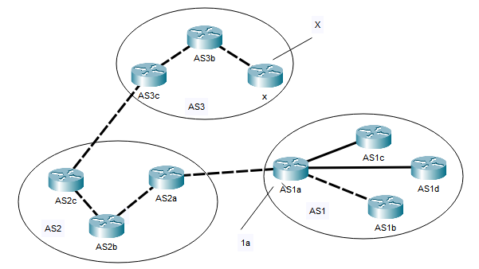

# Made*2231_HK2_2223_Câu hỏi thi*Đáp án.pdf

> 8 trang

## Trang 1

Giảng viên ra đề: (Ngày ra đề) Người phê duyệt: (Ngày duyệt đề)
(Chữ ký và Họ tên) (Chữ ký, Chức vụ và Họ tên)

                                                  (phần phía trên cần che đi khi in sao đề thi)

                   THI CUỐI KỲ        Học kỳ/năm học  2  2022-2023
                                                         Ngày thi          22/05/2023
                            Môn học                  Mạng máy tính

TRƯỜNG ĐH BÁCH KHOA – ĐHQG-HCM Mã môn học CO3093
KHOA KH & KT MÁY TÍNH
Thời lượng 90 phút Mã đề 2231
Ghi chú: - KHÔNG được sử dụng tài liệu - Chọn một câu trả lời ĐÚNG nhất - Nộp lại đề thi cùng với bài làm

Câu 1. Chọn phát biểu ĐÚNG liên quan đến cơ chế xử lý nghẽn TCP Tahoe?
A. Khi có bất thường thì thiết lập kích thước cwnd bằng 1.
B. Khi có bất thường thì giảm một nửa kích thước cwnd.
C. Sau tắc nghẽn phục hồi cwnd theo cấp số nhân (exponentially).
D. Sau khi tắc nghẽn phục hồi cwnd về ngưỡng ssthresh.
Câu 2. Hãy chọn một đặc điểm khác biệt giữa cơ chế slotted ALOHA và dùng Token?
A. Cơ chế được hiện thực phân tán hoàn toàn không có nút điều phối chung.
B. Khi có một nút truyền dữ liệu, nút đó chiếm trọn đường truyền.
C. Khi có M nút cần truyền dữ liệu, mỗi nút chiếm xấp xỉ một tỷ lệ 1/M đường truyền.
D. Tất cả các phát biểu A), B), C) đều KHÔNG chính xác.
Câu 3. Một nhà cung cấp dịch vụ ISP sử dụng giao thức NAT để thiết lập kết nối cho mạng cục bộ
của thuê bao với địa 192.168.1.0/24 và gán địa chỉ cho router 24.34.223.245. Giả sử có hai ứng
dụng trên máy của thuê bao đang kết nối dịch vụ Web ở địa chỉ 128.119.40.86 port 80. Hãy cho
biết dòng nào có thể hiện diện trong bảng ánh xạ NAT?
A. (192.168.1.4,4001) – (192.168.1.3,3545).
B. (128.119.40.86:3320) – (24.34.223.245:4002).
C. (24.34.223.245:4002) – (192.168.1.3,3545).
D. (128.119.40.86:80) – (192.168.1.1:3346).
Câu 4. Giao thức nào không dựa trên kiến trúc client-server?
A. Bittorrent. C. SMTP.
B. HTTP. D. DNS.
Câu 5. Trong trường hợp sử dụng nào thì người lập trình chọn sử dụng giao thức UDP thay vì TCP?
A. Ứng dụng thanh toán điện tử. C. Ứng dụng chia sẻ tập tin.
B. Ứng dụng họp truyền hình trực tuyến. D. Ứng dụng phát trực tuyến DASH.
Câu 6. Giả sử hệ thống mạng gồm 3 AS1, AS2 và AS3. Các router trong cùng AS sử dụng giao
thức OSPF để xác định đường đi. Giả sử có các kết nối lân cận (AS2, AS1), (AS2, AS3) bằng BGP
với các giao thứ eBGP và iBGP. Làm sao một router 1a ở AS1 biết được đường đi đến router x ở
AS3.
A. eBGP. C. OSPF.
B. iBGP. D. Kết nối trực tiếp.

                                                                                         1

## Trang 2

Câu 7. Trong định dạng gói tin TCP, chọn ánh xạ đúng về các trường dữ liệu và tính năng ở tầng
vận chuyển tương ứng được cung cấp.
A. FIN flag – Kiểm soát tắt nghẽn (congestion control).
B. CWR flag – Truyền tải dữ liệu đáng tin cậy (reliable data transfer).
C. receive window – Kiểm soát dòng lưu (flow control).
D. Sequence number – Thiết lập kết nối (connection establishment).
Câu 8. Giả sử có 2 segment TCP gởi từ máy A đến máy B với số thứ tự lần lượt là 90 và 110. Kích
thước của gói tin thứ nhất là bao nhiêu?
A. 20 bytes. B. 21 bytes. C. 110 bytes. D. 90 bytes.
Câu 9. Cơ chế ghép kênh và tách kênh (multiplexing và demultiplexing) ở giao thức không kết nối
(connectionless) được xác định dựa trên thông tin nào?
A. Địa chỉ IP nguồn và cổng nguồn C. Địa chỉ IP đích và cổng đích.
B. Cổng nguồn D. Cổng đích đến.
Câu 10. Tính độ trễ của liên kết giữa hai điểm với các thông tin như sau: độ dài gói tin 12Kbits,
băng thông 10Mbps, độ dài đường dây tín hiệu 2km, tốc độ lan tuyền là tốc độ ánh sáng 3e8 m/s?
A. 12 e-4 giây. C. 0.66e-5 giây.
B. 1.39e-5 giây. D. Tất cả các đáp án A), B), C) đều SAI.
Câu 11. Các nhà cung cấp dịch vụ hay quảng cáo với thông tin gói cước ví dụ 100Mbps, thông tin
gói cước mô tả gì?
A. Tốc độ truyền dữ liệu (transmission).
B. Tốc độ lan truyền dữ liệu (propagation).
C. Tốc độ tín hiệu di chuyển trong đường truyền vật lý.
D. Tốc độ dữ liệu di chuyển truyền giữa hai thiết bị đầu cuối.
Câu 12. Thành phần nào là điểm khác biệt giữa thời gian truyền tải (transmission delay) và thời
gian lan truyền (propagation delay).
A. Độ dài gói tin. C. Xử lý tính toán.
B. Xử lý hàng đợi. D. Kiểm tra và sửa lỗi.
Câu 13. Thiết bị nào sau đây chịu trách nhiệm chính trong việc chuyển tiếp (forward) các gói tin dữ
liệu giữa các mạng khác nhau?
A. Thiết bị đầu cuối (host).
B. Thiết bị định tuyến (router).
C. Thiết bị chuyển mạch mạng (switch).

                                                                                         2

## Trang 3

D. Thiết bị lọc phân giải tên miền (name server).
Câu 14. Để định nghĩa một giao thức truyền tin (protocol) dạng điểm tới điểm (point-to-point),
những thông tin tối thiểu nào sau đây phải được xác định rõ?
A. Định dạng gói tin.
B. Thứ tự trao đổi các gói tin.
C. Những hành động cần phải thực hiện khi gửi/nhận các gói tin.
D. Tất cả những điểm A) B) C) trên.
Câu 15. Phát biểu nào sau đây mô tả ĐÚNG nhất sự khác biệt giữa biên mạng (network edge) và lõi
mạng (network core) trong mạng máy tính?
A. Biên mạng bao gồm các thành phần mạng kết nối không dây, trong khi lõi mạng bao gồm các
thành phần mạng kết nối có dây.
B. Biên mạng đề cập đến các máy chủ trung tâm và trung tâm dữ liệu, trong khi lõi mạng bao gồm
các thiết bị mạng cục bộ nối với mạng.
C. Biên mạng bao gồm các thiết bị nối người dùng cuối với mạng, trong khi lõi mạng đề cập đến
các hạ tầng tốc độ cao kết nối các mạng khác nhau.
D. Biên mạng quan tâm chính đến bảo mật mạng, trong khi lõi mạng quan tâm đến tối ưu hiệu năng
truyền dẫn.
Câu 16. Điểm nào sau đây là thế mạnh của chuyển mạch gói (packet switching) so với chuyển mạch
dòng (circuit switching)?
A. Hiệu suất sử dụng tài nguyên mạng cao.
B. Đảm bảo băng thông cho mỗi kết nối.
C. Độ trễ truyền tin thấp.
D. Phù hợp với nhu cầu truyền tin liên tục và thời gian thực.
Câu 17. Cho một thiết bị chuyển mạch gói kết nối 30 thiết bị đầu cuối ra mạng bên ngoài. Tỷ lệ thời
gian hoạt động là 20%. Vậy xác suất để hơn 4 thiết bị đầu cuối cùng hoạt động là:
A. 0.001 B. 0.744 C. 0.133 D. 0.127
Câu 18. Trong mô hình OSI, đâu là mối quan hệ của một tầng (N) đối với tầng bên trên nó (N+1)?
A. Tầng N cung cấp các dịch vụ cho tầng N+1
B. Tầng N+1 bổ sung một phần đầu vào thông tin nhận được từ tầng N
C. Tầng N vận dụng các dịch vụ do tầng N+1 cung cấp
D. Tầng N không có tác động gì lên tầng N+1
Câu 19. Chức năng chính của các giao thức ở tầng vận chuyển (Transport Layer) là gì?
A. Kiểm soát việc truyền dữ liệu giữa hai tiến trình trên mạng máy tính
B. Kiểm soát nội dung thông điệp trao đổi giữa hai tiến trình và hành vi của mỗi bên khi nhận được
thông điệp
C. Kiểm soát việc truyền tin giữa hai máy tính trên mạng máy tính
D. Kiểm soát việc truyền dữ liệu giữa hai máy tính trên cùng một môi trường truyền
Câu 20. Điều gì xảy ra khi máy tính A gửi broadcasts (ARP request) đi tìm địa chỉ MAC của máy
tính B trên cùng một mạng?
A. Máy chủ DNS sẽ trả lời A với địa chỉ MAC của B
B. Tất cả các máy tính trong mạng đều nhận được yêu cầu (ARP request) và tất cả sẽ trả lời A với
địa chỉ MAC của B

                                                                                         3

## Trang 4

C. Tất cả các máy tính trong mạng đều nhận được yêu cầu (ARP request) nhưng chỉ có B mới trả lời
A với địa chỉ MAC của mình
D. Các Router gần nhất nhận được yêu cầu (ARP request) sẽ trả lời A với địa chỉ MAC của B hoặc
sẽ gửi tiếp yêu cầu này tới các router khác.
Câu 21. Khi thực thể (i.e., tiến trình) TCP gửi một gói SYNACK segment với trường
Acknowledgement Number = 100, điều này có nghĩa là gì?
A. Gói dữ liệu nó gửi đi bắt đầu bằng byte thứ 100 trong dòng dữ liệu
B. Byte dữ liệu đầu tiên trong dòng dữ liệu sẽ gửi đi có số thứ tự là 100
C. Nó sẽ gửi từ byte thứ 100 bỏ qua các byte trước
D. Nó hy vọng nhận được dữ liệu bắt đầu bằng byte có số thứ tự 100
Câu 22. Quy trình cho phép một máy tự động xin địa chỉ IP từ Server khi kết nối vào mạng là:
A. Host broadcasts thông điệp "DHCP discover" --> DHCP server đáp ứng với "DHCP offer" -->
host gửi thông điệp "DHCP request" --> DHCP server gửi "DHCP ack"
B. Host gửi thông điệp "DHCP request" --> DHCP server gửi "DHCP ack" --> host broadcasts
thông điệp "DHCP discover" --> DHCP server đáp ứng với "DHCP offer"
C. Host broadcasts thông điệp "DHCP discover"--> DHCP server gửi "DHCP ack" --> host gửi
thông điệp "DHCP request" --> DHCP server đáp ứng với "DHCP offer"
D. Host gửi thông điệp "DHCP request" --> DHCP server đáp ứng với "DHCP offer" --> host
broadcasts thông điệp "DHCP discover" --> DHCP server gửi "DHCP ack"
Câu 23. Giao thức OSPF sử dụng thuật toán tìm đường đi nào sau đây?
A. Flooding C. Link state
B. Distance vector D. Bellman-Ford
Câu 24. Quan sát một người đang truy cập một trang web, thấy người đó gõ đường dẫn như sau:
http://www.hcmut.edu.vn:3000. Hãy cho biết Server Web mà trang Web trên sử dụng cổng TCP
(TCP port) như thế nào?
A. Sử dụng port mặc định C. Sử dụng port theo chuẩn
B. Không sử dụng port mặc định D. Sử dụng port riêng của Web server
Câu 25. Giả sử một ứng dụng tạo ra một thông điệp 60 bytes. Thông điệp này được đặt trong TCP
segment rồi sau đó là IP datagram. Giả sử cả gói TCP lẫn gói IP không có trường dữ liệu đặc biệt
(Option= 0). Trong mỗi IP datagram sẽ chứa bao nhiêu phần trăm dữ liệu thật sự?
A. 20% B. 40% C. 60% D. 80%
Câu 26. Trong TCP/IP, sự đảm bảo về truyền dữ liệu tin cậy được hiện thực bởi:
A. Sử dụng một bộ đếm giờ (Timer) để gởi lại và gói tin xác nhận (ACK) bên cạnh sự kiện hết giờ
để gởi lại gói bị mất.
B. So trùng giữa cửa sổ nhận với không gian bộ đệm trống ở phía nhận để đảm bảo giao đến nơi
nhưng gói được truyền
C. Ấn định các bước bắt tay và thương lượng để tạo một kênh truyền tin cậy và gửi gói báo đóng
kết nối để hoàn thành các gói tin chưa giao.
D. Khởi đầu chậm và cố gắng tránh tắc nghẽn, nhưng nếu điều đó xảy ra thì triển khai cơ chế phục
hồi nhanh.
Câu 27. Gói tin TCP từ máy yêu cầu kết nối sẽ có giá trị của các cờ (Flags) nào?
A. RST=1, SYN=1 B. ACK=1, SYN=1

                                                                                         4

## Trang 5

C. ACK=0, SYN=1 D. FIN=1, SYN=0
Câu 28. Trong cơ sở dữ liệu của DNS, lưu trữ các Resource Record (RR) có dạng nào?
A. (name, value, type, ttl) C. (value, ttl, name, type)
B. (value, name, ttl, type) D. (name, type, ttl, value)
Câu 29. Khẳng định nào sau đây là đúng khi nói về đặc trưng của mạng có đường truyền quảng bá
(broadcast link)?
E. Tất cả các node cùng truy nhập chung trên một đường truyền vật lý
F. Nối từng cặp node lại với nhau theo một hình học xác định
G. Các node trung gian: tiếp nhận, lưu trữ tạm thời và gửi tiếp thông tin
H. Không có khả năng đụng độ thông tin (collision)
Câu 30. Đặc điểm quan trọng của kiến trúc mạng client/server (khách/chủ)?
A. Client/server là kiến trúc phân cấp, client đóng vai trò yêu cầu dịch vụ và server đáp ứng lại các
yêu cầu đó.
B. Server là host luôn hoạt động, thường có IP cố định, có nhóm các server để chia sẻ công việc.
C. Client có kết nối không liên tục, địa chỉ IP có thể thay đổi, gởi nhận dữ liệu với server và thường
không giao tiếp trực tiếp với client khác.
D. Câu A, B và C đều đúng
Câu 31. Trên mạng Internet, kết nối liên mạng các mạng LAN, WAN, MAN độc lập với nhau bằng
các thiết bị có chức năng cơ bản tối thiểu nào?
A. Kiểm soát lỗi, kiểm soát luồng C. Điều khiển liên kết
B. Định tuyến D. Điều khiển lưu lượng và đồng bộ hoá
Câu 32. Cơ chế demultiplexing trong giao thức tầng vận chuyển hướng kết nối xử lý các gói tin như
thế nào?
A. Hai gói có địa chỉ IP nguồn và cổng nguồn khác nhau sẽ được chuyển đến cùng một socket miễn
là đia chỉ IP đích và cổng đích đến giống nhau.
B. Hai gói có địa chỉ IP nguồn và cổng nguồn khác nhau sẽ được chuyển hướng đến hai socket khác
nhau.
C. Hai gói có địa chỉ IP đích và cổng đích khác nhau sẽ được chuyển hướng đến cùng một socket
miễn là địa chỉ IP nguồn và cổng nguồn giống nhau
D. Tất cả các phát biểu trên đều đúng.
Câu 33. Việc bảo đảm nào sau đây có thể được cung cấp bởi lớp vận chuyển mà không cần hỗ trợ
trên mô hình dịch vụ của giao thức mạng lớp dưới?
A. Bảo đảm về mặt thời gian giao nhận
B. Bảo đảm về băng thông tối thiểu
C. Bảo đảm về độ trễ tối đa.
D. Bảo đảm dữ liệu được giao nhận đáng tin cậy.
Câu 34. Trong TCP/IP, sự đảm bảo về băng thông được hiện thực bởi:
A. Phía gửi thận trọng và bắt đầu gửi chậm nhưng sau đó tăng tốc để gửi ở tốc độ cao hơn.
B. Tổng hợp giữa kích thước cửa sổ truyền và tích số băng thông – độ trễ
C. Câp cho mỗi kết nối một phần bằng nhau băng thông của liên kết.
D. Không hỗ trợ bởi mô hình dịch vụ của tầng IP bên dưới.

                                                                                         5

## Trang 6

Câu 35. Mạng máy tính thường được dùng trong một công ty, trường học hoặc những tòa nhà
gần nhau thường thuộc loại:
A. LAN C. WAN
B. MAN D. Tất cả (A), (B) và (C) đều sai
Câu 36. Khi một đơn vị dữ liệu được chuyển từ một tầng (layer) cao hơn xuống một tầng thấp hơn
theo mô hình TCP/IP, thì …
A. Gói dữ liệu sẽ được bổ sung với header mới C. Gói dữ liệu sẽ được loại bỏ bớt đi header
B. Gói dữ liệu không bị thay đổi D. Tất cả (A), (B) và (C) đều đúng
Câu 37. Các thông điệp ICMP được gửi đi trong các gói tin của giao thức:
A. TCP B. UDP C. IP D. FTP
Câu 38. Lệnh tracert trên Windows (hoặc traceroute trên Linux/UNIX) thường được dùng để:
A. Dò tìm đường đi đến một máy khác C. Thêm hay loại bỏ các đường đi trong bảng
B. Chắc chắn rằng kết nối đến một máy nào đó đường đi trên một máy tính
vẫn còn hoạt động D. Cả (A), (B) và (C) đều đúng
Câu 39. Được biết, giải thuật mã hóa công khai (public key cryptography) được sử dụng để tạo ra
chữ ký số. Trong quá trình này, khóa nào (công khai (public key), riêng (private key)) được sử dụng
để tạo ra chữ ký:
A. Khóa công khai C. Cả hai khóa đều được sử dụng
B. Khóa riêng D. Không khóa nào được sử dụng
Câu 40. Giao thức ICMP hoạt động ở tầng nào trong mô hình TCP/IP?
A. Ứng dụng (Application) C. Mạng (Network)
B. Vận chuyển (Transport) D. Liên kết dữ liệu (Data Link)
Câu 41. Giao thức nào dưới đây thường được dùng bởi các router và máy tính để thông báo với
nhau về các lỗi hay sự cố xảy ra ở tầng Mạng?
A. ARP B. ICMP C. RARP D. TCP
Câu 42. Ứng dụng Traceroute sử dụng các giao thức nào để tìm đường đi và đến một điểm nào đó
trên mạng?
A. IP và TCP B. ICMP và UDP C. TCP và ICMP D. UDP và IP
Câu 43. Trường nào trong một segment TCP được sử dụng để kiểm soát dòng dữ liệu giữa máy gửi
và máy nhận?
A. Sequence Number C. Checksum
B. Acknowledgement Number D. Receive Window
Câu 44. Giả sử có một gói tin ở tầng Mạng có kích thước 3000 byte được chuyển sang một mạng có
MTU là 1500 byte. Vậy, gói tin sẽ được phân thành bao nhiêu gói tin nhỏ hơn?
A. 2 B. 3 C. 4 D. 5
Câu 45. Trường SYN trong gói tin TCP được sử dụng trong trường hợp nào dưới đây?
A. Thiết lập kết nối C. Đóng kết nối
B. Gửi dữ liệu có đánh số thứ tự D. Được sử dụng cho cả ba trường hợp trên
Câu 46. Cho hai đoạn tin TCP và UDP có cùng một kích thước, lượng dữ liệu mang bởi gói tin UDP
nhiều hơn lượng dữ liệu chứa trong gói tin TCP ít nhất là:
A. 4 byte B. 8 byte C. 12 byte D. 16 byte

                                                                                         6

## Trang 7

Câu 47. Chọn mô tả đúng nhất về cách giao thức Ethernet quản lý việc sử dụng kênh truyền vật lý?
A. Phân chia kênh truyền theo thời gian
B. Phân chia kênh truyền theo tần số
C. Phát hiện tranh chấp kênh truyền, khi có tranh chấp thì hoãn gửi, sẽ gửi lại sau một khoảng thời
gian
D. Phát hiện tranh chấp kênh truyền, xếp lại thứ tự các nút gửi
Câu 48. Với giao thức TCP, tính từ khi bắt đầu tiến hành thiết lập kết nối, sau ít nhất bao nhiêu gói
tin được trao đổi giữa bên gửi (yêu cầu thiết lập kết nối) và bên nhận thì bên gửi có thể gửi dữ liệu
đi? (Giả sử việc thiết lập kết nối là thành công)
A. 0 B. 1 C. 2 D. 3
Câu 49. Trong giao thức TCP, thông số timeout được chọn thường có giá trị:
A. Nhỏ hơn Round Trip Time B. Bằng Round Trip Time
C. Lớn hơn Round Trip Time D. Lớn hơn nhiều lần Round Trip Time
Câu 50. Khi xem xét để xác định cổng ra cho các gói tin, địa chỉ nào được Switch sử dụng?
A. Source MAC address C. Network address
B. Destination MAC address D. Subnetwork address
Câu 51. Công nghệ mạng LAN nào sử dụng phương pháp CSMA/CD?
A. Ethernet B. Token Ring C. Bluetooth D. MPLS
Câu 52. Trường nào sau đây không tồn tại trong phần header của một Frame Ethernet IEEE 802.3?
A. Preamble C. Số thứ tự của Frame
B. Địa chỉ MAC của máy nhận (đích) D. Loại hình Frame
Câu 53. Chọn phát biểu ĐÚNG về giao thức ARP?
A. Giao thức xác định địa chỉ MAC từ địa chỉ IP
B. Giao thức xác định địa chỉ IP từ địa chỉ MAC
C. Giao thức xác định địa chỉ IP từ tên miền
D. Tìm kiếm địa chỉ IP bằng cách quảng bá (Broadcast) thông tin trên toàn mạng LAN.
Câu 54. Multi-Thread được sử dụng trong mô hình lập trình client-server với mục đích gì?
A. Để máy khách có thể được phục vụ đồng thời nhiều máy chủ
B. Để máy khách có thể được phục vụ bởi nhiều máy chủ
C. Để máy chủ có thể phục vụ nhiều máy khách
D. Để máy chủ có thể phục vụ được đồng thời nhiều máy khách
Câu 55. Mục tiêu của tường lửa là gì?
A. Bảo vệ một mạng máy tính trước các nguy cơ bảo mật từ bên ngoài
B. Ngăn chặn dữ liệu lưu thông ra khỏi mạng.
C. Giám sát lưu thông mạng (Monitor network Traffic)
D. Tất cả các câu trả lời A), B), C) trên đều sai
Câu 56. Router sử dụng giải thuật định tuyến dạng Vector khoảng cách (Distance Vector - DV) khác
với router sử dụng giải thuật định tuyến dạng Trạng thái liên kết (Link State - LS) ở điểm:
A. Router DV hiểu biết về tổng thể kết nối của toàn mạng.
B. Router DV tính toán đường đi tối ưu (best route) từ các routers LS.
C. Đường đi tối ưu sẽ được router DV tính toán dựa trên đường đi được gởi đến từ các routers lân cận.
D. Dùng giải thuật tìm đường đi ngắn nhất (Shortest Path First) để xác định đường đi tối ưu.

                                                                                         7

## Trang 8

Câu 57. Trong TCP/IP, sự đảm bảo về độ trễ được hiện thực bởi:
A. Phía gửi chỉ chờ tối đa bằng khoảng thời gian trễ của một lần quay vòng giữa phía gửi và phía
nhận.
B. Nếu sự kiện hết giờ (timeout) diễn ra, TCP sẽ nhanh chóng gửi lại gói, điều này dẫn đến thời
gian trễ truyền dữ liệu nhỏ.
C. Phía gửi có thể thường xuyên phát hiện gói bị mất và gửi lại trước khi sự kiện hết giờ (timeout)
xảy ra.
D. Bị ràng buộc bởi mô hình dịch vụ của giao thức IP tầng mạng bên dưới.
Câu 58. Khi một khung dữ liệu (frame) được chuyển đến một LAN switch và địa chỉ đích đến không
có trong bảng địa chỉ MAC (MAC address table) thì switch trên sẽ làm gì?
A. Chuyển frame đến cổng đầu tiên sẵn sàng (available)
B. Chuyển frame đến tất cả các cổng ngoại trừ cổng mà frame đến
C. Gởi thông điệp ngược lại nguồn gởi frame để hỏi địa chỉ đích đến
D. Loại bỏ frame đó.
Câu 59. Trong phương pháp dùng khóa bất đối xứng (public-key algorithm), Bob muốn gởi thông
điệp bí mật và người nhận là Alice. Để thực hiện việc này, Bob phải dùng đến:
A. Public-key của Alice
B. Private-key của Alice
C. Public-key của Bob
D. Private-key của Bob
Câu 60. Cho bảng định tuyến dưới đây, sử dụng phương pháp CIDR (Classless InterDomain
Routing):
Net/Mask Length Next Hop
196.80.0.0/12 D
196.94.16.0/20 C
196.96.0.0/12 B
196.104.0.0/14 A
Hỏi cổng ra kế tiếp (Next Hop) sẽ được chọn là gì nếu địa chỉ IP đích là 196.109.49.46?
A. A B. B C. C D. D

                                                                                         8
